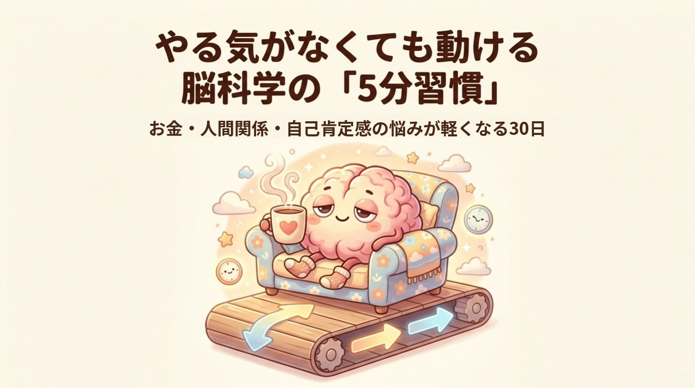
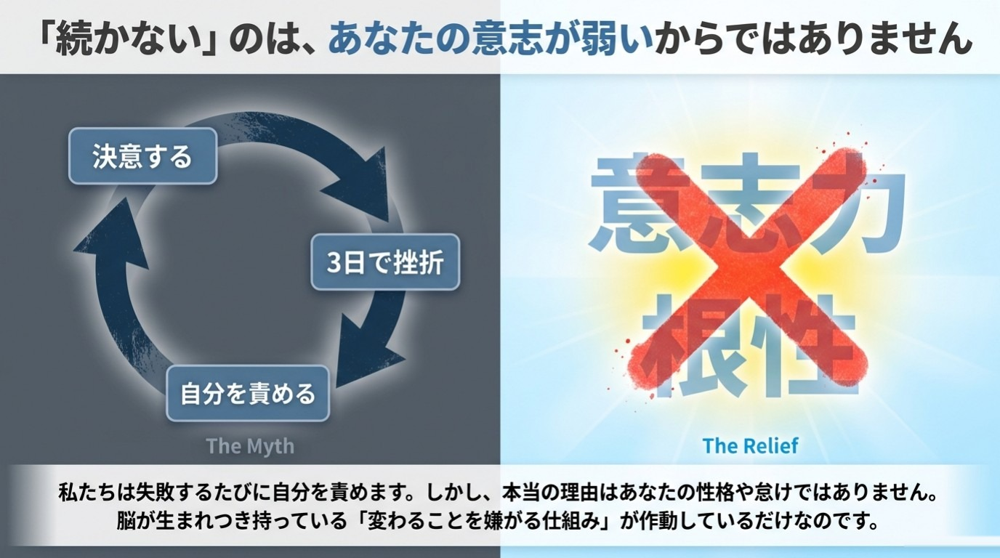

{width=100%}

# はじめに 「続かない」のは、あなたのせいじゃない

> 続かないのは、あなたのせいじゃない。警備員が心配性なだけ。

**Day 0** 日曜の夜11時。りんじくんは、新しい手帳の3ページ目を開いたまま、もう30分スマホを見ていました。
手帳も、朝活も、家計簿も、気づけば三日坊主。
「やる気が出たら、本気出しますから」。それが彼の口ぐせです。

あなたにも、こんな夜はありませんか。
「また続かなかった」と、ため息をつく。
お金、人間関係、自分への自信。悩みはあるのに、体が重い。
やる気が出ない自分に、さらにがっかりしてしまう。

もし心当たりがあるなら、最初にお伝えしたいことがあります。

**それは、あなたの意志が弱いからではありません。**

※本書に登場する人物は、複数の例をもとにした仮名です。師匠かみきと弟子りんじくんの対話は創作です。

## 続かない人は「やる気」で何とかしようとしている

私は「かみき♪」といいます。脳の仕組みを、やさしく伝える活動をしています。

<!-- 著者の体験談をここに入れる(聞き取り票 問1・問7) -->

「今月こそ貯めたい」「人に気をつかって、ぐったり」。そんな声をたくさんいただいてきました。悩みはばらばらでも、共通点がありました。

みなさん、**「やる気」や「根性」で何とかしようとしていた**のです。気合いで始めて、気合いが切れて、「やっぱり私はダメだ」と結論づける。そのくり返しで、悩みより「自分を責める気持ち」のほうが大きくなっていきます。

{width=90%}

## 脳はなぜ、新しいことにブレーキをかけるの?

脳には、**あなたを危険から守る**という大切な仕事があります。だから、いつものやり方を「安全」と見なしやすいのです。新しいことを始めると、「待って、大丈夫?」とブレーキをかけてきます。

本書では、この働きを**「ビビりな警備員」**とたとえます。警備員は悪者ではなく、少し心配性なだけです。

続かないのは、警備員があなたを守ろうと必死な証拠かもしれません。だったら、警備員が気づかないくらい小さく始めればいいのです。

## この本でお約束すること、しないこと

**お約束すること**

- 1日5分ほどでできる、小さなワークをお渡しします
- 悩みの「重さ」が少し軽くなる手がかりをお伝えします
- 日常の行動が「1つ」変わることを目指します

**お約束しないこと**

- 「悩みがすべて解決する」とは言いません
- 「お金が増える」「必ずうまくいく」とも言いません
- 医療やカウンセリング、投資のアドバイスの代わりにはなりません。つらさが強いときは、医療機関や専門家に相談してください

効果には個人差があります。合わないワークは、飛ばしてかまいません。

## 根拠の強さは「★」で正直に分けています

各章の終わりの「脳科学メモ」と本文の見出しの横に、根拠の強さを★で示しています。

| 表示 | 意味 |
|---|---|
| ★ | 研究で確認されていること |
| ★★ | 有力な仮説。研究はあるが、まだ議論が続いているもの |
| ★★★ | 体験談・経験則。科学的な裏づけは限られるもの |

「わかっていること」と「そうかもしれないこと」には、大きな差があります。その差を知ったうえで、ご自分で選んでほしいのです。

## この本は、どこから読んでもいい

- 序章の「3分診断」で、いまの悩みタイプを知る
- タイプに合わせた順番で、気になる章から読む
- 各章の【ワーク】が「今日の5分」。5分は上限です。30秒でもかまいません。飛ばしてもOK
- 合図は「コップ一杯の水」。水を飲んだら、5分
- 章の最後の「今日の5分、やれた? ○ / △」に印をつける
- 巻末の「30日チェックシート」で、続いた日を見える化する

動画では断片でしかお伝えできなかった、あなた用の順番と30日を、1冊にしました。各章の終わりでは、りんじくんも30日を一緒に歩きます。

## 30日後のゴールは、人生の一変ではありません

- 悩みを考えたとき、胸の重さが少し軽くなっている
- 「これなら続く」という小さな行動が、1つ残っている
- 続かない日があっても、責めすぎずに戻ってこられる

「戻ってこられる」ことこそ、いちばん強い習慣です。

## 【いますぐ30秒】悩みを「30秒サイズ」に縮める

できたら、こうなる:読み終えた直後に、もう一歩目を踏み出せています。

1. いちばん気になる悩みを、1つだけ選ぶ
2. それに効きそうな行動を「30秒でできるサイズ」に縮める
3. スマホのメモか紙に書く(頭の中で決めるだけでもOK)

- 例:「家計を見直す」→「通帳アプリを開いて、残高を見る」
- 例:「運動する」→「靴下を履いて、立ち上がる」

飛ばしてもかまいません。書けたら、それがあなたの最初の5分習慣です。やる気がなくても、もう動けました。

この本の合言葉は、1つだけです。**やる気があってもなくても、今日、5分だけ。**

では、序章へ進みましょう。あなたのペースで、大丈夫です。

かみき♪
