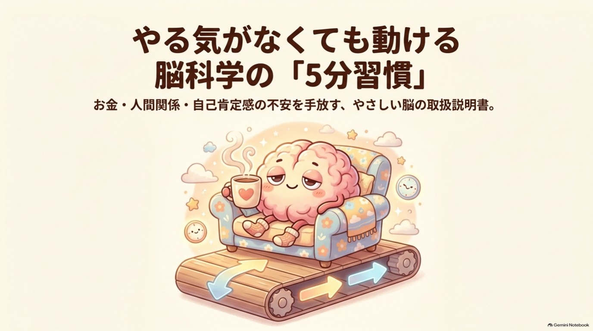
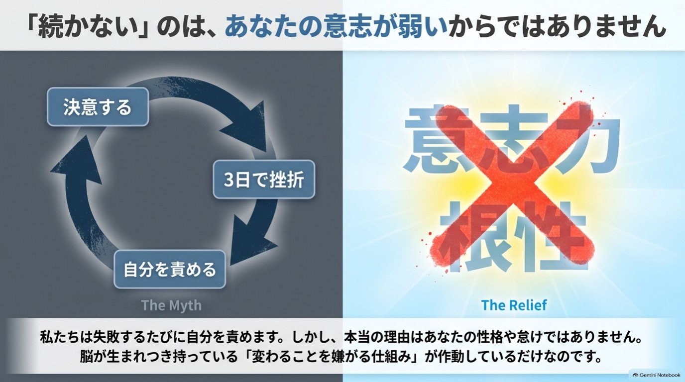

{width=100%}

# はじめに 「続かない」のは、あなたのせいじゃない

新しい手帳を買った。朝活を始めると決めた。家計簿アプリも入れた。
けれど、気づけば三日坊主。「また続かなかった」と、ため息をついている。

お金のこと、人間関係のこと、自分への自信のこと。
悩みはいくつもあるのに、動こうとすると体が重い。やる気が出ない自分に、さらにがっかりしてしまう。

もし、少しでも心当たりがあるなら、最初にお伝えしたいことがあります。

**それは、あなたの意志が弱いからではありません。**

## 頑張っても続かない人の「共通点」

私は「かみき♪」といいます。脳の仕組みをやさしく伝える活動をしています。

これまで多くの方から、こんな声をいただいてきました。

- 毎月「今月こそ貯めよう」と思うのに、気づくと同じ使い方をしている
- 人に気をつかいすぎて、家に帰るとぐったりしている
- 自分のことを、つい「ダメだな」と責めてしまう
- やる気が出るのを待っているうちに、1日が終わってしまう

内容はばらばらに見えます。でも、よく聞いていくと共通点がありました。

それは、**みなさん「やる気」や「根性」で何とかしようとしていた**ということです。

そして、気合いで始めて、気合いが切れて、「やっぱり自分はダメだ」と結論づけてしまう。この繰り返しで、悩みよりも「自分を責める気持ち」のほうが大きくなっていく。

私は、ここがいちばんもったいないと感じています。

{width=90%}

## 脳は「変わること」が苦手なだけ

人の脳には、昔から大切な仕事があります。**あなたを危険から守ること**です。

そのために脳は、いつものやり方、いつもの環境を「安全」と見なしやすい性質を持っています。新しいことを始めようとすると、「待って、それは本当に大丈夫?」とブレーキをかけてくるのです。

私はこの働きを、本書では**「ビビりな警備員」**というたとえで説明します。

警備員は、悪者ではありません。あなたを守りたくて、必死なだけです。ただ、少し心配性で、変化に敏感すぎる。

だから「続かない」とき、起きているのは意志の弱さではなく、**警備員が全力であなたを守っている**という状態かもしれません。

この見方ができると、不思議と肩の力が抜けます。自分を責める代わりに、「じゃあ、警備員に気づかれないくらい小さく始めてみよう」と考えられるようになるからです。

## この本でお約束すること、しないこと

最初に、正直にお約束しておきます。

**お約束すること**

- 30日間、1日5分ほどで取り組める小さなワークをお渡しします
- 悩みの「重さ」が少し軽くなる手がかりをお伝えします
- 読み終えるころに、日常の行動が「1つ」変わることを目指します

**お約束しないこと**

- 「これで悩みがすべて解決する」とは言いません
- 「お金が増える」「必ずうまくいく」とも言いません
- 医療やカウンセリング、投資のアドバイスの代わりにはなりません

効果の出方には個人差があります。合わないワークは、飛ばしてかまいません。

また、気分の落ち込みや不安が強く、日常生活に支障が出ているときは、この本で何とかしようとせず、医療機関や専門の相談窓口に頼ってください。それは弱さではなく、とても賢い選択です。

## 「★」で、根拠の強さを正直に区別します

この本には、各章の最後に**「脳科学メモ」**という囲みがあります。そこでは、書いてあることの根拠の強さを、★で示しています。

| 表示 | 意味 |
|---|---|
| ★ | 研究で確認されていること |
| ★★ | 有力な仮説。研究はあるが、まだ議論が続いているもの |
| ★★★ | 体験談や経験則。うまくいく人は多いが、科学的な裏づけは限られるもの |

脳の話は、ときどき「言い切り」で語られがちです。けれど、本当は「分かっていること」と「そうかもしれないこと」の間には、大きな差があります。

私は、読者のみなさんにその差を知ったうえで、ご自分で選んでほしいと思っています。だから、あえて区別しました。

確実に言えないことは、「〜と言われています」と書きます。数字や研究名も、確かなものだけにとどめました。

## この本の使い方 ~飛ばし読みOK、5分でOK~

この本は、最初から最後まで順番に読まなくて大丈夫です。

1. まず**序章の「3分診断」**をやってみてください。お金型・人間関係型・やる気型のうち、いまの自分にいちばん近いタイプが分かります
2. 診断の結果に合わせて、**あなた向けの読む順番**を選びます
3. 各章には**【ワーク】**があります。所要時間は1〜5分。手順は3ステップ以内で、どれも飛ばしてもかまいません
4. 章の最後の「**今日の5分、やれた? ○/△**」に印をつけます。△でもOKです

巻末には**「30日チェックシート」**があります。やれた日に○、難しかった日に△をつけてください。空白の日があっても、そこで終わりではありません。再開した日が、新しいスタートです。

## 30日後のゴール

30日後に目指すのは、人生が一変することではありません。

- 悩みを考えたとき、胸の重さが少しだけ軽くなっていること
- 「これなら続けられる」という小さな行動が、1つ手元に残っていること
- 続かなかった日があっても、自分を責めすぎずに戻ってこられること

この3つです。地味に見えるかもしれません。けれど、**「戻ってこられる」ことこそ、いちばん強い習慣**だと私は思っています。

## それでは、始めましょう

では、さっそく序章へ進みましょう。まずは、いまの自分の「悩みの傾向」を知ることから。

深呼吸を1回。口角を、ほんの少しだけ上げてみてください。

あなたのペースで、大丈夫です。一緒に、小さな一歩目を踏み出しましょう。

かみき♪
