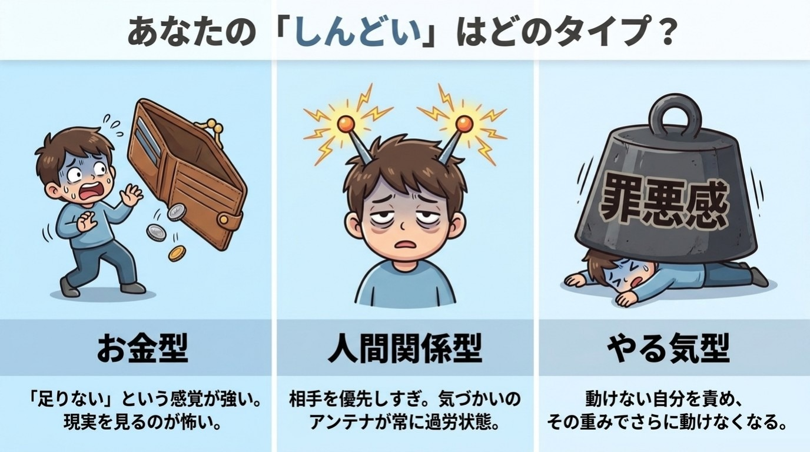

# 序章 3分でわかる「あなたの悩みタイプ診断」

**診断は、「いま読まなくていい章」を決めるためにある。**

お金も、人間関係も、自信のなさも、全部しんどい。
どこから手をつければいいのか、もうわからない。
全部いっぺんに直さなきゃと思うほど、動けなくなる。

**この章を読むとできること**

- いまの自分の悩みタイプがわかる
- 次に読む章を、迷わず選べる

**この章のワーク:3分診断(3分)=今日の5分**

---

## 1 悩みが多いときは、1つに絞るほうが動ける

悩みが多いと、人は「全部直さなきゃ」と考えて止まってしまいます。**脳は「何から手をつけるかわからない状態」が苦手**なのだと、私は考えています。

だから最初にやるのは、頑張ることではありません。いまの自分は、どの悩みが強めかを知ることです。

意外かもしれませんが、診断のいちばんの役目は、ここにあります。

> 診断は、「いま読まなくていい章」を決めるためにある。

読む量が減るほど、最初の一歩は軽くなります。

この診断は、いまの気持ちの傾向を知るためのものです。医学的な診断や、性格の優劣を決めるものではありません。結果は時期や状況で変わるので、気軽に受け取ってください。

## 【ワーク】3分診断(3分)

やること3つ/飛ばしてOK

できたら、こうなる:自分のタイプと、次に読む章が決まっています。

1. 10問に直感で答え、近いものを1つ選ぶ
2. 採点表で、選んだ番号に1点ずつつける
3. いちばん高いタイプの「ひと言処方」を読む

メモでも紙でも、頭の中で数えても大丈夫です。合う答えがない問いは、飛ばしてかまいません。「正しい答え」はないので、直感で選んでください。

---

## 2 診断 10問

### 問1 月末、通帳や家計アプリの残高を見たとき

① 「また減ってる…」と、数字を直視するのがこわい

② 「あの人に付き合って使いすぎたかも」と思い返す

③ 「貯めるつもりだったのに、何もしなかった」と落ち込む

### 問2 朝、目が覚めた直後

① 今日会う人の顔が浮かんで、少し気が重くなる

② 「やらなきゃ」が頭に山積みで、布団から出られない

③ ふと、お金や将来の心配が頭をよぎる

### 問3 気乗りしない誘いを受けたとき

① 断ると嫌われそうで、つい「行く」と答えてしまう

② 「お金がかかるなあ」と、まず財布のことが浮かぶ

③ 行く元気が出ず、返事を後回しにしてしまう

### 問4 新しいことを始めたいとき

① 「失敗したらお金がもったいない」と考えて、足が止まる

② 調べているだけで満足してしまい、最初の一歩が出ない

③ 「周りにどう思われるか」が気になって、言い出せない

### 問5 うまくいかなかったとき、心の中でつぶやく言葉

① 「やっぱり私は続かない人間だ」

② 「あの人に迷惑をかけてしまった」と、相手のことが頭から離れない

③ 「これでいくら損したか」と、つい数字で考える

### 問6 SNSを眺めているとき

① ほかの人の収入や暮らしぶりと比べて、落ち込む

② 「みんな頑張っているのに自分は…」と、動けなくなる

③ 誰かの投稿への反応や、自分の投稿の反応が気になる

### 問7 一日の終わりに、いちばん疲れの原因だと思うもの

① 人に気をつかいすぎたこと(職場で上司と部下のあいだに立ち、どちらの顔も立てようとした、など)

② やるべきことが進まなかった罪悪感

③ お金や将来の不安を考えすぎたこと

### 問8 「ちょっといい買い物」をしようとしたとき

① 「自分にそんな価値があるのかな」と、お金を使うことに罪悪感がある

② 家族や周りの目が気になって、買いにくい

③ 欲しいけれど、決めるのが面倒で先延ばしにする

### 問9 人から頼みごとをされたとき

① 引き受けたあとで、後悔することがよくある

② 引き受けたものの、手がつけられず溜まっていく

③ 見返りがはっきりしないと、なんだかモヤモヤする

### 問10 「変わりたい」と思う理由で、いちばん近いもの

① お金の不安から解放されたい

② 人の目や人間関係に、振り回されたくない

③ やる気がなくても、自然に動ける自分になりたい

---

## 3 採点は、選んだ番号に1点ずつつけるだけ

下の表で、選んだ番号のタイプに**1点ずつ**つけてください。

- 金 = お金型
- 人 = 人間関係型
- や = やる気型

| 問 | ① | ② | ③ |
|---|---|---|---|
| 問1 | 金 | 人 | や |
| 問2 | 人 | や | 金 |
| 問3 | 人 | 金 | や |
| 問4 | 金 | や | 人 |
| 問5 | や | 人 | 金 |
| 問6 | 金 | や | 人 |
| 問7 | 人 | や | 金 |
| 問8 | 金 | 人 | や |
| 問9 | 人 | や | 金 |
| 問10 | 金 | 人 | や |

10問すべてに答えると、合計は10点です。飛ばした問いがあれば、その分だけ少なくなります。

**あなたの点数**

お金型( )点 / 人間関係型( )点 / やる気型( )点

点数と、いまの悩みの重さ(10点満点の感覚で何点か)を、スマホのメモか紙に残しておいてください。これが「Day 1 の記録」です。30日後、おわりにで、もう一度診断して比べます。

### 結果の見方

1. いちばん高いタイプと、2番目のタイプの差を見ます
2. 差が2点以上 → そのタイプの単独型です
3. 差が0〜1点 → 上位2つの複合型です(ただし、4に当てはまるときは三拍子型)
4. 3つの差がすべて1点以内(例:4点・3点・3点)→ 三拍子型です

迷ったら、気になるほうの処方を両方読んでください。

{width=90%}

---

## 4 タイプ別のひと言処方 ~次に読む章はここ~

**お金型のあなたへ** 不安の正体は、金額より「足りないかも」という感覚です。第1章のあと、第7章の「お金のブロック診断」へ。

**人間関係型のあなたへ** 疲れの原因は、優しすぎるアンテナです。第1章のあと、第6章の「小さな線」の引き方へ。

**やる気型のあなたへ** やる気は待つより、小さく動いたあとについてくることが多いもの。第1章のあと、第3章の「5分ルール」へ。

**複合型のあなたへ** 悩みは、つながっているのが自然です。第1章のあと、上位2タイプの章を交互に。

**三拍子型のあなたへ** いろんな場面で踏ん張っている証拠です。第1章、第2章、第3章の順にどうぞ。

**第1章は、どのタイプの方も最初に。** 「変われない」理由が、すべての土台になるからです。第2章から先の全体のおすすめ順と、タイプ別のくわしい解説は、巻末の「5」にまとめました。

順番どおりに読めなかった日も、失敗ではありません。気になった章に寄り道したのは、心がいま必要なものを選んだ印です。

---

## この章のまとめ(3行)

**診断は、「いま読まなくていい章」を決めるためにある。**

1. 悩みは1つずつ見るほうが、脳は動きやすい
2. 診断は分類のためでなく、最初の一歩を選ぶため
3. 今日やるのは、3分診断と「ひと言処方」を読むこと(3分)

---

## 師匠かみき×弟子りんじの対話コラム Day 0 ~診断って、当たるんですか?~

**りんじ**:師匠、診断やりました。やる気型4点、お金型3点、人間関係型3点。三拍子型です。つまり、全部ダメってことですよね。

**かみき**:いいえ。いろんな場面で踏ん張っている、という印ですよ。

**りんじ**:でも、診断って当たるんですか? 占いみたいな気もして。

**かみき**:いい疑問です。これは医学的な診断ではありませんし、【研究】や【仮説】のラベルをつけるような話でもありません。いまの気持ちの傾向を見る、自分用のメモです。

**りんじ**:じゃあ、何のためにやるんですか?

**かみき**:読む順番を決めるためです。三拍子型なら、第1章、第2章、第3章の順。お金の第7章は、まだ開かなくていいんです。

**りんじ**:読まなくていい章があると、ちょっと気が楽です。

**かみき**:そうでしょう。診断は、「いま読まなくていい章」を決めるためにあるんですよ。

**りんじの次の一歩**:明日の朝、水を飲んだら、第1章の最初の1ページだけ読む。

---

**今日の5分、やれた? ○ / △**

次の章でわかること:「変われない」のは、あなたのせいではなく脳のクセだった理由。
