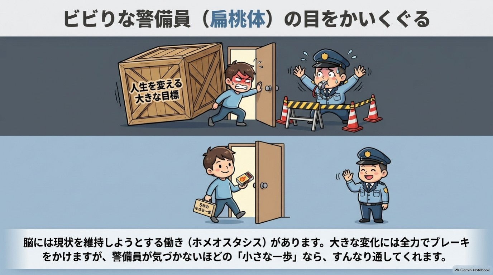

# 第1章 「変われない」のは脳のクセだった

「今度こそ変わろう」と決めたのに、気づけば元の自分に戻っている。
どうして私は、いつも同じところで止まってしまうんだろう。
やっぱり、私の意志が弱いのかな。

**この章を読むとできること**

- 続かない自分を責める回数が減る
- 30秒サイズの小さな一歩が見つかる

**この章のワーク:小さな一歩チェック(1分)**

---

## 1 元に戻ってしまうのは、脳が「いつも」を守るから ★★

**それは、あなたの意志が弱いからではありません。**

まず、体の話から始めましょう。
あなたの体温は、真夏の炎天下でも、真冬の朝でも、だいたい36〜37度前後に保たれています。
暑ければ汗をかき、寒ければ震えて熱をつくります。

意識していないのに、体は勝手に「いつもの状態」に戻そうとします。
この働きを、ホメオスタシス(恒常性)と呼びます。
体温や血糖、水分量など、生きるために欠かせない仕組みで、研究でしっかり確認されている話です。

そして、ここからが大切なところです。
**心や行動の面でも、似たような「いつも通りに戻ろうとする力」が働いていると考えられています。**

たとえば、こんな経験はありませんか。

- ダイエットで少し体重が落ちたのに、いつの間にか元に戻っている
- 早起きが三日続いたのに、四日目に寝坊してそのまま戻ってしまった
- 貯金を始めたのに、急な出費で「やっぱり無理だった」とやめてしまう

こうしたとき、私たちは「自分はダメだ」と考えます。
でも、少しだけ見方を変えてみてください。

脳にとっては、いつもの生活パターンが「慣れた安全な状態」です。
そこから外れると、元に戻そうとする力が働いても不思議ではありません。
体温が上がれば汗をかくのと、同じです。

ここで、ひとつ意外なことをお伝えします。
元に戻るのは、あなたがいったん「いつも」の外に出た証拠です。
外に出なければ、戻る力はそもそも働かないのですから。

### 事例 責めるのをやめたら、「流れ」が見えた(Mさん※)

Mさん(40代・会社員)は、毎月「今月こそ貯金しよう」と決めていました。
でも、月末にはいつも使い切ってしまいます。
そのたびに「私は意志が弱い」と自分を責めていたそうです。

ある日、Mさんは気づきました。
貯金できない月も、使い方のパターンはほぼ同じだったのです。
コンビニに寄る曜日も、つい買ってしまうものも、毎月よく似ていました。

「私が弱いというより、いつもの流れが決まっているんだ」
そう考えたら、不思議と気持ちが軽くなったといいます。
責める代わりに、「流れの一部を、少しだけ変えてみよう」と思えるようになりました。

これが、この章でお伝えしたい最初の視点の転換です。

---

## 2 ブレーキを踏んでいるのは、心配性な警備員(扁桃体) ★

では、脳の中で「元に戻れ」と言っているのは誰なのでしょう。
本書では、脳の働きを**「ビビりな警備員」**というたとえで説明します。
この警備員は、これから先の章にも何度も登場します。

> 警備員の仕事は、あなたを危険から守ること。
> 新しい人、新しい場所、新しい挑戦。
> 「初めて」を見ると、「待って、それは安全?」と呼び止めます。

この警備員のモデルは、脳の奥にある扁桃体(へんとうたい)という部分です。
扁桃体は、恐れや不安といった感情の反応に深く関わっています。
このことは、多くの研究で示されています。

ただし、「扁桃体=不安を作る悪い場所」ではありません。
扁桃体のおかげで、私たちは危険を素早く察知できます。
信号が変わる直前に足を止めたり、暗い道で警戒したりできるのも、この働きのおかげです。

### 心配性な警備員は、何にでも「ストップ!」と言う

ただ、この警備員は少し心配性です。
本当の危険(車が突っ込んでくる)にも、本当は危険ではないことにも、同じように声をかけます。

新しい習慣、人に断ること、お金の見直し。
こうしたことにも、「ストップ!」と言ってしまうのです。

この「ストップ」は、私たちの体験としては、次のような形で現れます。

- なんとなく気が重い
- 「でも、どうせ…」という考えが浮かぶ
- やろうとすると、急に別のことが気になりだす
- 「今日はやめておこう」と思えてくる

これらは、警備員の声かもしれません。
やる気がないのではなく、警備員が全力でブレーキを踏んでいるのです。
気が重いのは、あなたが「変わりそうな場所」に近づいているサインとも言えます。

### あなたのタイプでは、警備員は何と言う?

序章の診断で出たタイプによって、警備員の声は少し違って聞こえます。

- お金型 →「お金のことを見るのは危険だ。見ないほうが安心だよ」
- 人間関係型 →「断ったら嫌われるよ。我慢したほうが安全だよ」
- やる気型 →「失敗するかもしれない。今は動かないほうがいいよ」

どれも、あなたを守ろうとする言葉です。
形は違っても、中身は同じ。「変化は危険かもしれないから、いつも通りにしておこう」というメッセージです。

### 警備員は倒さず、お礼を言えばいい

ここで、大事なお願いがあります。
警備員を、倒そうとしないでください。

「不安なんか感じないようにしよう」「ビビる自分を克服しよう」と力むと、どうなるでしょう。
警備員は「やっぱり何か危ないことが起きている」と受け取り、かえって警戒を強めてしまいます。

おすすめは、こんな声かけです。

> 「心配してくれてるんだね。ありがとう。でも今回は、ちょっとだけやってみるよ」

警備員に感謝しながら、**気づかれないくらい小さく動く**。
これが、この本全体を貫く基本姿勢です。

---

## 3 小さな一歩なら、警備員は「大丈夫」と通してくれる ★★★

警備員が反応しやすいのは、「大きな変化」です。

「毎朝1時間早起きして勉強する」
「今日から毎月5万円貯める」
「苦手な上司にはっきり言う」

どれも立派な目標です。
でも、警備員から見れば、これは「生活を丸ごと変える大事件」。
当然、全力で止めに来ます。

{width=90%}

では、どうすればいいのでしょうか。
答えはシンプルです。**警備員が「それくらいなら大丈夫」と思うくらい、小さく始める**のです。

- 1時間の勉強 → 机に座って、本を開くだけ
- 5万円の貯金 → 今日のレシートを1枚、財布から出す
- 上司にはっきり言う →「少し考えさせてください」と、1回言ってみる

「そんなに小さくて意味があるの?」と思うかもしれません。
でも、小さな行動なら、警備員の警戒が強く出にくいのです。
すると、「やってみたら案外大丈夫だった」という体験が、少しずつ積み重なります。

この「大丈夫だった」の積み重ねが、次の一歩を軽くしてくれます。
だから、小さすぎて人に言うのが恥ずかしい一歩ほど、じつは上出来です。
警備員は、恥ずかしいくらい小さな一歩を、いちばんあっさり通してくれるのですから。

### 変わるとは、新しい道を何度か通ること(脳のカーナビ)

もうひとつ、本書で使うたとえを紹介します。「脳のカーナビ」です。

毎日通る道は、考えなくても運転できますよね。
脳も同じで、よく使う考え方や行動は「いつもの道」としてカーナビに登録されています。

新しいことを始めるのは、登録されていない道を走るようなものです。
最初は「ルートを再検索しています…」と時間がかかり、不安にもなります。
でも、同じ道を何度か通れば、少しずつ「いつもの道」に近づいていきます。

つまり、変わるとは、新しい道を何度か通ることです。
立派な決意ではなく、**小さな回数**がものをいうのです。

### 何十年のクセでも、脳は少しずつ変わる ★

「でも、もう何十年もこのクセで生きてきたし…」と思う方もいるでしょう。
安心してください。
脳は大人になってからも、経験や練習によって少しずつ変化することが分かっています(神経可塑性)。

ただし、ここは正直に言っておきます。
「脳が変わる」と聞くと、魔法のように一気に変わる印象を持つかもしれません。
実際には、ゆっくり、少しずつです。

劇的な変化を期待しすぎないほうが、かえって続けやすくなります。
「ゆっくりでいい」は、あきらめの言葉ではなく、続けるためのコツなのです。

---

## 4 自分を責めるほど、警備員はもっと心配になる ★★★

もうひとつ、見落とされがちなことがあります。

「どうして私は続かないんだろう」と自分を責めているとき、心はずっと緊張しています。
緊張が続くと、不安や心配が大きくなりやすくなります。
すると、新しいことに向かう余裕がなくなってしまうのです。

そんな経験をした方も、多いのではないでしょうか。

つまり、自分を責めることは、**警備員に「危険だ」と思わせる材料を渡すこと**になりかねません。
だから、この本では「頑張れ」とは言いません。
かわりに、こう言います。

> 「今日は、警備員に気づかれない大きさの一歩で十分。それができたら、花丸です」

これは甘やかしではなく、**続けるための戦略**です。
責めるより、認めるほうが、結果として次の一歩が出やすくなる。
多くの人が、そう実感しています。

### 三日坊主は、失敗ではなく「信頼の記録」

三日で終わった習慣を、私たちはつい「失敗」と呼びます。
でも、見方を変えると、三日坊主は、警備員が三日分の信頼を貸してくれた記録です。

四日目に戻ってしまっても、また三日やればいい。
その三日が、次の信頼の貯金になります。

「変われない自分」を責めたくなったら、思い出してください。
それは、目標の大きさと警備員の力関係を、少し見誤っていただけかもしれません。

次は、あなたの悩みの中から、警備員が気づかないくらい小さな一歩を探してみましょう。

---

## この章のまとめ(3行)

1. 元に戻ってしまうのは、意志の弱さではなく脳のクセ
2. 警備員(扁桃体)を倒さず、気づかれないくらい小さく動けばいい
3. 今日やるのは、悩みを「30秒でできる一歩」に縮めること(1分)

---

## 【ワーク】小さな一歩チェック(1分)

やること3つ/飛ばしてOK

**できたら、こうなる:** 今日やる「30秒の一歩」が、1つ決まっています。

書く場所は、スマホのメモ/紙/頭の中、どれでも大丈夫です。

1. いちばん気になっている悩みを1つ選ぶ。
2. やったほうがいいことを1つ、30秒でできるサイズに縮める。
3. 縮めた一歩を、今日どこかで1回だけやってみる。

- 例:「家計を見直す」→「通帳アプリを開いて、残高を見る」
- 例:「断る練習をする」→「鏡の前で『ごめんね、今回は難しい』と言ってみる」

悩みは、お金・人間関係・やる気、どれでもかまいません。
やれたら○、やれなかったら△。どちらでも、一歩を決めたこと自体が前進です。

---

## 脳科学メモ

**★ 研究で確認されていること**
- 体温などを一定に保つホメオスタシスの仕組み
- 扁桃体が、恐れや不安などの感情反応に関わっていること(LeDoux, 2000)
- 大人になっても、経験や練習で脳の働きが変化しうること(神経可塑性。例: 3か月ほどジャグリングを練習した大人で、脳の一部の灰白質が増えたという報告。Draganski et al., 2004)

**★★ 有力な仮説**
- 行動や気持ちの面でも「いつも通りに戻ろうとする力」が働くという考え方。人は現状を維持しやすい傾向がある、という行動経済学の研究(現状維持バイアス。Samuelson & Zeckhauser, 1988)もあります。ただ、「ホメオスタシスと同じ仕組み」と言い切れるかは議論があります。本書では、わかりやすい説明として使っています。

**★★★ 体験談・経験則**
- 「小さな行動のほうが、不安反応が出にくい」という説明。実践上うまくいく人は多いのですが、脳の中でそうなっていることを直接確かめた研究は、確認できていません。経験則として受け取ってください。
- 「ビビりな警備員」「脳のカーナビ」は、理解しやすくするためのたとえです。脳の中に本当に警備員がいるわけではありません。

---

## 師匠かみき × 弟子りんじ ~警備員にお礼を言う?~

**りんじ** 「師匠、警備員の話は分かったんですけど、結局その警備員をやっつけないと変われないんじゃないですか?」

**かみき** 「やっつけたくなる気持ちは分かります。でも、りんじくん、警備員がいなくなったらどうなると思います?」

**りんじ** 「えっと…自由に動ける?」

**かみき** 「信号も見ずに道路に飛び出して、危ない目にあうかもしれませんよ」

**りんじ** 「あ、それは困ります」

**かみき** 「でしょう。警備員は、味方なんです。ただ、ちょっと心配しすぎるだけ。だから、倒すのではなく、**説得する**んです」

**りんじ** 「説得、ですか。どうやって?」

**かみき** 「『これくらいなら大丈夫だよ』と、小さな体験を見せてあげる。何度か『大丈夫だった』を見せれば、警備員も少しずつ信頼してくれます」

**りんじ** 「なるほど、じゃあ僕の三日坊主は…」

**かみき** 「警備員が、三日分の信頼しか持てなかっただけ。四日目に戻っても、また三日やればいい。それは失敗じゃなくて、**経験の積み重ね**ですよ」

**りんじ** 「それなら、気が楽です」

---

**今日の5分、やれた? ○ / △**

次の章でわかること:自分を責める言葉を、1つだけやさしく言い換える方法
