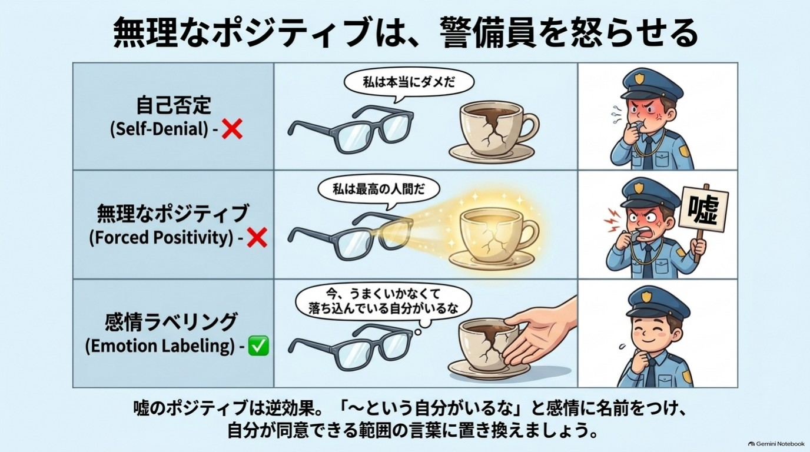
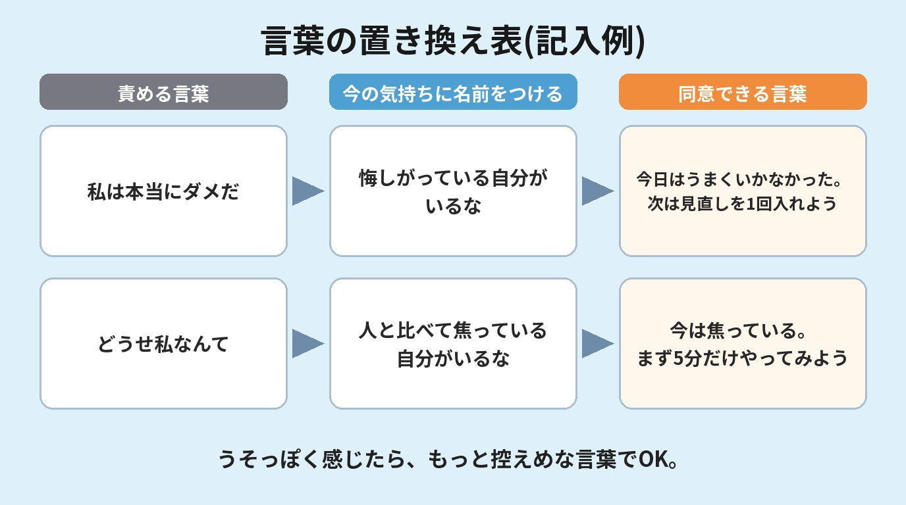

# 第2章 自分を責める言葉を、1つだけ変える

「どうせ私なんて」「また失敗した。本当にダメだな」
気づくと、また自分にそう言っている。
止めようとするほど、その声は大きくなる気がする……。

**この章を読むとできること**

- 自分を責める言葉に気づける
- 責める言葉を1つ、やさしい言葉に置き換える

**この章のワーク:言葉の置き換え表(3分)**

---

## 1 無理なポジティブは、いらない ★★

### 「前向きな言葉を言おう」で、しんどくなったのはなぜ?

自己啓発の本や動画で、こんなアドバイスを見たことはありませんか。

「ネガティブな言葉をやめて、ポジティブな言葉を使いましょう」
「鏡に向かって『私は幸せだ』『私は最高だ』と唱えましょう」

やってみて、うまくいかなかった。むしろ、気持ちが沈んだ。
それは、あなたの意志が弱いからではありません。

仕事で大きなミスをした夜に、鏡の前で「私は最高だ!」と言ってみたとします。
すると、心の中で別の声が聞こえませんか。
「いやいや、最悪の一日だったでしょ」

この声は、脳がサボっている証拠ではありません。
むしろ、正直に働いている証拠です。
信じていない言葉を無理に聞かせると、「理想の言葉」と「本音」のあいだにズレが生まれ、居心地が悪くなるのです。

### 信じられない肯定は、かえって逆効果になることがある

自己評価が低いと感じている人ほど、信じられない前向きな言葉で、かえって気分が下がることがある。
そんな研究が報告されています。

私は、これを「錆びた車にペンキを塗る」ことにたとえています。
真っ白なペンキを塗っても、きれいになるのは見た目だけ。下の錆はそのままです。

気持ちも同じです。
「苦しい」「悲しい」という本音に、明るい言葉でふたをしても、本音は消えてくれません。
だからこの本では、はっきり言います。**無理なポジティブは、いりません。**

### 地味な言葉ほど、脳は素直に受け取る

「でも、アファメーション(自分を肯定する言葉を唱える方法)もあるでしょう?」
そんな疑問が出るかもしれません。
この本の立場は、シンプルです。**「同意できる範囲の言葉に置き換える」。**

肯定的な言葉そのものが、悪いのではありません。
今のあなたが「まあ、それなら本当かも」と思える言葉なら、使っていい。
少しでも「嘘っぽいな」と感じる言葉は、使わなくていいのです。

| 自分を責める言葉 | 無理なポジティブ(NG) | 同意できる範囲の言葉(OK) |
|---|---|---|
| 私はなんてダメなんだ | 私は完璧な最高の人間だ | 今は、うまくいかなくて落ち込んでいる |
| どうせ私には無理 | 絶対に成功する! | やってみないとわからない |
| また続かなかった | 私は継続の天才だ | 今回は続かなかった。次はやり方を変えてみよう |

右の列は地味です。でも、その地味さがいいのです。
脳は、自分が納得できる言葉には、あまり反発しません。
派手な言葉は弾かれ、地味な言葉ほど心の奥まで届く。ここが、この章のいちばん意外なところかもしれません。

全部を変える必要はありません。
あなたがいちばんよく自分に言ってしまう言葉を、1つだけ置き換える。それだけで始められます。
思い浮かんだ言葉があれば、頭の片隅に置いておいてください。のちほど、ワークで使います。

---

## 2 責める言葉は、消そうとするほど大きくなる ★★

### なぜ「考えないように」はうまくいかないの?(白くまの実験)

「今日は絶対にイライラしないぞ」
「もう、あのことは考えないようにしよう」
そう決めた途端に、かえって頭から離れなくなった。そんな経験はありませんか。

心理学者のダニエル・ウェグナーらが行った「白くまの実験」が有名です。
参加者に「白くまのことだけは考えないでください」と伝えます。
すると、考えないようにしたグループは、その後、白くまのことをよく思い浮かべてしまったのです。

「考えないようにしよう」と頑張ること自体が、そのことを呼び出し続けてしまうことがあるのです。
できないのは、意志が弱いからではありません。
そもそも、うまくいきにくい方法なのです。

### 「〜しない」より「〜する」で言葉を選ぶ

では、どうすればいいのか。
おすすめは、**「〜しない」を「〜する」に言い換える**ことです。

- 「夜更かしをしない」→「11時にはふとんに入る」
- 「怒らない」→「一度、水を一口飲んでから話す」

否定の言葉だと、避けたい場面のほうが頭に浮かびやすくなります。
一方で、「〜する」という言葉は、次にとる行動のイメージが浮かびます。

私はこれを、「脳のカーナビに目的地を入れる」と呼んでいます。
「渋滞しているところには行かない」と入力しても、ルートは出ませんよね。
「〇〇へ行く」と目的地を入れて、はじめて道が表示されます。

自分への言葉も同じです。
「落ち込まない」ではなく、「落ち込んだ自分に、温かい飲み物を出す」。
目的地を入れた言葉は、あなたを次の一歩に連れていってくれます。

### 責める言葉は、消さずに「並べる」

「じゃあ、責める言葉は頭から消さなきゃいけないの?」
いいえ。消そうとしなくて大丈夫です。
白くまの話のとおり、消そうとするほど、かえって目立ってしまうからです。

責める言葉が浮かんだら、「あ、今こういう言葉が浮かんだな」と気づく。
これだけで、十分な一歩です。
そのうえで、同意できる言葉を横に並べます。**消すのではなく、並べる。**このイメージが大切です。

---

## 3 感情に名前をつけると、楽になる(感情ラベリング) ★

### 「モヤモヤ」は、名前がつくと小さくなる

自分を責める言葉が浮かぶとき、その少し手前に、ある「感情」があります。
失敗したときの悔しさ。人と比べたときの焦り。期待に応えられなかったときの申し訳なさ。

感情は、名前がないと、モヤモヤした大きなかたまりのままです。
そのかたまりが、「自分はダメだ」という言葉になって出てくることがよくあります。
そこで、**今の感情に、名前をつけてあげる**のです。

- 「今、私は、悔しいと感じている」
- 「今、私は、疲れている」

感情に名前をつけると、扁桃体(警備員・第1章)の反応が落ち着く方向に働く。
そんな結果を示した脳画像の研究があります。

警備員は、正体不明の物音がすると大騒ぎします。
でも、「あれは風の音です」と名前がつくと、少し落ち着きますよね。
感情も、正体がわかると、警備員が少し静かになってくれるのです。

### 「私は〜だ」ではなく「〜という自分がいるな」

もう1つ、使いやすい言い方があります。
**「〜という自分がいるな」**というフレーズです。

「私は無能だ」と言うと、自分そのものを無能だと決めつけた形になります。
一方で、「無能だと感じている自分がいるな」と言うと、感情と自分を少し切り離せます。
あなたがダメなのではなく、「ダメだと感じている状態」が今ここにある、という見方です。

心理学では、この練習を「脱フュージョン」と呼ぶことがあります。
覚えなくて大丈夫です。「〜という自分がいるな」の一言だけ、持ち帰ってください。

{width=90%}

### 事例 「私は本当に使えない」が口ぐせだった人(ミキさん※)

ミキさん(40代・事務職)は、仕事でミスをするたびに、心の中でつぶやいていました。
「私は本当に使えない」

最初は、この言葉を消そうとしました。
「私はできる」とノートに書いたこともあります。
けれど、書けば書くほど「嘘だ」という気持ちが強くなり、苦しくなったそうです。

そこで、やり方を変えました。
まず、「あ、今『使えない』という言葉が浮かんだな」と気づく。
次に、感情に名前をつける。「今、私は、悔しい。それと、少し怖い」。

最後に、同意できる言葉を横に並べます。
「今日のミスは、確認の順番が抜けていた。明日から、提出前に1回だけ見直す」。
「使えない人間」から、「確認の順番を直せばいい出来事」に、見え方が変わったそうです。

自分の価値を裁く言葉から、次にやることがわかる言葉へ。
これが「1つだけ変える」の中身です。

> ひとつ、お伝えしておきます。この本の言葉の工夫は、日常のモヤモヤを軽くするためのものです。
> 眠れない、食欲がないなど、日常生活に支障が出る状態が続くときは、ひとりで抱えないでください。
> 医療機関や専門の相談窓口に頼ることも、大切な選択肢です。

---

## 4 朝のコップ一杯で、やさしい一言を添える ★★★

### 一言は、毎日の動作にくっつけると思い出せる

言葉の置き換えは、思い出せなければ、使えません。
そこでおすすめなのが、**すでにやっている習慣に、一言をくっつける**方法です。

毎朝、水を飲む人は多いと思います。
コップ一杯の水は、新しい習慣の「スタート合図」にぴったりです。
水そのものに特別な力があるわけではありません。大事なのは、毎日の動作と一言を結びつけることです。

### 朝の一言は、「半分くらい本当」でちょうどいい

水を一口飲んだら、胸に手を当てて、こう言ってみます。

- 「今日も、ここまで来られた」
- 「完璧じゃなくて、いい」

どちらも、大げさではありません。
「そうだね」と半分くらい思えるくらいが、ちょうどいいのです。

「べき」を「でいい」に変えるのも、おすすめです。
「もっと頑張るべき」→「今日は、これでいい」。
「べき」には小さなプレッシャーがずっとかかっていて、「でいい」に変えるだけで肩の力が少し抜けます。

### 夜は「できたこと」を3つだけ

夜は、寝る前に「できたこと」を3つだけ書いてみてください。
「朝、起きられた」「ごはんを作った」「洗濯機を回した」。どんなに小さくても構いません。

私たちの脳は、うまくいったことより、うまくいかなかったことを覚えやすい傾向があると言われています。
意識して書かないと、頭の中は「できなかった記録」でいっぱいになってしまいます。

だから、「できたこと」を書くのは、自分を甘やかすことではありません。
**偏った記録を、もとに戻しているだけ**なのです。

---

## この章のまとめ(3行)

1. 自分を責める言葉が止まらないのは、脳のクセ
2. 消さずに、同意できる言葉を横に並べればいい
3. 今日やるのは、責める言葉を1つ置き換えること(3分)

---

## 【ワーク】言葉の置き換え表(3分)

やること3つ/飛ばしてOK

**できたら、こうなる:** 責める言葉が浮かんだときに使う「自分用の一言」が、1つ手元にあります。

書く場所は、スマホのメモ/紙/頭の中、どれでも大丈夫です。

1. 頭の中でよく流れる「責める言葉」を、1つそのまま書く。
2. 今の感情に名前をつけ、「〜という自分がいるな」の形にする。
3. 「まあ本当かも」と思える言葉を、1つだけ書く。

{width=90%}

声に出してみて、少しでも嘘っぽいと感じたら、もう少し控えめな言葉にします。
思いつかないときは、「まあ、そんな日もある」で十分です。

---

## 脳科学メモ

**感情に名前をつけると、扁桃体の反応が落ち着く方向に働く ★(研究で確認)**
感情を言葉にすることで、脳の感情に関わる部位の反応が変わることを示した脳画像研究があります。否定的な表情の写真を見ながら、その感情を言葉で選ぶと、扁桃体の反応が弱まり、前頭前野の一部の活動が高まったという報告です(Lieberman et al., 2007)。ただし、実験室での少人数の実験であり、効果の大きさには個人差があります。

**信じられない肯定的な言葉は、逆効果になることがある ★★(有力な仮説)**
自己評価が低い人が、自分では信じにくい前向きな言葉を唱えると、かえって気分が下がったという研究があります(「私は愛される人間だ」と繰り返す実験。自己評価が高い人では、わずかに気分が上がりました。Wood, Perunovic & Lee, 2009)。ただし、条件によって結果は変わるため、「必ずそうなる」とは言えません。

**「考えないようにする」ほど考えてしまう ★★(有力な仮説)**
ウェグナーらの「白くま」の実験が有名です(Wegner et al., 1987)。思考を抑えようとしたあとに、かえってその思考が増える「リバウンド」が報告されました。ただし、その後の研究をまとめた分析では効果は小〜中程度とされ(Abramowitz et al., 2001)、すべての場面で同じ結果になるとは限りません。

**「〜しない」より「〜する」と言い換えると行動しやすい ★★★(体験談・経験則)**
否定形を肯定形に言い換えると、次の行動をイメージしやすくなる、という経験則です。「脳は否定形を理解できない」と言い切れるほど単純ではありませんので、本書では「イメージしやすくなる」程度にとどめます。

**朝の水と一言を結びつける ★★★(体験談・経験則)**
「毎日やる動作」に新しい習慣をくっつけると続けやすい、という考え方に基づいています。水に特別な作用があるという話ではありません。

---

## 師匠かみき×弟子りんじの対話コラム

**りんじ**:師匠、僕、また言っちゃいました。「どうせ僕なんか」って。もう口ぐせです。

**かみき**:あら、気づけただけでも前進ですよ。まず、その言葉を消そうとしていませんか?

**りんじ**:はい。「ポジティブになろう」って、鏡の前で「僕は最高だ」って言ってみたんですけど、全然しっくり来なくて。

**かみき**:それは、りんじくんが正直だからです。信じられない言葉は、警備員にすぐ見抜かれますから。

**りんじ**:警備員、手ごわいですね。じゃあ、どうすれば?

**かみき**:「どうせ僕なんか」の隣に、「うまくいかなくて悔しいと感じている僕がいるな」と並べてみてください。消さずに、並べるのです。

**りんじ**:並べるだけでいいんですか?

**かみき**:ええ。次に「次は5分だけ、やってみよう」くらいの言葉を足せば十分です。大きな言葉はいりません。

**りんじ**:それなら、できそうです。

**かみき**:自分に同意できる言葉を選ぶことが、一番の近道ですよ。

---

**今日の5分、やれた? ○ / △**
(責める言葉を1つ書き出せたら、それだけで○です)

次の章でわかること:やる気を待たずに、5分で動き出す方法
