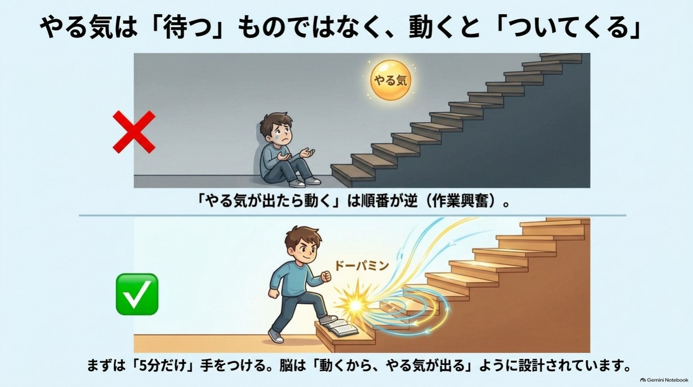
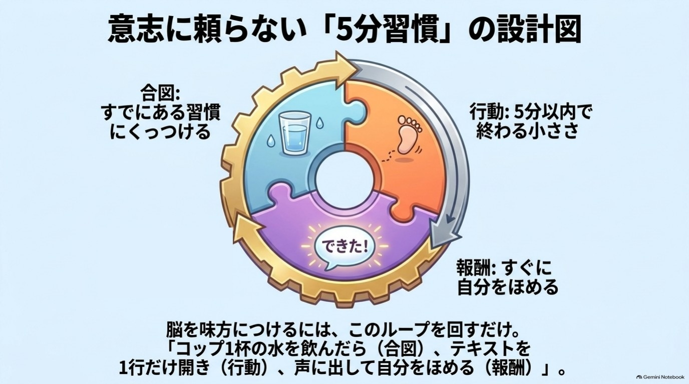

# 第3章 5分で動き出す「やる気」の作り方

やらなきゃいけないのは、わかっている。
でも、体が動かない。気づけば、スマホを見たまま夜。
どうして私は、やる気ひとつ出せないんだろう。

**この章を読むとできること**

- やる気を待たずに、5分で動き出せる
- 自分専用の「合図とごほうび」が決まる

**この章のワーク:5分ルール習慣表(1分)**

---

## 1 やる気は、待つものではなく、作るもの

### 「やる気が出たらやる」は、順番が逆かもしれない ★★★

多くの人は、こう考えています。

やる気が出る → 行動する

けれど、実際には逆のことが、よく起こります。

行動する → やる気が出てくる

掃除を始めるまでは面倒だったのに、やり始めたら夢中になっていた。
そんな経験は、ありませんか。

やる気が出ないのは、あなたの意志が弱いからではありません。
「やる気が出るまで待つ」という順番のほうが、そもそも、うまくいきにくいのです。

この本では、こう考えます。
やる気は、待つものではなく、作るもの。
やる気は、動いたあとに届く「おまけ」のようなものなのです。

{width=90%}

### やる気の物質は「ごほうび」より「期待」で動く(ドーパミン) ★

やる気の話でよく登場するのが、ドーパミンという脳内の物質です。
「幸せ物質」「ごほうび物質」と紹介されることがあります。
でも実は、少し誤解されやすい呼び方です。

動物を使った研究などから、ドーパミンは、ごほうびをもらった瞬間だけに働くのではないとわかってきました。
**「これをやったら、いいことがありそうだ」という予測や期待**に関わっている、と考えられています。

つまり、こういうことです。

- 「すぐに、小さくても良いことがある」と脳が予測できる → 動き出しやすい
- 「ごほうびは、ずっと先。しかも、しんどそう」と脳が予測する → 動きにくい

やる気が出ないのは、あなたが怠けているからではありません。
脳が「今やっても、見返りが遠い」と判断しているだけ、という可能性があるのです。

この「期待」をうまく使うのが、下の図の輪です。
合図・行動・ごほうびの3つは、この章の後半で1つずつ作っていきます。

{width=90%}

### 近いごほうびを選んでしまうのは、性格ではなく脳のクセ(時間割引) ★

人は、同じ大きさのごほうびでも、遠い未来のものより、すぐ手に入るものを高く見積もりがちです。
心理学や行動経済学では、これを「時間割引」と呼びます。

ダイエットをしたいのに、目の前のケーキに手が伸びる。
資格の勉強をしたいのに、スマホを見てしまう。

これは、性格の問題ではありません。
半年後の健康や合格より、目の前のケーキやスマホのほうが、脳にとって「近いごほうび」だからです。

だから、やる気を作るには、こう考えると楽です。
**遠くの大きなごほうびを、近くの小さなごほうびに分けてあげる。**

---

## 2 「5分だけ」と決めると、なぜ動けるの?

### 最初の一歩が重いのは、警備員が止めに来るから

やる気が出ないとき、いちばん大変なのは最初の一歩です。
走り出してしまえば楽なのに、動き出すまでの重さがつらい。

ここで思い出してほしいのが、警備員(第1章)です。
新しいことや面倒なことが始まりそうになると、警備員は「疲れるぞ」と止めに来ます。
そこで使うのが、5分ルールです。

1. やる気が出ないことを1つ選ぶ。
2. 「5分だけやってみる」と決める。
3. 5分たったら、やめてもいい。

ポイントは、**「5分たったら、やめてもいい」**と、自分に許可を出しておくことです。

警備員は、「ずっと続くのでは」と思うから、全力で止めに来ます。
けれど、「5分だけ」と聞くと、「それくらいなら、まあいいか」と警戒がゆるみます。
5分ルールの本当の役目は、5分やることより、警備員に「いつでもやめられるよ」と約束することなのです。

### 始めると、やる気が追いかけてくることがある ★★★

5分やってみると、不思議なことが起こることがあります。
「もう少しだけ、やってみようかな」という気持ちが出てくるのです。

これは、日本では「作業興奮」と呼ばれてきたものです。
作業を始めると、あとからやる気が湧いてくる、という見方があります。

もちろん、毎回そうなるとは限りません。
5分やって、やっぱり気が乗らなければ、そこでやめてOKです。
それでも、「5分、動けた」という事実は残ります。

大切なのは、**「やる気を出そう」をやめて、「5分だけ動こう」に切り替えること**です。
気持ちは自分でコントロールしにくいものです。
でも、5分だけ手を動かすことなら、できそうな気がしませんか。

### 5分ルールなら、10分やれた日は「大成功」になる

5分ルールのいいところは、失敗しにくいことです。
「30分やる」と決めて10分でやめたら、「失敗」に感じます。
でも、「5分やる」と決めて10分やれたら、予定の2倍の「大成功」です。

第2章でお話しした言葉の置き換えも、ここで使えます。

- 「どうせ続かない」→「5分なら、やってみよう」
- 「やる気が出ない自分はダメだ」→「やる気が出ないなと感じている自分がいるな。5分だけやってみよう」

自分を責める言葉を使わなくていい仕組みを、最初から作っておく。
それが、5分ルールのもう1つの役割です。

---

## 3 5分でも重い日は、どうすればいい?

### もっと小さくしていい。目安は「失敗のしようがない」サイズ

「5分でも、重い」という日もあります。
そんなときは、さらに小さくしましょう。
これを、ベビーステップ(赤ちゃんの一歩のように小さな一歩)と呼びます。

目安は、「始めるのに、5分もかからないレベル」まで小さくすることです。

| やりたいこと | 大きすぎる一歩 | ベビーステップ |
|---|---|---|
| 企画書を仕上げる | 企画書を完成させる | パソコンを開いて、ファイルを開く |
| ランニング | 30分走る | ランニングシューズを履く |
| 読書 | 1章読む | 本を開いて、1行だけ読む |
| 部屋の片づけ | 部屋全体を片づける | 床に落ちているものを3つ拾う |
| 家計の見直し | 1か月分を整理する | レシートを1枚、財布から出す |

「そんなに小さくていいの?」と思うかもしれません。
でも、小さいからこそ、警備員が気づく前に始められるのです。

ずるいくらい小さな一歩は、さぼりではなく、立派な作戦です。

小さくできた、という事実が、「私にもできた」という感覚の最初の種になります。

### 「何から始めるか」を考えなくていい環境を作る ★★★

やる気が出ない理由の1つに、**「何から始めるか考えること」自体が疲れる**ということがあります。
私たちの脳は、考えるだけでもエネルギーを使います。

だから、考えなくていいほうへ逃げようとします。スマホを見てしまうのは、その1つです。

そこで、環境を整えて、考える手間を減らします。

やりたいことのための道具は、目に入るところに置きます。

- 朝、運動したいなら、前の晩に運動着とシューズを枕元に出しておく。
- 読書をしたいなら、椅子の上に本を開いて置いておく。
- 勉強したいなら、ノートと筆記用具を机の真ん中に出しておく。

やめたいことは、少し手間をかけないとできない場所に置きます。

- スマホは、別の部屋の充電器に置く。
- お菓子は、見えない棚の奥にしまう。

意志の力で戦うのではなく、「やりやすい」「やりにくい」という環境を作ってしまう。
これは、ずるでもなんでもありません。賢い工夫です。

### 「水を飲んだら、5分」と、合図を決めておく ★★★

もう1つ、きっかけを作る方法をご紹介します。
すでにやっている習慣に、新しい行動をくっつけるのです。

私のおすすめは、**コップ一杯の水を飲んだら、5分だけ始める**という形です。

- 朝、コップ一杯の水を飲んだら、机に向かって5分だけ。
- 帰宅して水を飲んだら、郵便物を5分だけ整理する。

水そのものに、特別な力があるわけではありません。
ただ、水を飲むのは、多くの人が毎日やっていること。だから、「合図」として使いやすいのです。

「Aをしたら、Bをする」と決めておくと、「やろうかな、どうしようかな」と迷う時間が減ります。
迷いが減ると、警備員の出番も減ります。

---

## 4 小さな「やれた」は、すぐ自分に伝える

### ごほうびは、大きさより「早さ」で選ぶ

先ほどお話ししたように、脳は「近いごほうび」に反応しやすい性質があります。
だから、5分やれたら、**すぐに**自分にごほうびをあげましょう。
週末の大きなごほうびより、今すぐの小さなごほうびのほうが、脳には届きやすいのです。

ごほうびは、大きなものでなくて構いません。

- 好きな音楽を1曲聴く
- お気に入りのお茶を一口飲む
- カレンダーに○をつける
- 「やれた」と声に出す

いちばん手軽でおすすめなのが、自分への声かけです。
「よし、5分できた」「ここまでやれた。いいね」
それだけで、十分です。

### 「まだ足りない」ではなく「ここまでできた」と数える ★★

私たちは、つい「まだ全然終わっていない」と、足りない部分を見てしまいます。
けれど、それでは、いつまでたっても「できた」という感覚が持てません。

そこで、見方を切り替えます。

- 「まだ5分しかやってない」→「5分、やれた」
- 「ほんの少ししか進まなかった」→「ゼロじゃなくて、ここまで進んだ」

こうした「やれた」の積み重ねは、**「自分にもできる」という感覚(自己効力感)**を育てると言われています。
これは、心理学者のバンデューラが提唱した考え方です。
「やってみよう」と思えるかどうかに関わる、とされています。

大きな成功をたまにするより、小さな「できた」を毎日積み重ねる。
そのほうが、自分への信頼は育ちやすいのです。

### 〔事例〕「1行だけ読む」から始めたケンジさん ※

ケンジさん(30代・会社員)は、資格の勉強をしたいと思いながら、半年間、一度も机に向かえませんでした。
夜は疲れて、スマホを見るうちに寝てしまう。
そして翌朝、「また今日もできなかった」と自分を責める。

そこで、やり方を小さくしました。
お風呂上がりにコップ一杯の水を飲んだら、テキストを開いて1行だけ読む。それだけです。

最初の数日は、本当に1行で終わりました。
でも、「1行読めた」と手帳に○をつけるうちに、「もう1ページいけるかも」という日が少しずつ増えました。

もちろん、効果の出方には個人差があります。ケンジさんも、全然やれない日がありました。

けれど、できなかった日を責める言葉を「今日は休む日。明日、また1行から」に置き換えました。
それで、完全にやめてしまうことなく続けられた、と話していました。

---

## この章のまとめ(3行)

① やる気が出ないのは、「ごほうびが遠い」と感じる脳のクセ
② やる気を待たず、合図を決めて5分だけ動けばいい
③ 今日やるのは、5分ルール習慣表を1行つくること(1分)

---

## 【ワーク】5分ルール習慣表(1分)

やること3つ/飛ばしてOK

できたら、明日の「最初の5分」が、もう決まっています。

スマホのメモに書く/紙に書く/頭の中で答える。どれでも構いません。

1 → やる気が出ないことを、1つだけ選ぶ。
2 → それを「5分もかからない一歩」に縮める。
3 → 「〇〇したら」の合図と、ごほうびを1つ決める。

合図には、水を飲む・歯みがき・帰宅など、毎日やっていることを入れます。
ごほうびは、「できた」と声に出す、で構いません。

| やること(1つ) | ベビーステップ | 合図(〇〇したら) | ごほうび |
|---|---|---|---|
| (例1)資格の勉強 | テキストを開いて1行読む | お風呂上がりに水を飲んだら | 手帳に○をつける |
| (例2)部屋の片づけ | 床のものを3つ拾う | 帰宅して水を飲んだら | 「やれた」と声に出す |

できた日は○、できなかった日は△をつけます。
△も立派な記録です。△の日に気づけたのは、自分を観察できている証拠です。

---

## 脳科学メモ

**ドーパミンは「期待・予測」に関わる ★(研究で確認)**
ドーパミンの神経細胞が、ごほうびそのものだけでなく、ごほうびの予測に反応することは、サルの実験で示されてきました(予測と実際の結果のずれ「予測誤差」に反応する。Schultz, Dayan & Montague, 1997)。人間のやる気にそのまま当てはめられるかについては、まだ研究が進んでいる段階です。「ドーパミンを出せばやる気が出る」と単純に言い切ることはできません。

**遠いごほうびより近いごほうびを選びやすい(時間割引) ★(研究で確認)**
行動経済学や心理学で、繰り返し観察されている傾向です(総説: Frederick, Loewenstein & O'Donoghue, 2002)。個人差が大きく、状況によっても変わります。

**始めるとやる気が出てくる(作業興奮) ★★★(体験談・経験則)**
日本でよく語られる考え方で、精神医学者クレペリンの作業研究に由来すると紹介されることがあります。クレペリンが作業量の時間的な変化(作業曲線)を研究したことは確かですが(Kraepelin, 1902)、「作業興奮」という考え方が原典でどう位置づけられているかは確認できていません。やる気が出てくることは多くの人が経験しますが、すべての人、すべての場面で起こるわけではありません。

**小さな成功体験が自己効力感を育てる ★★(有力な仮説)**
バンデューラの自己効力感の理論(Bandura, 1977)に基づく考え方です。小さな成功を積み重ねることが「自分にもできる」という感覚につながると考えられていますが、効果の大きさは人や状況によって異なります。

**環境を整えると行動しやすくなる ★★★(体験談・経験則)**
道具を目に入る場所に置く、誘惑を見えない場所に置く、といった工夫は多くの人が実践している経験則です。「水を飲んだら5分」のように既存の習慣とくっつける方法も、体験に基づく工夫で、水に特別な効果があるという意味ではありません。

---

## 師匠かみき×弟子りんじの対話コラム

**りんじ**:師匠、僕、やる気が出るのを待っているうちに、毎日が終わっちゃうんです。

**かみき**:それは、りんじくんが怠けているのではありません。順番が逆なのです。

**りんじ**:逆?

**かみき**:やる気が出てから動くのではなく、動いたら、あとからやる気がついてくることがあります。だから、まず「5分だけ」と決めるのです。

**りんじ**:5分で何ができるんですか?

**かみき**:何も完成しなくていいのです。ノートを開く、靴を履く。それだけで十分です。

**りんじ**:それって、ちょっとズルくないですか?

**かみき**:いいえ。心の警備員に、気づかれないようにそっと動く知恵ですよ。そして終わったら、「5分できた」と、自分に伝えてあげてください。

**りんじ**:自分で自分を褒めるの、ちょっと照れますね。

**かみき**:照れても、小さな声でも、大丈夫です。

---

**今日の5分、やれた? ○ / △**
(ベビーステップを1つ決められたら、それだけで○です)

次の章でわかること:「今日もいいことがなかった」と感じる日に、目の向け方を少しずらす方法。
