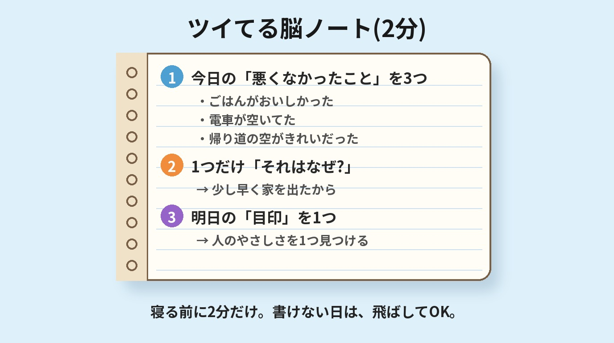

# 第4章 いいことに気づける脳になる

> 同じ一日を過ごしているはずなのに、「今日もいいことがなかった」と感じて眠る日がありませんか。
> 一方で、同じ職場の誰かは「今日もツイてたな」と笑っている。
> その差は、運の強さではないのかもしれません。

**この章を読むとできること**

- 「いいことがない」と感じる日に、脳の注意の向き方を疑ってみることができる
- 1日2分、いいことに気づく練習(ツイてる脳ノート)を始められる

---

## 1. 「運がいい人」は、何が違うのか

最初に、免責から言わせてください。

いいことに気づけないのは、あなたの性格が暗いからでも、感謝が足りないからでもありません。

脳はもともと、そういう仕様になっているのです。

たとえば、こんな経験はありませんか。

新しい靴を買おうと決めた日から、街ですれ違う人の足元ばかりが目に入る。赤い車が気になり始めた途端、赤い車ばかり走っているように感じる。

世の中の靴や赤い車が、急に増えたわけではありません。変わったのは、あなたの「注意の向き」です。

私たちは、目や耳から毎秒おびただしい情報を受け取っています。そのすべてを意識していたら、頭がパンクしてしまいます。そこで脳は、「今の自分に関係がありそうなもの」だけを前に出し、残りを背景に下げています。

この「選んで前に出す働き」を、本書では**注意のフィルター**と呼びます。

脳科学では、注意や覚醒に関わる仕組みのひとつとして、網様体賦活系(もうようたい ふかつけい。略してRAS)が知られています。ただ、RASだけで「何が見えるか」がすべて決まるわけではありません。注意の仕組みは脳のあちこちが関わる、もっと複雑なものです。ですから本書では、むずかしい名前を覚えることより、「私たちの目には、見たいもの・気にしているものが映りやすい」という体験のほうを大切にします。

さて、ここからが大事なところです。

このフィルターは、ふだん無意識に動いています。そして、その日の気分や、最近の出来事、頭の中を占めている心配ごとに、強く影響されます。

不安や疲れで頭がいっぱいのとき、フィルターは「危険そうなもの」「足りないもの」を拾いやすくなります。

つまり「今日はいいことがなかった」の中身は、**本当にいいことがなかった**のではなく、**いいことが目に入っていなかった**可能性があるのです。

---

## 2. 悪いことばかり目につくのは、警備員の仕事だから

第1章で、扁桃体を「ビビりな警備員」にたとえました。思い出してください。

この警備員の仕事は、あなたを守ることです。そのため、危険や失敗の気配には敏感に反応し、よく覚えておこうとします。

一方で、「今日は電車で座れた」「同僚があいさつしてくれた」のような穏やかな出来事は、警備員にとっては「異常なし」の報告にすぎません。記録にも残りにくいのです。

心理学には、悪い出来事のほうが、同じ大きさのいい出来事よりも強く心に残りやすい、という考え方があります(ネガティビティ・バイアスと呼ばれます)。人類が危険の多い環境で生き延びてきた名残だと説明されることが多いです。

大事なのは、これは**あなたの欠点ではなく、守るための仕様**だということです。

ただし、現代の私たちの暮らしでは、命に関わる危険はそれほど多くありません。それなのに警備員が「悪いニュースばかり」を前に出し続けると、毎日が疲れやすくなります。

では、どうすればいいか。

警備員を叱って黙らせる必要はありません。それは第1章でお伝えしたとおり、逆効果になりがちです。

代わりに、**警備員の報告リストに「いいこと」の欄を足してあげる**。それが、この章でお伝えしたいことです。

---

## 3. 「無理なポジティブ」はいりません

ここで、ひとつ注意があります。

「いいことに気づこう」は、「悲しいことや嫌なことを見ないようにしよう」という意味ではありません。

つらいときに無理に「ありがたいな」と思おうとしても、心の中の警備員が「本当にそう思ってる?」と疑って、かえって苦しくなります。第2章で見たとおりです。

この章でやりたいのは、感謝を強要することではなく、もっと小さなことです。

**すでに起きているのに、見落としていた小さな「悪くないこと」に、気づく回数を少し増やす。**

- 温かい飲み物がおいしかった
- 信号が青で、スムーズに渡れた
- 洗い立てのタオルの感触が気持ちよかった
- 誰かが、さりげなくドアを押さえてくれた

こんなことで十分です。感動も、感謝の涙もいりません。「ふーん、悪くないな」で合格です。

これを繰り返すと、何が起きるのでしょうか。

私たちの脳は、よく使う注意の向け方を、だんだんと「いつもの癖」にしていくと言われています。いいことを探す練習を重ねれば、探す癖がついて、気づきやすくなっていく。そういう方向に、少しずつ進める可能性があります。

もちろん、効果の出方には個人差があります。「3日で人生が変わる」ようなものではありません。けれど、1日2分、お金もかからず、道具もノート1冊あれば始められます。だから、この章のワークは**「やってみて、合わなければやめていい」**くらいの軽さで取り組んでみてください。

ひとつ、覚えておいてほしいことがあります。いいことに気づく練習は、「嫌なことが消える」練習ではありません。嫌なことは嫌なこととして、ちゃんとそこにあります。そのうえで、**「悪くないこと」も同じ画面に映るようにしていく**。いわば、見える景色の幅を、ほんの少し広げる練習なのです。

---

## 4. 「見る場所」を変える、もうひとつの方法

目標を持つことも、注意のフィルターに関わっています。

たとえば、あなたが「今月は、取引先に笑顔であいさつをする」と決めたとします。すると不思議なことに、その日から、笑顔であいさつしている人や、あいさつがきっかけで会話が広がる場面が、目に入りやすくなります。

これは、**意味のある目印を1つ決めると、脳がそれを探すようになる**、という働きです。

大きな目標を掲げなくても、小さな「今日の目印」で十分です。

- 「今日は、人の親切を1つ見つける」
- 「今日は、空の色を1回見上げる」
- 「今日は、自分がちゃんとやれたことを1つ見つける」

朝のうちに1つ決めておくだけで、1日の見え方が少し変わります。

ちなみに、「目標は高いほうがいい」「限界の3段上を狙え」という考え方もあります。高い目標が人を動かすことはたしかにあるのでしょう。ただ、「やる気がなくても動ける」ことを目的にした本書では、まず**手の届く小さな目印**からお勧めします。大きな夢は、そのあとでゆっくり描けば十分です。

---

## 5. 「ありがとう」は、いちばん小さな目印になる

いいことに気づく練習のなかで、いちばん手軽なのが「ありがとう」を探すことです。

ただし、ここでも無理は禁物です。「感謝しなきゃ」と思うほど、心は固くなります。「ありがとうが素直に言えない自分は、だめなのかな」と思う方もいるかもしれません。でも、それもあなたのせいではありません。さきほどお話ししたとおり、警備員が「悪いこと優先」で動いているだけなのです。

そんな方には、**一番ハードルの低い「ありがとう」**からをお勧めします。

- 「今日も起きられた。ありがとう」
- 「布団があった。ありがとう」
- 「この電車が動いていてくれた。ありがとう」

人にではなく、物や出来事に向けて、心の中で一言つぶやくだけです。声に出さなくて構いません。

感謝を書き出す習慣が、気分の安定と関連したという研究は、実際にいくつかあります。ただ、効果の出方は人それぞれです。「やれば必ず幸せになる」と約束できるものではありません。それでも、お金も時間もほとんどかからず、副作用の心配もほぼない習慣ですから、試す価値はあると私は思っています。

### 事例: 「毎日、何もいいことがない」と思っていたAさん(※仮名の再構成です)

40代の会社員のAさんは、「毎日、同じことの繰り返しで、いいことなんてひとつもない」と感じていました。

試しに、寝る前に「悪くなかったこと」を1つだけ書いてみることにしました。最初の1週間は、「コンビニのコーヒーがおいしかった」のような言葉ばかり。「こんなことで変わるのかな」と思っていたそうです。

けれど2週間ほど続けたころ、通勤の途中で、ふと道ばたの花に目がいったといいます。「前からそこにあったはずなのに、初めて気づいた」。それだけの出来事です。

人生が一変したわけではありません。けれどAさんは、「今日も何もなかった」と言う回数が、少し減ったと話してくれました。

これは小さな変化です。でも、小さな変化に気づけることこそが、この章のゴールです。

---

{width=90%}

## 【ワーク】ツイてる脳ノート(所要時間: 2分)

寝る前や、1日の終わりに、2分だけ使います。ノートでもスマホのメモでも構いません。

**ステップ1　今日あった「悪くなかったこと」を3つ書く**
大きなことでなくて大丈夫です。「ごはんがおいしかった」「電車が空いてた」で合格です。思いつかない日は1つで構いません。

**ステップ2　1つだけ、「それがなぜ起きたか」を一言添える**
たとえば「ごはんがおいしかった → 昼にゆっくり食べる時間があったから」「電車が空いてた → 少し早く家を出たから」。自分の行動が関わっていたら、それも書いてください。

**ステップ3　明日の「目印」を1つ決める**
「明日は、人のやさしさを1つ見つける」のように、ひとことだけ書いて終わります。

**ポイント**
- 書けない日は、飛ばしてもOKです。空白の日があっても、ノートはなくなりません
- 嫌なことがあった日は、無理に探さなくて大丈夫です。「今日はしんどかった」とだけ書いて閉じても、立派な記録です
- 気分の落ち込みがずっと続いている場合は、ノートより先に、身近な人や専門家に相談することをお勧めします

---

## 脳科学メモ

**★★ 有力な仮説: 注意は、意味のある目印に引っ張られる**
「自分に関係がある」「気になっている」情報に気づきやすくなる現象は、心理学で「選択的注意」などとして研究されています。ただし、RAS(網様体賦活系)がその主役かどうかは単純には言えません。本書では「注意のフィルター」という比喩にとどめています。

**★★ 有力な仮説: 感謝や「いいこと」を書き出す練習が、気分に役立つ可能性**
「感謝できることを書き出す」「その日のよかったことを3つ書く」といった練習が、気分の向上と関連したという研究が複数あります(感謝を書き出す研究: Emmons & McCullough, 2003。「3つのいいこと」とその理由を1週間書く研究: Seligman et al., 2005)。ただし、追試では、幸福感の上昇は比較用の課題でも同じように見られ、落ち込みの改善は比較群と差がなかったという報告もあります(Mongrain & Anselmo-Matthews, 2012)。効果の大きさは研究や人によって異なり、万人に同じように効くわけではありません。

**★★ 有力な仮説: 悪い出来事のほうが心に残りやすい**
「悪いことは良いことより強く残る」という傾向(ネガティビティ・バイアス)は、心理学で広く論じられています(総説: Baumeister et al., 2001)。「悪いことは良いことの何倍」といった倍率の数字は、本書では扱いません。

**★★★ 体験談・経験則: 「今日の目印」を決めると1日の見え方が変わる**
これは著者かみきや、講座の受講者から聞く経験則です。厳密な実験で確かめられたものではありません。

---

## 師匠かみき×弟子りんじの対話コラム

**りんじ:** 師匠、ツイてる脳ノートを3日やってみたんですが、正直、ネタ切れです。「お茶がおいしかった」しか出てきません。

**かみき:** いいじゃないですか。お茶がおいしかった。立派な収穫です。

**りんじ:** でも、こんな小さなことでいいんでしょうか。もっとこう、「いいこと」らしいことを書かないと。

**かみき:** りんじさん、グラスに水が半分入っていたら、どう見えますか。

**りんじ:** うーん、「半分しかない」とも「半分もある」とも言えますね。

**かみき:** そうです。グラスの中身は同じ。変わるのは、どこに目を向けるかだけです。ノートは「いいことらしいこと」を探す場所ではなく、**目を向ける場所を、ほんの少しずらす練習の場**なんです。

**りんじ:** なるほど。じゃあ、お茶がおいしかった、でいいんですね。

**かみき:** はい。明日、そのお茶の湯気が見えたら、それがもう新しい収穫ですよ。

---

**今日の5分、やれた?　○ / △**
(ツイてる脳ノートが1行でも書けたら○。開いただけでも△。どちらも合格です)
