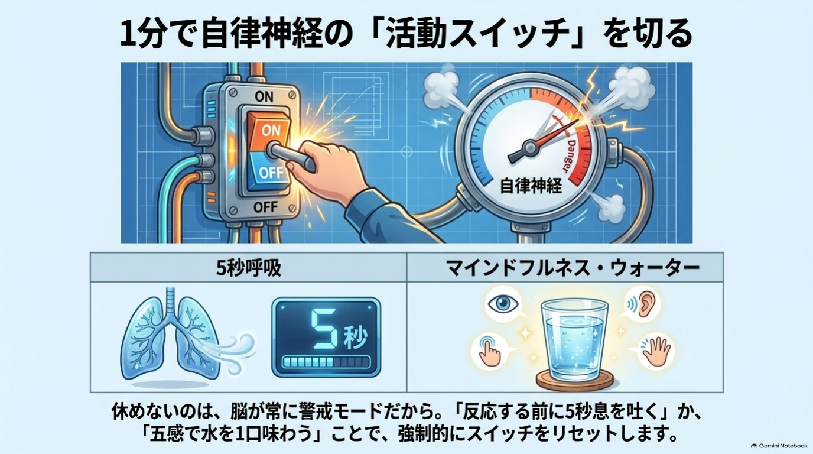

# 第5章 疲れ・ストレス・眠りを1分でリセットする

休んだはずなのに、どうして疲れが抜けないんだろう。
布団に入ると、今日の失敗や明日の心配がぐるぐる回り出す。
「ちゃんと休めない私」を、また責めてしまう。

**この章を読むとできること**

- 疲れたときに1分で「止まる」方法がわかる
- 水一杯の時間を、小さなリセットに変えられる

**この章のワーク:呼吸と水の1分ワーク(1分)**

---

## 1 休めないのは、スイッチが入れっぱなしなだけです

まず、お伝えしたいことがあります。
「ちゃんと休めない」のは、あなたの意志が弱いからでも、要領が悪いからでもありません。

私たちの体には、緊張と休息を切り替える仕組みがあります。
緊張しているときは「活動モード」、ゆるんでいるときは「休息モード」です。
この切り替えを担っているのが、自律神経と呼ばれるものです。

ところが現代の私たちは、一日中ちょっとした緊張にさらされています。
仕事の連絡、スマホの通知、お金の心配、人間関係の気がかり。

ここで、警備員(第1章)を思い出してください。
警備員は、本物の危険とスマホの通知の区別があまり得意ではありません。
小さな刺激にも反応して活動モードにしたまま、元に戻すのを忘れてしまうことがあります。

つまり、休めないのは**切り替えのスイッチが、入れっぱなしになっているだけ**かもしれません。
疲れが抜けないのは、休み方が下手だからではありません。
**「もう終わっていいよ」という合図が、体に届いていないだけ**なのです。

そのスイッチを戻す方法は、意外なほど小さなものです。
大がかりな休暇も、高価なグッズもいりません。
ほんの1分手を止めて、体に「もう大丈夫だよ」と伝えるだけです。

この章では、1分でできる3つの方法をお伝えします。

1. 5秒呼吸(息を吐くことから始める)
2. ぼーっとする時間(あえて何もしない)
3. 眠る前の習慣(脳に「今日は終わり」を知らせる)

そして最後に、水を一杯、五感で味わう「マインドフルネスウォーター」をご紹介します。

---

## 2 息を長く吐くだけで、体はゆるみやすくなる(5秒呼吸) ★★

緊張しているとき、私たちの呼吸は浅く、速くなりがちです。
逆に言えば、**呼吸をゆっくりにすると、体は「落ち着いていいんだ」と受け取りやすくなる**と言われています。
呼吸は、自分で意識して変えられる、数少ない体の動きのひとつだからです。

{width=90%}

やり方は、とても簡単です。

- 鼻から、ゆっくり5秒ほど息を吸う
- 口から、ゆっくり5秒ほどかけて息を吐く
- これを数回くり返す

深呼吸というと「大きく吸う」ものと思われがちです。
でも、この本では**「吐く」が主役**です。
吐く息を、吸う息より少し長めにするくらいが目安です。

きれいにやろうとしなくて大丈夫です。
数がずれても、途中で別のことを考えても、まったく問題ありません。

おすすめは、次のような場面です。

- 嫌なメッセージが届いて、すぐ返したくなったとき
- 家に帰ってきて、玄関で一度立ち止まるとき

「反応する前に、5秒だけ止まる」。
それだけで、勢いで言い返したり送信したりすることが、少し減るかもしれません。

なお、息苦しさやめまいを感じたら、すぐにやめてください。

---

## 3 ぼーっとする時間は、サボりではありません ★★

次は、「何もしない時間」の話です。
ぼーっとしている自分に、罪悪感を覚えたことはありませんか。
「時間がもったいない」「何か生産的なことをしなきゃ」と。

でも、**何もしていない時間にも、脳は静かに働いている**と考えられています。
何かに集中していないとき、脳では「デフォルトモードネットワーク」と呼ばれる活動が盛んになります。
過去を思い出したり、先を想像したり、自分を振り返ったりするときの働きです。

散歩中やお風呂のなかで、ふとアイデアが浮かんだ経験はありませんか。
もちろん、「ぼーっとすれば必ず創造力が高まる」と言い切れるほど、わかっているわけではありません。
ただ、情報を入れ続けると頭が休まる隙間がなくなるのは、多くの方が実感していることだと思います。

ちょっと意外かもしれません。
すきま時間のスマホは、休憩のつもりでも、**脳にとっては「仕事の続き」**かもしれないのです。

ですから、1日のなかに「何も入れない時間」を、少しだけ作ってみましょう。

- 電車を待つあいだ、スマホを見ずに景色を眺める
- 朝のコーヒーを飲みながら、30秒だけ湯気を見る

ポイントは、「何かを得ようとしない」ことです。
ぼーっとすることを、頑張る必要はありません。

---

## 4 眠る前の「1つの合図」が、今日の終わりを知らせる ★★

眠りについては、とくに丁寧にお話しします。

寝つきが悪い、夜中に目が覚める、朝すっきり起きられない。
こうした悩みには、生活リズム、体の病気、心の状態、環境など、さまざまな原因があります。
ですから、ここでお伝えするのは**あくまで、眠りやすい環境づくりのヒント**です。

一般的に、眠る前の過ごし方として、次のようなことが言われています。

- 寝る前の強い光(とくにスマホの画面)は、体内時計に影響して眠気を妨げることがある
- 寝る前にSNSやニュースを見ると、気持ちが落ち着きにくくなりやすい
- ぬるめのお湯での入浴や、部屋を少し暗くすることは、リラックスしやすい環境づくりに役立つ

全部を完璧にではなく、1つだけやってみるのが、この本のおすすめです。
たとえば次のようなものです。

1. 寝る30分前だけ、スマホを手の届かない場所で充電する
2. 部屋の照明を、1段階だけ暗くする
3. 布団に入る前に、「今日はここまで」と心のなかで言う

3つ目は、儀式のようなものです。
同じ動作や言葉を毎日くり返すと、脳が「これをやったら休む時間だ」と覚えてくれやすくなります。
いつもの行動の「あと」に新しい行動をくっつけて、行動のきっかけを作るやり方です。

ここで、とても大事なことをお伝えします。
**眠れない夜があっても、自分を責めないでください。**

「眠らなきゃ」と焦るほど、かえって目が冴えてしまうことがあります。
眠れない夜に必要なのは、眠る努力ではなく「眠れなくてもいい」という許可なのかもしれません。
目を閉じて横になっているだけでも、体はある程度休まると言われています。

> 【ご相談の目安】 この章で紹介するのは、一般的なセルフケアです。医療や治療の代わりにはなりません。
> 眠れない状態が2〜3週間続く、強い不安や落ち込みが長引く、生活に支障が出ている。
> そんなときは我慢せず、かかりつけの医師や睡眠外来、専門の相談窓口に相談してください。

---

## 5 水を一杯、五感で味わうと「今」に戻れる(マインドフルネスウォーター) ★★★

最後に、水を使った小さなワークをご紹介します。
水が登場するのは、特別な力があるからではありません。
水はコップ1杯で、いつでも・どこでも・お金をかけずにできる**「習慣のきっかけ」**だからです。

マインドフルネスとは、「今この瞬間の体験に、評価せずに注意を向けること」です。
むずかしく聞こえますが、日常でやっていることを、少し丁寧にするだけです。

水のコップを、次の5つの感覚で味わってみてください。

1. 見る: 水の透明さ、光の反射を見る
2. 聴く: 注ぐ音、コップに触れる音に耳をすます
3. 触る: コップの冷たさ、手のひらの感触を感じる
4. 嗅ぐ: かすかな香りに注意を向ける
5. 味わう: ひと口含んで、喉をとおる感覚を確かめる

全部やる必要はありません。
1つか2つだけでも十分です。

まず期待できるのは、**「今、ここ」に注意が戻ってくる**ことです。
頭のなかが過去の後悔や未来の不安でいっぱいのときも、五感はいつも「今」を教えてくれます。
注意が「今」に戻るだけで、頭のなかのぐるぐるが、少し静かになることがあります。

毎朝のコーヒーや仕事の合間の水など、すでにある習慣にくっつければ、新しく始める負担もありません。

「水を飲めば体や運命が変わる」と言いたいわけではありません。
水に言葉をかけると結晶の形が変わる、という話もありますが、科学的には支持されていません。
大切なのは水そのものではなく、水を見ている30秒の「すき間」です。

---

## この章のまとめ(3行)

① 休めないのは、緊張のスイッチが入れっぱなしになる脳のクセ
② 長く吐く呼吸や水ひと口で、「止まる合図」を出せばいい
③ 今日やるのは、呼吸と水の1分ワーク(1分)

---

## 【ワーク】呼吸と水の1分ワーク(1分)

やること3つ/飛ばしてOK

できたら、こうなる: 頭のぐるぐるが、ひと息ぶん静かになっています。

水を一杯用意して、好きなタイミングで始めましょう。
書くものはいりません。頭の中で感じるだけで大丈夫です(残したい方は、スマホのメモか紙にひと言どうぞ)。

1. コップを両手で持ち、3回ゆっくり息を吐く。
2. 水を見て、触って、冷たさや透明さを感じる。
3. ひと口ゆっくり飲み、「今、ここ」と心で言う。

途中で余計なことを考えたら、「あ、考えてた」と気づいて、水の感覚に戻れば十分です。

**例**

- 忙しい朝: ステップ3の「ひと口」だけでも合格です
- 寝る前: 布団の横に置いた水で、ステップ1の呼吸だけ

できなかった日があっても、続きから再開すれば大丈夫です。
医師から水分制限を受けている方は、その指示を優先してください。

---

## 脳科学メモ

**★★ 有力な仮説: ゆっくりした呼吸が、落ち着きにつながる**
1分間に10回未満のゆっくりした呼吸で、心拍の揺らぎ(心拍変動)が大きくなる、リラックス感が増え不安が下がる、といった変化が報告されています(システマティックレビュー: Zaccaro et al., 2018)。ただし、まとめられた研究の数は少なく、効果の大きさや、どのくらいの回数・時間が適切かについては、研究によって幅があります。

**★★ 有力な仮説: 何もしないときに、脳は別の形で働いている**
安静時に活発になる脳の活動(デフォルトモードネットワーク)は、神経科学で盛んに研究されています(Raichle et al., 2001)。創造的な思考では、このネットワークと、注意をコントロールするネットワークが協力して働くという見方もあります(Beaty et al., 2016)。ただし、「ぼーっとするとアイデアが出る」と断定できる段階ではなく、まだ議論の途中です。

**★★ 有力な仮説: 眠る前の光や習慣は、眠りやすさに影響する**
就寝前の光環境や、生活リズムが睡眠に関わることは、睡眠研究で広く論じられています(例: 寝る前に光を出す電子書籍端末で読書すると、紙の本より寝つきが遅れたという実験。Chang et al., 2015)。ただし、個人差が大きく、不眠が続く場合は医学的な評価が必要です。

**★★ 有力な仮説: マインドフルネスは、ストレスの軽減と関連する**
マインドフルネスの練習が、ストレスや不安の軽減と関連したという研究は複数あります。研究をまとめた分析では、不安や落ち込みの軽減に中程度の根拠がある一方、ストレスへの効果の根拠は弱めとされています(Goyal et al., 2014)。健康な人を対象にしたプログラム(MBSR)でも、ストレスや不安の軽減に中程度の効果が報告されています(Khoury et al., 2015)。ただし、効果の大きさや誰に向いているかは、まだ議論されています。

**★★★ 体験談・経験則: 水を一杯、五感で味わうと、気持ちが切り替わる**
「マインドフルネスウォーター」は、著者かみきが講座などで紹介してきた実践です。水に特別な効果があることを示す研究ではなく、「習慣のきっかけ」としての経験則です。

---

## 師匠かみき×弟子りんじの対話コラム

**りんじ:** 師匠、夜になっても頭のなかがうるさくて、休まった気がしないんです。

**かみき:** 今日の昼間は、一回でも、何もしない時間がありましたか。

**りんじ:** ……ないです。電車ではスマホ、昼休みもスマホ、トイレでもスマホです。

**かみき:** それでは、脳が休む隙間がありませんね。たとえば、グラスの水を一杯、ゆっくり見てみませんか。

**りんじ:** 水を見るだけで、何か変わるんでしょうか。

**かみき:** 水が変えてくれるのではありません。水を見ている間は、ほかのことを考えにくいでしょう。その、たった30秒の隙間が、脳には大切なんです。

**りんじ:** なるほど。水は「立ち止まるための道具」なんですね。

**かみき:** そうです。しかも、飲めば喉もうるおいますしね。

---

**今日の5分、やれた?　○ / △**
(呼吸3回、水ひと口のどちらかだけでも、やれたら○です。思い出しただけなら△です)

**次の章でわかること:** 人と会ったあとにどっと疲れる理由と、消耗しない「線」の引き方。
