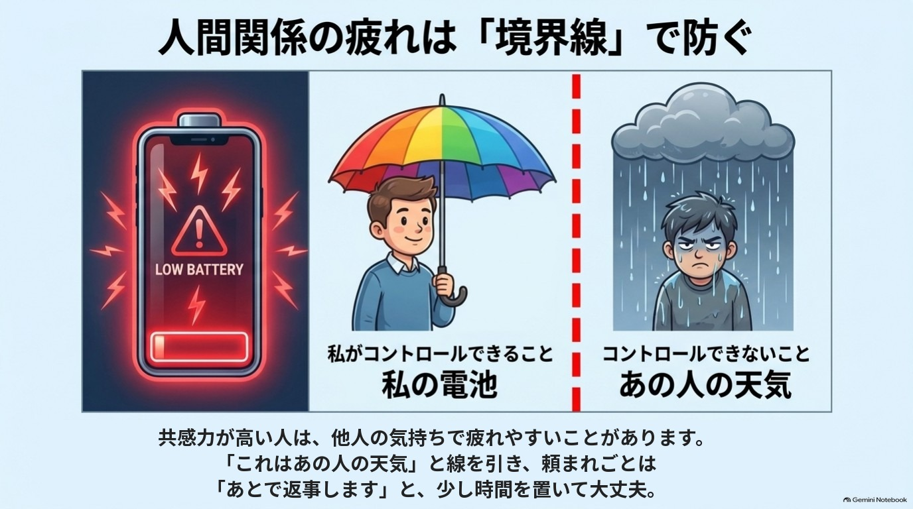

# 第6章 人間関係で消耗しない脳の使い方

> 人と会った帰り道、どっと疲れていることはありませんか。
> あの人の一言が、何日たっても頭から離れない。頼まれると断れず、あとで自分を責めてしまう。
> 「私は心が弱いのかな」と思ったことがあるなら、この章はあなたのために書きました。

**この章を読むとできること**

- 人づきあいで疲れる理由を、「性格の弱さ」ではなく「脳の仕組みと状況」として見直せる
- 「誰といると回復し、誰といると消耗するか」を5分で整理して、明日からの関わり方を1つ変えられる

---

## 1. 優しすぎる人は、なぜ疲れやすいのか

それは、あなたの心が弱いからではありません。

人の表情や声の調子に気づきやすい人は、まわりの空気を細かく拾っています。上司の不機嫌、同僚のため息、友人の沈んだ声。気づいてしまうぶん、受け取る情報が多く、帰るころにはぐったりしてしまうのです。

この「気づきやすさ」と結びつけて語られてきたのが、**ミラーニューロン**です。サルの実験で、「自分が動くとき」と「他者の動きを見るとき」の両方で反応する神経細胞が見つかり、そう名づけられました。

ここで、正直にお伝えしておきたいことがあります。

ヒトのミラーニューロンが、共感の「原因」だと確かめられているわけではありません。「見たものを自分のことのように感じる仕組みの一部かもしれない」という、有力な手がかりのひとつ、というのが現在の控えめな見方です。

ですので本書では、こう言うにとどめます。

> 人は、他人の様子を見ただけで、自分の中にも似た反応が起きることがある。
> その反応が強い人ほど、人づきあいで疲れやすいかもしれない。

「かもしれない」で十分です。大切なのは、疲れの原因を「自分がダメだから」から「受け取る量が多いから」に置き換えることだからです。

### 拒絶に敏感なのも、警備員のしごと

もうひとつ、人間関係で消耗する理由があります。

脳の中には、危険を見張る**ビビりな警備員**(扁桃体を中心とした警報の仕組み)がいます。この警備員は、人が群れで暮らしていた時代の名残で、「仲間から外されそうな気配」にも敏感に反応すると言われています。

実際に、仲間はずれにされたときの脳活動を調べた研究では、体の痛みに関わる領域と重なる部分が活動したと報告されています。ただし、「体が痛いのと同じ」と言い切れるほど単純な話ではありません。

ここでわかってほしいのは、一言が忘れられないのは「警備員が仕事をしすぎている」状態かもしれない、ということです。あなたが繊細すぎるのではなく、見張り役が心配性なだけ。そう考えると、少し肩の力が抜けませんか。

---

## 2. 巻き込まれない「線」の引き方

人間関係の疲れの多くは、「自分では動かせないこと」を何とかしようとするところから生まれます。

相手の機嫌。相手の返信の速さ。相手が自分をどう思うか。
どれも、あなたの努力で決められるものではありません。

{width=90%}

そこで役に立つのが、**課題の分離**という考え方です(アドラー心理学の考え方として、日本で広く知られるようになりました)。

- 自分の課題: 自分の言葉、自分の行動、自分の気持ちの扱い方
- 相手の課題: 相手の機嫌、相手の受け取り方、相手の決断

「これは相手の課題だ」と心の中で区切るだけで、背負っていた荷物が減ることがあります。相手を見捨てるわけではありません。**手を貸すことと、代わりに背負うことは違う**、というだけです。

### 巻き込まれそうな瞬間の、小さな3つの手

① **心の中でひと言つぶやく**
「これは、あの人の気持ち。私の気持ちとは別」。

② **気持ちに名前をつける**
モヤモヤを「悲しい」「悔しい」「焦っている」と言葉にすると、気持ちとの間に少し距離ができると言われています(第2章の感情ラベリングです)。愚痴を言いたくなったときも、「あの人最悪」より「あのとき私は悲しかった」と言い換えると、気持ちを吐き出しつつ、警備員の興奮を落ち着かせやすくなります。

③ **すぐ返事をしない**
頼まれごとには、「予定を確認して、あとでお返事しますね」と時間をもらいます。その場で「はい」と言ってしまう人ほど、この一呼吸が効きます。

### 断り方は、短くていい

断るときに、長い理由づけは要りません。次のような形が使いやすいです。

- 「今回は難しいです。声をかけてくれてありがとう」
- 「その日は都合がつかないので、今回は見送りますね」
- 「そこまでは手が回らないので、ここまでなら引き受けられます」

感謝を添えて、短く、できないことだけを伝えます。上手に言おうとしなくて大丈夫です。

なお、批判されたときに「ご意見ありがとうございます」と受け止めて、その場で言い返さずに距離を取る、という方法もあります。これは相手をやり込めるためではなく、**自分が感情的に反応しすぎないための一呼吸**として使ってください。

---

## 3. 「付き合う5人の平均」は、本当なのか

「あなたは、最も長い時間を過ごす5人の平均になる」という言葉を、聞いたことがあるかもしれません。

最初にはっきりお伝えします。**これは俗説です。**

自己啓発の世界で有名な言葉ですが、「ちょうど5人」「平均になる」ということを裏づける研究は、私の知る限りありません。人の考え方や習慣が、身近な人から影響を受けること自体は、いろいろな研究で語られています。けれど、それは「5人」という数字でも「平均」という計算でもなく、もっとゆるやかで、人によって大きく違うものです。

この言葉が怖いのは、読んだ人を追い詰めやすいところです。

- 「今の自分がうまくいかないのは、周りの人のせいだ」
- 「この人たちと付き合っている私は、ダメになる」
- 「だから、人を切らなくては」

そんなふうに、人を「役に立つ・立たない」で選別する方向に進むと、心はかえってすり減ります。

本書では、この言葉は使いません。かわりに、もっと実感に近い問いを使います。

> **その人といると、私は回復するか。消耗するか。**

年収も肩書きも、関係ありません。会ったあとの自分の体と気持ちを、事実として見るだけです。

- 会ったあと、肩の力が抜けている。呼吸が深い。
- 会ったあと、どっと疲れている。ひとりになりたい。

この2つは、あなたの体がくれる正直なデータです。それを「いい人・悪い人」の判定にしないことが、ここでは大切です。

### 「消耗する人」が悪い人とは限りません

消耗する相手が、悪意のある人だとは限りません。

こんな例があります(※仮名の再構成です)。

> ミカさん(40代・仮名)は、仲のよい友人からの長い電話のあと、いつもぐったりしていました。友人は悪い人ではありません。むしろ大切な人です。
> 棚卸しをしてみると、疲れの原因は「友人」ではなく、「夜に1時間以上、愚痴を聞き続ける形」だとわかりました。そこで、電話は30分までにして、会うときは昼のカフェにしました。友人との関係は続いたまま、帰り道の疲れが軽くなったそうです。

見直すのは、**人そのもの**ではなく、**関わり方の条件**(時間・場所・頻度)かもしれません。

もちろん、距離を取るのが一番よい場合もあります。職場や家族など、簡単に離れられない関係もあります。そのときは、顔を合わせる時間を少し短くする、返信の速さを変える、ひとりで回復する時間を先に予定に入れる、といった小さな工夫から始めてかまいません。

---

## 4. 全員に好かれなくても、人生は回る

「全員にいい人と思われたい」という気持ちは、とても自然です。警備員が「嫌われる=危険」と感じているからです。

でも、全員に好かれることは、現実にはできません。価値観も、そのときの状態も、人それぞれだからです。

「何割の人には嫌われても大丈夫」といった数字を目安にする話もありますが、その数字に確かな根拠があるわけではありません。ここでは数字ではなく、次のことだけ覚えておいてください。

> 好かれるために使っているエネルギーを、
> 自分を大切にしてくれる人と、自分自身に回していい。

境界線を引くことは、冷たいことではありません。**長く優しくいるために、自分の電池を守る行動**です。

そして、相手を思い通りに動かす技術は、この本では扱いません。人と人との関わりは、取引でも勝ち負けでもなく、お互いの電池を大切にしながら続けていくものだと考えているからです。

---

## 【ワーク】回復と消耗の棚卸し(所要時間: 5分)

飛ばして読み進めても大丈夫です。気が向いたときに、やってみてください。

**ステップ1: 名前を書く(2分)**
紙かスマホのメモに、最近よく関わる人を5〜8人書き出します。名前でもイニシャルでもかまいません。家族、職場の人、友人、SNSのつながりも入れてOKです。

**ステップ2: 印をつける(2分)**
会ったあと(やりとりしたあと)の自分を思い出して、印をつけます。

- 〇 回復する(ほっとする、元気が出る)
- △ どちらでもない
- ▼ 消耗する(疲れる、ざわざわする)

「いい人か悪い人か」ではなく、**あなたの体と気持ちがどうなるか**だけで選んでください。迷ったら△でOKです。

**ステップ3: 変えるのは1つだけ(1分)**
▼の人を1人選び、「関わり方の条件」を1つだけ変えます。たとえば、

- 会う時間を短くする
- 返信を即答ではなく、数時間あとにする
- 会う前か後に、ひとりの時間を15分入れる

〇の人については、「その人と過ごす時間を、今週ひとつ増やす」でもかまいません。

> ※相手を無理に変えようとしなくて大丈夫です。変えるのは、あなた側の条件だけ。
> ※▼が多くても、あなたが悪いわけではありません。疲れているときは誰でも、▼が増えます。

---

## 脳科学メモ

**ミラーニューロンと共感** ★★(有力な仮説)
サルで見つかった神経細胞で、ヒトにも似た仕組みがあるのではと考えられています(総説: Rizzolatti & Craighero, 2004)。ただし、これが共感の原因だと確定しているわけではなく、研究者の間でも解釈が分かれています。「共感の正体はミラーニューロン」と言い切る話は、慎重に受け取ってください。

**社会的な拒絶と痛みの領域** ★★(有力な仮説)
ボール回しのゲームで仲間はずれにされる状況で、体の痛みに関わる領域(前帯状皮質)と重なる脳活動が見られたという研究があります(Eisenberger, Lieberman & Williams, 2003)。ただし、その後、脳活動のパターンを詳しく比べると、体の痛みと拒絶は区別できたという報告もあり(Woo et al., 2014)、「同じ痛み」と言い切れるかは議論があります。

**感情に名前をつける(感情ラベリング)** ★(研究で確認)
気持ちを言葉にすると、扁桃体の反応が弱まることを示した脳画像研究があります(Lieberman et al., 2007)。実験室での結果であり、効果の大きさには個人差があります。

**「付き合う5人の平均になる」** 俗説(★の対象外)
自己啓発の分野で広まった言葉で、「5人」「平均」という点を裏づける研究は、確認した範囲では見当たりませんでした。身近な人の影響が「ある」ことと、「5人の平均になる」ことは別の話です。

**境界線・課題の分離** ★★★(経験則・心理学の考え方)
アドラー心理学の考え方を日常に使いやすくした実践的な方法です。脳科学で直接確かめられたものではなく、使ってみて自分に合うかを確かめる位置づけです。

---

## 師匠かみき×弟子りんじの対話コラム

**りんじ**「師匠、僕、同僚の愚痴を聞いたあと、いつも頭がどんよりするんです。聞いてあげないと冷たいかなって」

**かみき**「りんじくんは、人の話をよく受け取る人だからね。まず聞いておくけど、聞き終わったあと、何か感じる?」

**りんじ**「疲れます。あと、自分も不機嫌になってる気がします」

**かみき**「それは弱さじゃなくて、受け取る量が多いだけ。でもね、愚痴を聞くことと、愚痴を全部抱えることは別だよ」

**りんじ**「どうすればいいですか?」

**かみき**「聞くときに、心の中でこう言うの。『これは、あの人の気持ち』。そして『そうなんだね、大変だったね』と言ったら、15分で切り上げる。時間の枠を先に決めておくのもいいよ」

**りんじ**「それって、冷たくないですか?」

**かみき**「冷たいのは、疲れ切って優しくできなくなること。電池が切れたら、誰のことも助けられないでしょう。電池を守るのは、優しさを長持ちさせる方法だよ」

**りんじ**「なるほど。まず15分、やってみます」

**かみき**「うん。うまくいかなくても、それも大事なデータだからね」

---

## 今日の5分、やれた? 〇 / △

(〇: 棚卸しをした、または関わり方を1つ変えた  △: 読んだだけ。それでも十分です)

> ※この章の内容は、心のつらさが強いときの治療やカウンセリングの代わりにはなりません。人間関係のつらさが長く続く、眠れない、気持ちが沈んで動けない、職場や家庭で理不尽な扱いを受けているといった場合は、ひとりで抱えずに、医療機関や公的な相談窓口、専門家に相談してください。
