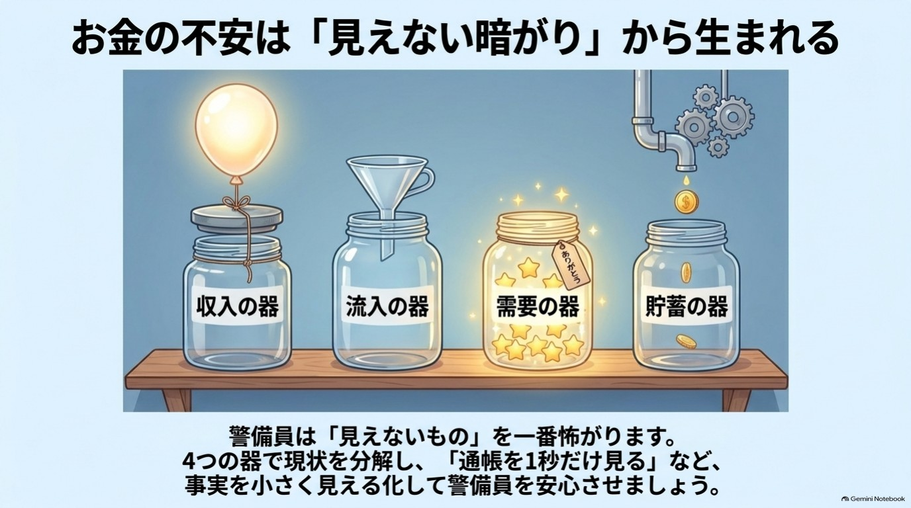
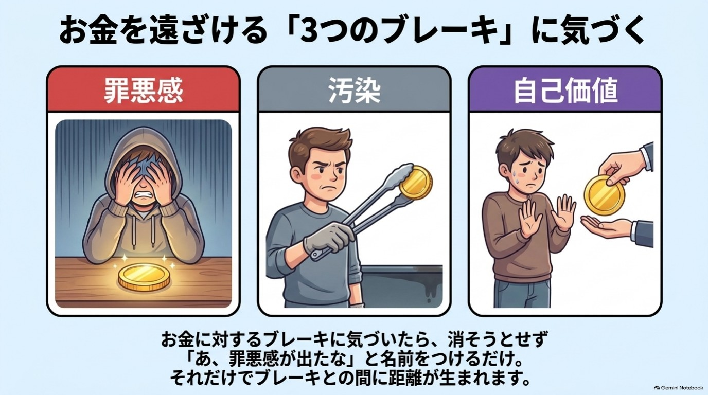

# 第7章 お金の不安を小さくする「お金の器」

> 通帳を開く前から、なんとなく胸がざわつく。
> 稼いでも、貯めても、「これで足りるのかな」という気持ちが消えない。
> お金の話になると、つい話題を変えてしまう。
>
> もし心当たりがあるなら、この章はあなたのためのものです。

**この章を読むとできること**

- 自分のお金の不安が、4つの「器」のどこで大きくなっているかが見えるようになります。
- 罪悪感・汚染・自己価値という3つのブロックのうち、自分に近いものを3分で確かめられます。

> **先にお伝えしておきます。** この章は、お金が増えることを約束するものではありません。投資や資産運用の助言でもありません。目指すのは「お金の不安が少し小さくなる」「お金に関する行動が1つ変わる」ところまでです。効果の感じ方には個人差があります。

---

## 1 不安は「足りない」より「見えない」ときに大きくなる

お金の不安というと、「収入が少ないからだ」と思いがちです。
もちろん、それも大きな要因です。

ただ、収入がそれなりにある人でも、不安が消えないことがあります。
反対に、収入は多くなくても、落ち着いている人もいます。

この差は、金額だけでは説明できません。
分かれ目の1つが、**「自分のお金の状態が、自分に見えているかどうか」**です。

通帳を見ない。レシートを溜める。請求額を確認するのが怖くて、アプリを開かない。
こうした「見ない工夫」は、その場では楽になります。
けれど、見えないものを、脳は実際よりも大きく見積もりがちです。

第1章でお話しした、ビビりな警備員(扁桃体)を思い出してください。
警備員は、よく分からない暗がりが苦手です。
「何かいるかもしれない」と、警戒レベルを上げ続けます。

つまり、お金の不安が大きいのは、あなたが弱いからではありません。
**見えていない部分が多いほど、警備員が警戒を解けないから**です。

そこでこの章では、お金の状態を「4つの器」に分けて眺めます。
暗がりに小さな灯りをともして、警備員に「ここは大丈夫」と見せてあげるイメージです。

---

## 2 「お金の器」4つの見方

最初に大事なことをお伝えします。
**「お金の器」は、この本が使う比喩(たとえ)です。** 脳の特定の場所に、4つの器があるわけではありません。「お金の状態を整理するための4つの引き出し」くらいの気持ちで読んでください。

4つの器は、次のとおりです。

| 器 | ひとことで言うと | 自分への問い |
|---|---|---|
| 収入の器 | どれくらいの収入を「自分にとって普通」と感じているか | 「これ以上は無理」と思う線は、どこにありますか? |
| 流入の器 | お金が入ってくる入口が、いくつあるか | 収入の入口は、いくつ思い浮かびますか? |
| 需要の器 | 自分の力や時間が、誰かの役に立っているか | 最近、誰かに「ありがとう」と言われたのは、どんなときですか? |
| 貯蓄の器 | 入ってきたお金が、手元に残る仕組みがあるか | お金が残る「仕組み」は、ありますか? |

順番に、見ていきましょう。

{width=90%}

### 収入の器 ― 「普通」の線は、いつの間にか引かれている

収入の器は、金額そのものではなく、**「自分にとってこれが普通」という感覚**のことです。

子どものころに聞いた「うちはそんなに贅沢できない」。
職場で自然と共有されている「このくらいが相場」。
そうした言葉が積み重なって、頭の中に1本の線が引かれていることがあります。

線があること自体は、悪いことではありません。
ただ、**線が「事実」ではなく「思い込み」だった**ことに気づくだけで、見え方が変わります。

小さな一歩は、「これ以上は無理」と思う金額や条件を、紙に1行だけ書くことです。
書いた線を、すぐに動かす必要はありません。見える形にするだけで十分です。

### 流入の器 ― 入口は1つだけ、と決めていませんか

多くの人にとって、お金の入口は給与や年金など、1〜2本です。
入口が少ないと、そこが揺らいだときに不安が一気に大きくなります。

だからといって、無理に副業や投資を始める必要はありません。
この本は、特定の金融商品や副業をすすめる本ではないからです。

ここでの一歩は、とても小さなものです。

- 家にある不要品を、1点だけ手放してみる
- 使っていないポイントや、受け取っていない還付・給付がないか確認する
- 自分にできることを、誰かの役に立つ形で書き出してみる

どれも、「入口が増える感覚」を体験するための練習です。
金額の大きさは、問いません。

### 需要の器 ― 自分の力は、誰かに必要とされている

需要の器は、「自分の力が、誰かの役に立っている」という実感のことです。

自分の価値を低く見積もる癖がある人は、感謝された経験があっても、
「あれは大したことじゃない」と流してしまいます。
けれど、流された記憶は、自己評価の材料として使われません。

小さな一歩は、**「ありがとう」と言われたことを3つ書くこと**です。
仕事でも家事でも、友人とのやり取りでも構いません。
「それくらいで?」と思うことほど、書く価値があります。

### 貯蓄の器 ― 意志ではなく仕組みで残す

貯蓄の器は、「いくら貯めたか」ではなく、**「お金が残る仕組みがあるか」**を見る器です。

貯められないと、「自分は意志が弱い」と責めてしまいがちです。
でも、第3章で見たように、意志に頼らず**仕組みで動く**ほうが、続きやすいのです。

たとえば、給料日に、無理のない少額が別の口座へ自動で移るように設定する。
財布に入れる現金の上限を決める。
やることは、それだけです。

金額は、「え、それだけ?」と思うくらいで始めてかまいません。
大事なのは、金額よりも「自動で動く」という体験です。

> **事例(仮名の再構成)**
> 美咲さん(30代・会社員)は、毎月「今月こそ貯めよう」と決意しては、月末に自己嫌悪になっていました。
> そこで、決意をやめました。給料日に、千円だけが別口座に自動で移る設定にしたのです。
> 3か月たっても、貯まった額はわずかでした。けれど、「月末に自分を責める時間」が減ったそうです。
> 金額より先に、「お金が残る仕組みがある」という安心が生まれた、という例です。
> ※この事例は、複数の相談や体験談をもとにした仮名の再構成です。実在の特定の人物の話ではありません。

### どの器から始めるか

4つの器は、上の順番で見ていくと整理しやすいですが、**順番に決まりはありません。**

- 通帳を見るのも怖い → 「貯蓄の器」の見える化から
- 「自分なんて」が口ぐせ → 「需要の器」の3つ書きから
- 毎月ぎりぎりで余裕がない → 「流入の器」の確認から

一番気になる器を1つだけ選べば十分です。

---

## 3 お金のブロック3診断

4つの器が「お金の状態」を整理する見方だとすれば、**ブロック3診断は、「お金に対する気持ちの癖」を見る見方**です。

ここでいう「ブロック」とは、お金に近づこうとしたときに、ふっと出てくるブレーキのことです。
診断といっても、医学的な診断ではありません。自分を知るためのセルフチェックです。

お金に対するブレーキは、大きく3つのタイプに分けられます。

{width=90%}

### ブロック1 罪悪感タイプ

「お金を使う(受け取る)のは、悪いことだ」と感じるタイプです。

- 自分のために使うとき、強い罪悪感がある
- 人におごってもらうと、落ち着かない
- 臨時収入があると、すぐ使い切ってしまう
- 「贅沢は敵」という言葉が、頭に浮かぶ

育った環境で耳にした「うちは余裕がないから」という言葉が、背景にあることがあります。
これは、あなたを守るために身につけた考え方でもあります。

### ブロック2 汚染タイプ

「お金は、なんとなく汚いもの」というイメージを持つタイプです。

- お金の話をするのが苦手で、避けてしまう
- お金持ちの人に、批判的な気持ちが湧く
- 「お金より大事なものがある」と、つい言いたくなる
- 稼ぐことに、後ろめたさがある

ニュースやドラマで見た「お金で人が変わる話」が、イメージを作っていることもあります。

### ブロック3 自己価値タイプ

「自分は、お金を受け取る価値がない」と感じるタイプです。

- 値上げや、給与の交渉を言い出せない
- 自分の仕事や時間を、安く見積もってしまう
- 褒められると、「いえいえ」とすぐ打ち消す
- 「私なんか」が口ぐせになっている

このタイプは、お金の問題というより、第2章の「自分を責める言葉」と深くつながっています。

### 診断の見方

それぞれ4つのチェックのうち、**2つ以上当てはまったものが、今のあなたの「気になるタイプ」**です。
3つとも当てはまった方も、1つも当てはまらなかった方もいると思います。どちらも普通です。

大切なのは、次の3点です。

1. **ブロックは、悪者ではありません。** 過去のあなたを守るために身につけた、警備員のルールです。
2. **タイプは、固定ではありません。** 状況によって、強く出るものが変わります。
3. **すべてを一度に直す必要はありません。** 一番気になるものを1つだけ見れば十分です。

### 気づくだけで、少し楽になる

ブレーキが出た瞬間に、**そのブレーキに名前をつけてみる**のが、おすすめの入り口です。

たとえば、高い買い物の前に胸がざわついたとき。
「あ、罪悪感が出たな」と、心の中で言ってみます。
ここでは、「罪悪感を消そう」とはしません。**名前をつけるだけ**です。

第2章でも触れた「感情ラベリング」です。
気持ちを言葉にすることで、気持ちとの間に少し距離ができると言われています。

もし、お金にまつわる過去の出来事を思い出して、つらさが強くなるときは、無理に掘り下げないでください。
信頼できる人や、専門家に相談することも選択肢です。

---

## 4 器を整えても「お金が増える」とは言えない理由

ここで、正直にお話ししておきます。

お金の器を見つめ直しても、**収入が増える保証はありません。**
この本のどこにも、「これをすればお金が入ってくる」という約束は書いていません。

なぜなら、収入は、景気、職場、住んでいる地域、健康状態、家族の状況など、あなたの努力以外の要素にも大きく左右されるからです。
「気持ちの持ち方で、すべてが変わる」という話は、うまくいかなかった人を、さらに責めてしまいます。

この章が目指すのは、もっと手前の、次の2つです。

- お金の状態が見えて、**漠然とした不安が少し小さくなる**
- 不安に押されて避けていた**行動が、1つだけ変わる**

たとえば、「請求書を、封を切って確認した」。
たとえば、「毎月の固定費を、一覧にした」。
それだけでも、大きな一歩です。

また、次のような状況のときは、本の中のワークだけで抱え込まないでください。

- 返済が苦しく、生活が立ち行かなくなりそう
- 眠れない、食欲がないなど、不安が日常生活に影響している
- 家族や周囲に、お金のことを言い出せずにいる

自治体の相談窓口、法テラス、お金や法律の専門家、医療機関など、頼れる場所があります。
**相談することは、弱さではなく、警備員を安心させる、いちばん確かな方法の1つです。**

---

## 【ワーク】お金のブロック診断(所要 約3分)

飛ばしても大丈夫です。気が向いたときに、やってみてください。

**ステップ1(1分)** 第3節の3タイプのチェックを読み、当てはまるものに印をつけます。

**ステップ2(1分)** 一番多く当てはまったタイプを、1つだけ選びます。同数なら、直感でかまいません。

**ステップ3(1分)** 選んだタイプに、小さな一歩を1つ決めて書きます。

| タイプ | 小さな一歩の例 |
|---|---|
| 罪悪感 | 好きな飲み物を1つ買い、「買っていい」と声に出す |
| 汚染 | 信頼できる人と、お金の話を1分だけしてみる |
| 自己価値 | 「ありがとう」と言われたことを、3つ書く |

もう1つ、おまけです。**4つの器のうち、一番気になる器にも○をつけてみてください。** 次の1週間は、その器だけ見れば十分です。

---

## 脳科学メモ

**★ 研究で確認されていること:感情に名前をつける**
不快な画像を見ているときに、感情を言葉にすると、脳の警戒反応が落ち着く傾向が見られたという実験があります(扁桃体の活動が低下したという報告)。「気持ちに名前をつける」ことの根拠の1つです。ただし、実験室での結果であり、お金の不安への効果は個人差があります。

**★★ 有力な仮説:不安が頭の容量を使う**
お金の心配が頭の中を占めていると、他のことを考える余裕が減ることを示す研究があります。「状況を見える形にすると、頭の負担が軽くなる」という考え方は、この仮説と相性が良いと考えられます。ただし、この分野は議論が続いており、結論は固まっていません。【要出典確認】

**★★ 有力な仮説:現金とカードで「使った感覚」が違う**
現金で払うほうが、カードや電子決済より「お金が減った」という感覚が強く、支出が控えめになりやすい、という研究があります。ただし、環境や人によって差があり、全員に当てはまるわけではありません。【要出典確認】

**★★★ 体験談・経験則:「器」と「ブロック」**
「お金の器」と「3つのブロック」は、本書の著者が相談や発信の経験から整理した**比喩・整理の枠組み**です。各器が脳のどの部位に対応する、といった科学的な裏づけはありません。自分の状態を見つめるための道具として使ってください。

---

## 師匠かみき×弟子りんじ ― 「怖くて通帳が開けません」

**りんじ** 師匠、実はもう3か月、通帳を開いてないんです。見たら、現実を突きつけられそうで。

**かみき** りんじくん、話してくれてありがとう。それは、怠けているんじゃなくて、警備員が頑張っている証拠だよ。

**りんじ** 警備員が、ですか。

**かみき** そう。見えないものほど、警備員は「大変なことになってるかも」と最悪を想像する。実際の数字より、想像のほうが大きいことが多いんだ。

**りんじ** でも、実際に見て最悪だったらどうしましょう。

**かみき** 見るのは、全部じゃなくていい。最初は、封筒を1通だけ開ける。それか、通帳の「いまの残高」だけ。5分もかからないよ。

**りんじ** それだけで、いいんですか。

**かみき** いい。数字を見て落ち込んだら、「あ、不安が出たな」と名前をつけるだけでいい。いきなり解決しなくていいんだよ。見えれば、次の一歩が選べるからね。

**りんじ** ……今夜、残高だけ見てみます。

**かみき** いいね。それが、器を整える最初の一滴だよ。

---

**今日の5分、やれた? ○ / △**
