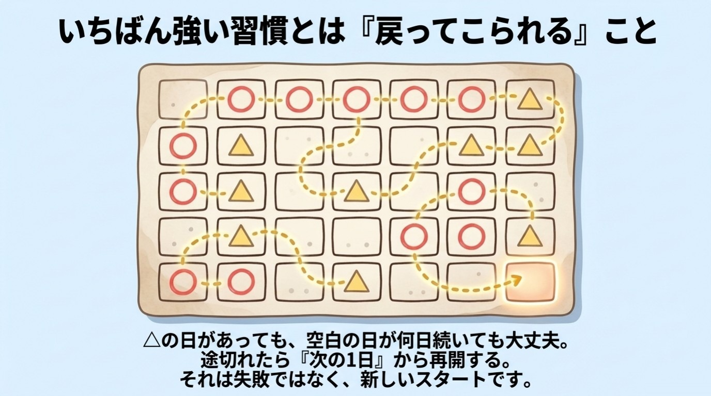
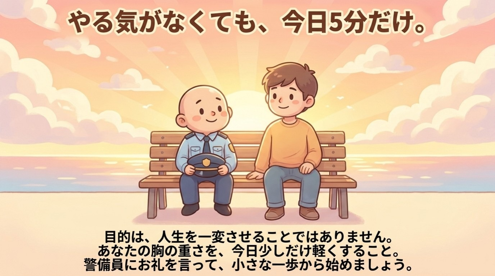

# おわりに 30日プランをつくろう

**いちばん強い習慣は、「戻ってこられる」習慣。**

ここまで読んでくださって、ありがとうございます。

もしかすると、あなたはもう「全部やらなきゃ」と、少し肩に力が入っているかもしれません。
その力を、まず抜いてください。

この本は、最初から最後まで完璧にやり切るための本ではありません。
**「続かない日があっても、また戻ってこられる」ための本**です。

---

## 1 続かなかった自分を、責めなくていい

習慣が身につくまでの時間には、大きな個人差があることが、研究でも報告されています【研究】。
数週間で慣れる人もいれば、半年以上かかると見込まれる人もいました。

あなたが何度も途中でやめてきたのは、意志が弱いからではありません。
脳は、新しいことより、慣れたことを選びたがるようにできています。
第1章で見た、あの警備員です。

だから、これから作る30日プランには、最初から次のルールを入れておきます。

> **△の日があってもOK。空白の日があってもOK。**
> 止まったら、「次の1日」から、再開するだけ。

途中で止まった日は、失敗の記録ではありません。
「ここから戻った」という印をつけられる、いちばん大事な日です。

> いちばん強い習慣は、「戻ってこられる」習慣。

{width=90%}

---

## 2 【ワーク】自分用30日プランをつくる(10分)

やること3つ/飛ばしてOK

できたら、こうなる:明日から30日、「いつ・何を・5分」が、「気づかれないサイズ」で決まっています。

巻末に、30日チェックシートがあります。
第1〜7章のワークを30日に割り振った、1日1項目の表です。
そのまま使ってもかまいませんが、自分用に整えると、続けやすくなります。

### ステップ1 悩みを1つ選び、読む順番を決める

序章の診断で出たタイプ(お金型・人間関係型・やる気型)を思い出してください。
いちばん軽くしたい悩みを、1つだけ選びます。

あとは、序章の「ひと言処方」と、巻末の「読む順番ガイド」に沿って、先に読む章を決めます。
迷ったら、どのタイプの方にも土台になる第1章から始めましょう。

### ステップ2 「いつやるか」を、いまある習慣にくっつける

やる気に頼らず、すでにある習慣のあとにくっつけます。
おすすめは、この本でずっと使ってきた合図です。

> **水を飲んだら、5分。**

朝のコップ一杯の水を飲んだら、決めた5分を始めます。5分は上限です。30秒で終わってもかまいません。
水を飲む習慣がない方は、歯みがきのあとや、寝る前にスマホを充電器につないだときなど、毎日やっている動作を1つだけ選んでください。

「〇〇したら、△△する」の形で書くと、行動が動き出しやすくなります。
これは、行動のきっかけを前もって決めておく方法です(「実行意図」と呼ばれます)。
研究でも、目標の達成しやすさとの関連が報告されています【研究】。

### ステップ3 「やれなかった日」の戻り方を、先に決める

やれなかった日が、いちばん大事です。ここで、先に決めておきます。

- 1日休んだら → 次の日は、1分だけやる
- 3日休んだら → いちばん簡単なワーク(第1章のワーク)に戻る
- 1週間空いたら → 読み返すのは、各章の冒頭だけでよい

### 書き留める

決めたことを、下の6項目にそって書き留めます。
スマホのメモ、紙、頭の中。どれでもかまいません。
書き込み用のシートは、購入者特典のPDFにもあります(巻末)。

| 項目 | あなたの答え |
|---|---|
| いちばん軽くしたい悩み | |
| 先に読む章 | |
| 毎日の「きっかけ」(〇〇したら) | |
| 5分でやること | |
| やれなかった日の戻り方 | |
| 30日後の自分に、ひとこと | |

---

## 3 30日後は、「変わったか」より「気づけたか」を確かめる

### 序章の診断を、もう一度

30日たったら、序章の3分診断を、もう一度やってみてください。
診断は「いまの傾向」を見るものです。点数が動いたら、悩みの中心が少し移ったということ。良し悪しではありません。
序章でメモした Day 1 の記録と、並べてみましょう。

| 比べること | Day 1 | Day 30 |
|---|---|---|
| 診断の点数(お金型・人間関係型・やる気型) | | |
| 悩みの重さ(10点満点の感覚で) | | |
| 続いている「5分」 | | |
| 30日チェックシートの○と△の数 | ― | |

書き方は、巻末の「りんじくんの30日シート」が記入例になります。

### 3つの問い

そのうえで、次のことだけ確かめてみてください。

- 悩みの重さは、少しでも変わりましたか?
- 以前はしなかった行動が、1つでも増えましたか?
- 自分を責める回数は、少しでも減りましたか?

「変わった」と言い切れなくても、大丈夫です。
**小さな変化に気づけること自体が、第4章でお話しした、注意の向け方の変化だからです。**

つらさが強いときの相談先については、巻末の免責事項にまとめました。
この本だけで、抱え込まないでくださいね。

---

## 師匠かみき×弟子りんじの対話コラム Day 30 ~戻ってこられた~

**りんじ**:師匠、あの夜、残高を見ました。思ったより、ましでした。30日の○は17個。△が8個、空白が5日です。

**かみき**:ちゃんと数えましたね。

**りんじ**:半分ちょっとです。変わったのかは、正直わかりません。

**かみき**:診断は、もう一度やってみましたか。

**りんじ**:はい。やる気型が4点から2点、お金型が3点から5点に。悩みの重さは、8から5です。

**かみき**:悩みの中心が、やる気からお金に移ったんですね。動けるようになって、次の悩みが見えてきたのかもしれません。

**りんじ**:でも、○が17個じゃ、習慣になったとは言えませんよね。やっぱり失敗ですか?

**かみき**:いいえ。習慣が身につくまでの日数に大きな個人差があることは、【研究】で報告されています。30日で終わりではありません。ただ、りんじくんは△が3日続いたあとも、空白の次の日も、戻ってきました。いちばん強い習慣は、「戻ってこられる」習慣ですよ。

**りんじの次の一歩**:次の30日は、第7章から。明日の朝、水を飲んだら、通帳アプリを開く。

---

## むすび

<!-- 著者の体験談をここに入れる(聞き取り票 問6・問8) -->

あなたが「やる気が出ない自分」を責めてきた時間は、
それだけ「ちゃんとしたい」と思い続けてきた時間でもあります。

その気持ちは、そのままで大丈夫です。
やる気があってもなくても、今日、5分だけ。

それが、30日の最初の1日になります。

いってらっしゃい。あなたの30日が、少しだけ軽くなりますように。

脳科学研究家 かみき♪

---

**今日の5分、やれた? ○ / △**

{width=90%}
