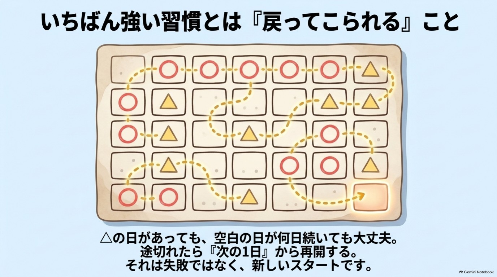

# おわりに 30日プランをつくろう

ここまで読んでくださって、ありがとうございます。

もしかすると、あなたはもう「全部やらなきゃ」と、少し肩に力が入っているかもしれません。
その力を、まず抜いてください。

この本は、最初から最後まで完璧にやり切るための本ではありません。
**「続かない日があっても、また戻ってこられる」ための本**です。

---

## 続かなかった自分を、責めなくていい

習慣が身につくまでの時間には、大きな個人差があることが、研究でも報告されています。
数週間で慣れる人もいれば、半年以上かかると見込まれる人もいました。

あなたが何度も途中でやめてきたのは、意志が弱いからではありません。
脳は、新しいことより、慣れたことを選びたがるようにできています。第1章で見た、あの警備員です。

だから、これから作る30日プランには、最初から次のルールを入れておきます。

> **△の日があってもOK。空白の日があってもOK。**
> 止まったら、「次の1日」から、再開するだけ。

{width=90%}

---

## 自分用30日プランのつくり方(所要 約10分)

この本の巻末に、30日チェックシートがあります。
第1〜7章のワークを30日に割り振った、1日1項目の表です。
そのまま使ってもかまいませんが、自分用に整えると、続けやすくなります。

### ステップ1 いまの悩みを1つ選ぶ

序章の診断で出たタイプ(お金型・人間関係型・やる気型)を思い出してください。
一番軽くしたい悩みを、1つだけ選びます。

### ステップ2 読む順番を決める

序章のガイドに沿って、先に読む章を決めます。
迷うなら、第1章と第3章は、どのタイプの方にも土台になります。

### ステップ3 「いつやるか」を決める

やる気に頼らず、**すでにある習慣のあとにくっつけます。**

- 歯みがきのあとに
- 朝のコップ1杯の水を飲んだあとに
- 通勤電車で座ったときに
- 寝る前、スマホを充電器につないだときに

「〇〇したら、△△する」の形で書くと、行動が動き出しやすくなります。
これは、行動の「きっかけ」を前もって決めておく方法(「実行意図」と呼ばれます)で、研究でも目標の達成しやすさとの関連が報告されています。

### ステップ4 「やれなかった日」のルールを決める

やれなかった日が、一番大事です。ここで、先に決めておきます。

- 1日休んだら → 次の日は、1分だけやる
- 3日休んだら → 一番簡単なワーク(第1章の1分ワーク)に戻る
- 1週間空いたら → 読み返すのは、各章の冒頭だけでよい

### ステップ5 書き込む

下の欄に、あなたの言葉で書いてみてください。

| 項目 | あなたの答え |
|---|---|
| 一番軽くしたい悩み | |
| 先に読む章 | |
| 毎日の「きっかけ」(〇〇したら) | |
| 5分でやること | |
| やれなかった日の戻り方 | |
| 30日後の自分に、ひとこと | |

---

## 30日後に、確かめてほしいこと

30日たったとき、次のことだけ確かめてみてください。

- 悩みの重さは、少しでも変わりましたか?
- 以前はしなかった行動が、1つでも増えましたか?
- 自分を責める回数は、少しでも減りましたか?

「変わった」と言い切れなくても、大丈夫です。
**小さな変化に気づけること自体が、第4章でお話しした、注意の向け方の変化だからです。**

もし、お金のことでも、人間関係のことでも、眠れない日が続くなど、つらさが強いときは、この本だけで抱え込まないでください。
医療機関や、専門の相談窓口を頼ることも、立派な「次の一歩」です。

---

## むすび

あなたが「やる気が出ない自分」を責めてきた時間は、
それだけ「ちゃんとしたい」と思い続けてきた時間でもあります。

その気持ちは、そのままで大丈夫です。
やる気があってもなくても、今日、5分だけ。

それが、30日の最初の1日になります。

いってらっしゃい。あなたの30日が、少しだけ軽くなりますように。

脳科学研究家 かみき♪

---

**今日の5分、やれた? ○ / △**

{width=90%}
