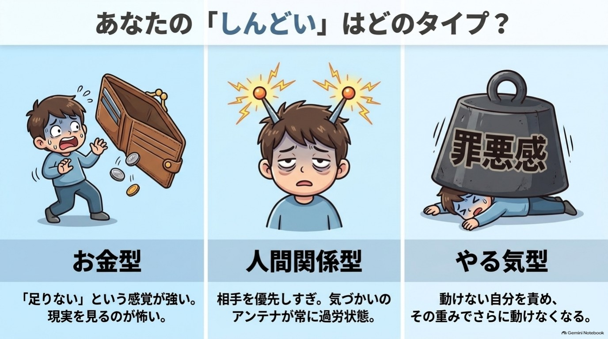

{width=100%}

# はじめに 「続かない」のは、あなたのせいじゃない

新しい手帳を買った。朝活を始めると決めた。
けれど、気づけば三日坊主。「また続かなかった」と、ため息をつく。
お金、人間関係、自分への自信。悩みはあるのに、体が重い。
やる気が出ない自分に、さらにがっかりしてしまう。

もし心当たりがあるなら、最初にお伝えしたいことがあります。

**それは、あなたの意志が弱いからではありません。**

※本書に登場する人物は、複数の例をもとにした仮名です。

## 続かない人は「やる気」で何とかしようとしている

私は「かみき♪」といいます。脳の仕組みを、やさしく伝える活動をしています。

「今月こそ貯めたい」「人に気をつかって、ぐったり」。そんな声をたくさんいただいてきました。悩みはばらばらでも、共通点がありました。

みなさん、**「やる気」や「根性」で何とかしようとしていた**のです。気合いで始めて、気合いが切れて、「やっぱり私はダメだ」と結論づける。その繰り返しで、悩みより「自分を責める気持ち」のほうが大きくなっていきます。

{width=90%}

## 脳はなぜ、新しいことにブレーキをかけるの?

脳には、**あなたを危険から守る**という大切な仕事があります。だから、いつものやり方を「安全」と見なしやすいのです。新しいことを始めると、「待って、大丈夫?」とブレーキをかけてきます。

本書では、この働きを**「ビビりな警備員」**とたとえます。警備員は悪者ではなく、少し心配性なだけです。

続かないのは、警備員があなたを守ろうと必死な証拠かもしれません。だったら、警備員が気づかないくらい小さく始めればいいのです。

## この本でお約束すること、しないこと

**お約束すること**

- 1日5分ほどでできる、小さなワークをお渡しします
- 悩みの「重さ」が少し軽くなる手がかりをお伝えします
- 日常の行動が「1つ」変わることを目指します

**お約束しないこと**

- 「悩みがすべて解決する」とは言いません
- 「お金が増える」「必ずうまくいく」とも言いません
- 医療やカウンセリング、投資のアドバイスの代わりにはなりません。つらさが強いときは、医療機関や専門家に相談してください

効果には個人差があります。合わないワークは、飛ばしてかまいません。

## 根拠の強さは「★」で正直に分けています

各章の終わりの「脳科学メモ」では、根拠の強さを★で示しています。

| 表示 | 意味 |
|---|---|
| ★ | 研究で確認されていること |
| ★★ | 有力な仮説。研究はあるが、まだ議論が続いているもの |
| ★★★ | 体験談や経験則。科学的な裏づけは限られるもの |

「分かっていること」と「そうかもしれないこと」には、大きな差があります。その差を知ったうえで、ご自分で選んでほしいのです。

## この本は、どこから読んでもいい

- 序章の「3分診断」で、いまの悩みタイプを知る
- タイプに合わせた順番で、気になる章から読む
- 各章の【ワーク】は1〜5分。飛ばしてもOK
- 章の最後の「今日の5分、やれた? ○/△」に印をつける
- 巻末の「30日チェックシート」で、続いた日を見える化する

## 30日後のゴールは、人生の一変ではありません

- 悩みを考えたとき、胸の重さが少し軽くなっている
- 「これなら続く」という小さな行動が、1つ残っている
- 続かない日があっても、責めすぎずに戻ってこられる

「戻ってこられる」ことこそ、いちばん強い習慣です。

## 【いますぐ30秒】悩みを「30秒サイズ」に縮める

できたら、こうなる:読み終えた直後に、もう一歩目を踏み出せています。

1. いちばん気になる悩みを、1つだけ選ぶ
2. それに効きそうな行動を「30秒でできるサイズ」に縮める
3. スマホのメモか紙に書く(頭の中で決めるだけでもOK)

- 例:「家計を見直す」→「通帳アプリを開いて、残高を見る」
- 例:「運動する」→「靴下を履いて、立ち上がる」

飛ばしてもかまいません。書けたら、それがあなたの最初の5分習慣です。やる気がなくても、もう動けました。

では、序章へ進みましょう。あなたのペースで、大丈夫です。

かみき♪

---

# 序章 3分でわかる「あなたの悩みタイプ診断」

お金も、人間関係も、自信のなさも、全部しんどい。
どこから手をつければいいのか、もう分からない。
全部いっぺんに直さなきゃと思うほど、動けなくなる。

## この章を読むとできること

- いまの自分の悩みタイプがわかる
- 次に読む章を、迷わず選べる

**この章のワーク:3分診断(3分)**

---

## 1 悩みが多いときは、1つに絞るほうが動ける

悩みが多いと、人は「全部直さなきゃ」と考えて止まってしまいます。それは意志の弱さではありません。**脳は「何から手をつけるか分からない状態」が苦手**なだけです。

だから最初にやるのは、頑張ることではありません。いまの自分は、どの悩みが強めかを知ることです。

意外かもしれませんが、診断のいちばんの役目は「いま読まなくていい章」を決めることです。読む量が減るほど、最初の一歩は軽くなります。

この診断は、いまの気持ちの傾向を知るためのものです。医学的な診断や、性格の優劣を決めるものではありません。結果は時期や状況で変わるので、気軽に受け取ってください。

## 【ワーク】3分診断(3分)

できたら、こうなる:自分のタイプと、次に読む章が決まっています。

1. 10問に直感で答え、近いものを1つ選ぶ
2. 採点表で、選んだ番号に1点ずつつける
3. いちばん高いタイプの「ひと言処方」を読む

スマホのメモに番号を打っても、紙に書いても、頭の中で数えても大丈夫です。ぴったりの答えがない問いは、飛ばしてかまいません。

「正しい答え」はありません。素直に選んだほうが、役に立つ結果になります。

---

## 2 診断 10問

### 問1 月末、通帳や家計アプリの残高を見たとき

① 「また減ってる…」と、数字を直視するのがこわい
② 「あの人に付き合って使いすぎたかも」と思い返す
③ 「貯めるつもりだったのに、何もしなかった」と落ち込む

### 問2 朝、目が覚めた直後

① 今日会う人の顔が浮かんで、少し気が重くなる
② 「やらなきゃ」が頭に山積みで、布団から出られない
③ ふと、お金や将来の心配が頭をよぎる

### 問3 気乗りしない誘いを受けたとき

① 断ると嫌われそうで、つい「行く」と答えてしまう
② 「お金がかかるなあ」と、まず財布のことが浮かぶ
③ 行く元気が出ず、返事を後回しにしてしまう

### 問4 新しいことを始めたいとき

① 「失敗したらお金がもったいない」と考えて、足が止まる
② 調べているだけで満足してしまい、最初の一歩が出ない
③ 「周りにどう思われるか」が気になって、言い出せない

### 問5 うまくいかなかったとき、心の中でつぶやく言葉

① 「やっぱり私は続かない人間だ」
② 「あの人に迷惑をかけてしまった」と、相手のことが頭から離れない
③ 「これでいくら損したか」と、つい数字で考える

### 問6 SNSを眺めているとき

① 他の人の収入や暮らしぶりと比べて、落ち込む
② 「みんな頑張っているのに自分は…」と、動けなくなる
③ 誰かの投稿への反応や、自分の投稿の反応が気になる

### 問7 一日の終わりに、いちばん疲れの原因だと思うもの

① 人に気をつかいすぎたこと
② やるべきことが進まなかった罪悪感
③ お金や将来の不安を考えすぎたこと

### 問8 「ちょっといい買い物」をしようとしたとき

① 「自分にそんな価値があるのかな」と、お金を使うことに罪悪感がある
② 家族や周りの目が気になって、買いにくい
③ 欲しいけれど、決めるのが面倒で先延ばしにする

### 問9 人から頼みごとをされたとき

① 引き受けたあとで、後悔することがよくある
② 引き受けたものの、手がつけられず溜まっていく
③ 見返りがはっきりしないと、なんだかモヤモヤする

### 問10 「変わりたい」と思う理由で、いちばん近いもの

① お金の不安から解放されたい
② 人の目や人間関係に、振り回されたくない
③ やる気がなくても、自然に動ける自分になりたい

---

## 3 採点は、選んだ番号に1点ずつつけるだけ

下の表で、選んだ番号のタイプに**1点ずつ**つけてください。

- 金 = お金型
- 人 = 人間関係型
- や = やる気型

| 問 | ① | ② | ③ |
|---|---|---|---|
| 問1 | 金 | 人 | や |
| 問2 | 人 | や | 金 |
| 問3 | 人 | 金 | や |
| 問4 | 金 | や | 人 |
| 問5 | や | 人 | 金 |
| 問6 | 金 | や | 人 |
| 問7 | 人 | や | 金 |
| 問8 | 金 | 人 | や |
| 問9 | 人 | や | 金 |
| 問10 | 金 | 人 | や |

10問すべてに答えると、合計は10点です。飛ばした問いがあれば、その分だけ少なくなります。

**あなたの点数**

お金型( )点 / 人間関係型( )点 / やる気型( )点

### 結果の見方

1. いちばん高いタイプと、2番目のタイプの差を見ます
2. 差が2点以上 → そのタイプの単独型です
3. 差が0〜1点 → 上位2つの複合型です
4. 3つの差がすべて1点以内(例:4点・3点・3点)→ 三拍子型です

迷ったら、気になるほうの処方を両方読んでください。どちらも「自分のことだ」と感じたなら、それがいまの答えです。

{width=90%}

---

## 4 タイプ別のひと言処方 ~次に読む章はここ~

**お金型のあなたへ**
不安の正体は、金額より「足りないかも」という感覚です。
第1章を読んだら、第7章の「お金のブロック3診断」へ進みましょう。

**人間関係型のあなたへ**
疲れの原因は、優しすぎるアンテナです。
第1章を読んだら、第6章で自分を守る「小さな線」の引き方へ。

**やる気型のあなたへ**
やる気は待つより、小さく動いた後に付いてくることが多いものです。
第1章を読んだら、第3章の「5分だけ」ルールへ進みましょう。

**複合型のあなたへ**
悩みは、つながっているのが自然です。
第1章のあと、上位2タイプの章を交互に読んでみてください。

**三拍子型のあなたへ**
いま、いろんな場面で踏ん張っている証拠です。
第1章のあと、いちばん気持ちが軽くなりそうな章からどうぞ。

---

## 5 タイプ別 読む順番ガイド

**第1章は、どのタイプの方も最初に読んでください。** 「変われない」理由を知ることが、すべての土台になるからです。

その後は、次の順番がおすすめです。

| タイプ | おすすめの順番 |
|---|---|
| **お金型** | 第1章 → 第2章 → **第7章** → 第3章 → 第4章 → 第5章 → 第6章 |
| **人間関係型** | 第1章 → **第6章** → 第2章 → 第5章 → 第3章 → 第4章 → 第7章 |
| **やる気型** | 第1章 → **第3章** → 第5章 → 第2章 → 第4章 → 第6章 → 第7章 |
| **複合型** | 第1章 → 上位2つのタイプの太字の章を先に → 残りは気になる順 |
| **三拍子型** | 第1章 → 第2章 → 第3章 → 気持ちが動いた章から |

### 30日の目安

- 1〜4日目 序章と第1章。ここは丁寧に
- 5〜26日目 1章につき3〜4日。ワークは1日1つで十分
- 27〜30日目 おわりに。自分用の30日プランを作る

これはあくまで目安です。ペースが遅れても、順番を飛ばしても問題ありません。1日5分、やれたら○、むずかしかったら△で十分です。

順番どおりに読めなかった日も、失敗ではありません。気になった章に寄り道したのは、心がいま必要なものを選んだ印です。

---

## 6 タイプごとの、もう少し詳しい解説

ひと言処方で足りた方は、読み飛ばしてかまいません。自分のタイプをもう少し知りたい方は、どうぞ。

### お金型 ~「足りない」という感覚が、心の中心にいる~

お金型の方は、金額そのもの以上に**「足りないかもしれない」という感覚**に反応しやすい傾向があります。

残高を見るのがこわい。使うときに罪悪感がある。「自分にお金を使っていいのかな」と感じる。

こうした反応は、あなたがだらしないからではありません。脳は、不確かなものや「失うかもしれないもの」に敏感だと言われています。お金は、まさにその代表です。

最初の課題は、お金の不安を「大きな塊」から「小さな事実」に戻すことです。いきなり貯金や投資の話はしません。まず、自分の反応のクセを知るところから始めます。

※本書はお金の増減を約束するものではなく、投資のアドバイスでもありません。

### 人間関係型 ~「相手」を優先しすぎて、自分が後回しになる~

人間関係型の方は、相手の気持ちを察する力が高く、優しい方が多い傾向があります。

頼まれると断れない。空気を読みすぎて、帰宅後にどっと疲れる。相手の機嫌が、自分の責任のように感じる。

これは心が弱いのではなく、**気づかいのアンテナが敏感なだけ**です。ただ、アンテナを常にフル稼働させると、エネルギーが先になくなります。

最初の課題は、自分を守る「小さな線」を引く練習です。大げさな断り方ではなく、できるところから少しずつ試します。

### やる気型 ~「動けない自分」を責めて、さらに動けなくなる~

やる気型の方は、やりたい気持ちも、やらなきゃという意識もあります。それなのに、体が動かないことに悩みやすい傾向があります。

動けなかった自分を「怠けている」と責める。その気持ちが重しになり、次の一歩がさらに遠くなる。この悪循環に入りやすいのが、このタイプです。

まずお伝えしたいのは、**やる気は小さく動いた後に付いてくることが多い**ということです(詳しくは第3章で)。

最初の課題は、「やる気を出す」ことをいったん手放すことです。そして、動き出しのハードルを極限まで下げます。

---

## 7 複合タイプは、悩みがつながっているサイン

実際には、1つのタイプにきれいに収まる方はあまり多くありません。悩みは、つながっているからです。

### お金型 × 人間関係型

人に気をつかって出費が増える。お金の不安を人に言えず、抱え込む。そうなりやすい組み合わせです。

**「断る」と「お金を守る」は、実はセット**です。第6章と第7章を交互に読むと、つながりが見えてきます。

### お金型 × やる気型

お金の不安をなんとかしたいのに、家計の見直しに手がつかない組み合わせです。不安が大きいほど、動くのが怖くなる面があります。小さなワークから、少しずつ始めましょう。

### 人間関係型 × やる気型

人に気をつかってエネルギーを使い切り、自分に回す力が残らない組み合わせです。まずは休むこと、線を引くことから。

動けないのは、怠けではなく**疲れているサイン**かもしれません。

### 三拍子型

3つとも同じくらい強いタイプです。これは、いまいろんな場面で踏ん張っているということです。

ここまで頑張ってきた自分を、まずねぎらってください。順番は、いちばん気持ちが軽くなりそうな章から選んで大丈夫です。

---

## この章のまとめ(3行)

1. 悩みは1つずつ見るほうが、脳は動きやすい
2. 診断は分類のためでなく、最初の一歩を選ぶため
3. 今日やるのは、3分診断と「ひと言処方」を読むこと(3分)

**今日の5分、やれた? ○ / △**

次の章でわかること:「変われない」のは、あなたのせいではなく脳のクセだった理由。

---

# 第1章 「変われない」のは脳のクセだった

「今度こそ変わろう」と決めたのに、気づけば元の自分に戻っている。
どうして私は、いつも同じところで止まってしまうんだろう。
やっぱり、私の意志が弱いのかな。

**この章を読むとできること**

- 続かない自分を責める回数が減る
- 30秒サイズの小さな一歩が見つかる

**この章のワーク:小さな一歩チェック(1分)**

---

## 1 元に戻ってしまうのは、脳が「いつも」を守るから ★★

**それは、あなたの意志が弱いからではありません。**

まず、体の話から始めましょう。
あなたの体温は、真夏の炎天下でも、真冬の朝でも、だいたい36〜37度前後に保たれています。
暑ければ汗をかき、寒ければ震えて熱をつくります。

意識していないのに、体は勝手に「いつもの状態」に戻そうとします。
この働きを、ホメオスタシス(恒常性)と呼びます。
体温や血糖、水分量など、生きるために欠かせない仕組みで、研究でしっかり確認されている話です。

そして、ここからが大切なところです。
**心や行動の面でも、似たような「いつも通りに戻ろうとする力」が働いていると考えられています。**

たとえば、こんな経験はありませんか。

- ダイエットで少し体重が落ちたのに、いつの間にか元に戻っている
- 早起きが三日続いたのに、四日目に寝坊してそのまま戻ってしまった
- 貯金を始めたのに、急な出費で「やっぱり無理だった」とやめてしまう

こうしたとき、私たちは「自分はダメだ」と考えます。
でも、少しだけ見方を変えてみてください。

脳にとっては、いつもの生活パターンが「慣れた安全な状態」です。
そこから外れると、元に戻そうとする力が働いても不思議ではありません。
体温が上がれば汗をかくのと、同じです。

ここで、ひとつ意外なことをお伝えします。
元に戻るのは、あなたがいったん「いつも」の外に出た証拠です。
外に出なければ、戻る力はそもそも働かないのですから。

### 事例 責めるのをやめたら、「流れ」が見えた(Mさん※)

Mさん(40代・会社員)は、毎月「今月こそ貯金しよう」と決めていました。
でも、月末にはいつも使い切ってしまいます。
そのたびに「私は意志が弱い」と自分を責めていたそうです。

ある日、Mさんは気づきました。
貯金できない月も、使い方のパターンはほぼ同じだったのです。
コンビニに寄る曜日も、つい買ってしまうものも、毎月よく似ていました。

「私が弱いというより、いつもの流れが決まっているんだ」
そう考えたら、不思議と気持ちが軽くなったといいます。
責める代わりに、「流れの一部を、少しだけ変えてみよう」と思えるようになりました。

これが、この章でお伝えしたい最初の視点の転換です。

---

## 2 ブレーキを踏んでいるのは、心配性な警備員(扁桃体) ★

では、脳の中で「元に戻れ」と言っているのは誰なのでしょう。
本書では、脳の働きを**「ビビりな警備員」**というたとえで説明します。
この警備員は、これから先の章にも何度も登場します。

> 警備員の仕事は、あなたを危険から守ること。
> 新しい人、新しい場所、新しい挑戦。
> 「初めて」を見ると、「待って、それは安全?」と呼び止めます。

この警備員のモデルは、脳の奥にある扁桃体(へんとうたい)という部分です。
扁桃体は、恐れや不安といった感情の反応に深く関わっています。
このことは、多くの研究で示されています。

ただし、「扁桃体=不安を作る悪い場所」ではありません。
扁桃体のおかげで、私たちは危険を素早く察知できます。
信号が変わる直前に足を止めたり、暗い道で警戒したりできるのも、この働きのおかげです。

### 心配性な警備員は、何にでも「ストップ!」と言う

ただ、この警備員は少し心配性です。
本当の危険(車が突っ込んでくる)にも、本当は危険ではないことにも、同じように声をかけます。

新しい習慣、人に断ること、お金の見直し。
こうしたことにも、「ストップ!」と言ってしまうのです。

この「ストップ」は、私たちの体験としては、次のような形で現れます。

- なんとなく気が重い
- 「でも、どうせ…」という考えが浮かぶ
- やろうとすると、急に別のことが気になりだす
- 「今日はやめておこう」と思えてくる

これらは、警備員の声かもしれません。
やる気がないのではなく、警備員が全力でブレーキを踏んでいるのです。
気が重いのは、あなたが「変わりそうな場所」に近づいているサインとも言えます。

### あなたのタイプでは、警備員は何と言う?

序章の診断で出たタイプによって、警備員の声は少し違って聞こえます。

- お金型 →「お金のことを見るのは危険だ。見ないほうが安心だよ」
- 人間関係型 →「断ったら嫌われるよ。我慢したほうが安全だよ」
- やる気型 →「失敗するかもしれない。今は動かないほうがいいよ」

どれも、あなたを守ろうとする言葉です。
形は違っても、中身は同じ。「変化は危険かもしれないから、いつも通りにしておこう」というメッセージです。

### 警備員は倒さず、お礼を言えばいい

ここで、大事なお願いがあります。
警備員を、倒そうとしないでください。

「不安なんか感じないようにしよう」「ビビる自分を克服しよう」と力むと、どうなるでしょう。
警備員は「やっぱり何か危ないことが起きている」と受け取り、かえって警戒を強めてしまいます。

おすすめは、こんな声かけです。

> 「心配してくれてるんだね。ありがとう。でも今回は、ちょっとだけやってみるよ」

警備員に感謝しながら、**気づかれないくらい小さく動く**。
これが、この本全体を貫く基本姿勢です。

---

## 3 小さな一歩なら、警備員は「大丈夫」と通してくれる ★★★

警備員が反応しやすいのは、「大きな変化」です。

「毎朝1時間早起きして勉強する」
「今日から毎月5万円貯める」
「苦手な上司にはっきり言う」

どれも立派な目標です。
でも、警備員から見れば、これは「生活を丸ごと変える大事件」。
当然、全力で止めに来ます。

{width=90%}

では、どうすればいいのでしょうか。
答えはシンプルです。**警備員が「それくらいなら大丈夫」と思うくらい、小さく始める**のです。

- 1時間の勉強 → 机に座って、本を開くだけ
- 5万円の貯金 → 今日のレシートを1枚、財布から出す
- 上司にはっきり言う →「少し考えさせてください」と、1回言ってみる

「そんなに小さくて意味があるの?」と思うかもしれません。
でも、小さな行動なら、警備員の警戒が強く出にくいのです。
すると、「やってみたら案外大丈夫だった」という体験が、少しずつ積み重なります。

この「大丈夫だった」の積み重ねが、次の一歩を軽くしてくれます。
だから、小さすぎて人に言うのが恥ずかしい一歩ほど、じつは上出来です。
警備員は、恥ずかしいくらい小さな一歩を、いちばんあっさり通してくれるのですから。

### 変わるとは、新しい道を何度か通ること(脳のカーナビ)

もうひとつ、本書で使うたとえを紹介します。「脳のカーナビ」です。

毎日通る道は、考えなくても運転できますよね。
脳も同じで、よく使う考え方や行動は「いつもの道」としてカーナビに登録されています。

新しいことを始めるのは、登録されていない道を走るようなものです。
最初は「ルートを再検索しています…」と時間がかかり、不安にもなります。
でも、同じ道を何度か通れば、少しずつ「いつもの道」に近づいていきます。

つまり、変わるとは、新しい道を何度か通ることです。
立派な決意ではなく、**小さな回数**がものをいうのです。

### 何十年のクセでも、脳は少しずつ変わる ★

「でも、もう何十年もこのクセで生きてきたし…」と思う方もいるでしょう。
安心してください。
脳は大人になってからも、経験や練習によって少しずつ変化することが分かっています(神経可塑性)。

ただし、ここは正直に言っておきます。
「脳が変わる」と聞くと、魔法のように一気に変わる印象を持つかもしれません。
実際には、ゆっくり、少しずつです。

劇的な変化を期待しすぎないほうが、かえって続けやすくなります。
「ゆっくりでいい」は、あきらめの言葉ではなく、続けるためのコツなのです。

---

## 4 自分を責めるほど、警備員はもっと心配になる ★★★

もうひとつ、見落とされがちなことがあります。

「どうして私は続かないんだろう」と自分を責めているとき、心はずっと緊張しています。
緊張が続くと、不安や心配が大きくなりやすくなります。
すると、新しいことに向かう余裕がなくなってしまうのです。

そんな経験をした方も、多いのではないでしょうか。

つまり、自分を責めることは、**警備員に「危険だ」と思わせる材料を渡すこと**になりかねません。
だから、この本では「頑張れ」とは言いません。
かわりに、こう言います。

> 「今日は、警備員に気づかれない大きさの一歩で十分。それができたら、花丸です」

これは甘やかしではなく、**続けるための戦略**です。
責めるより、認めるほうが、結果として次の一歩が出やすくなる。
多くの人が、そう実感しています。

### 三日坊主は、失敗ではなく「信頼の記録」

三日で終わった習慣を、私たちはつい「失敗」と呼びます。
でも、見方を変えると、三日坊主は、警備員が三日分の信頼を貸してくれた記録です。

四日目に戻ってしまっても、また三日やればいい。
その三日が、次の信頼の貯金になります。

「変われない自分」を責めたくなったら、思い出してください。
それは、目標の大きさと警備員の力関係を、少し見誤っていただけかもしれません。

次は、あなたの悩みの中から、警備員が気づかないくらい小さな一歩を探してみましょう。

---

## この章のまとめ(3行)

1. 元に戻ってしまうのは、意志の弱さではなく脳のクセ
2. 警備員(扁桃体)を倒さず、気づかれないくらい小さく動けばいい
3. 今日やるのは、悩みを「30秒でできる一歩」に縮めること(1分)

---

## 【ワーク】小さな一歩チェック(1分)

やること3つ/飛ばしてOK

**できたら、こうなる:** 今日やる「30秒の一歩」が、1つ決まっています。

書く場所は、スマホのメモ/紙/頭の中、どれでも大丈夫です。

1. いちばん気になっている悩みを1つ選ぶ。
2. やったほうがいいことを1つ、30秒でできるサイズに縮める。
3. 縮めた一歩を、今日どこかで1回だけやってみる。

- 例:「家計を見直す」→「通帳アプリを開いて、残高を見る」
- 例:「断る練習をする」→「鏡の前で『ごめんね、今回は難しい』と言ってみる」

悩みは、お金・人間関係・やる気、どれでもかまいません。
やれたら○、やれなかったら△。どちらでも、一歩を決めたこと自体が前進です。

---

## 脳科学メモ

**★ 研究で確認されていること**
- 体温などを一定に保つホメオスタシスの仕組み
- 扁桃体が、恐れや不安などの感情反応に関わっていること(LeDoux, 2000)
- 大人になっても、経験や練習で脳の働きが変化しうること(神経可塑性。例: 3か月ほどジャグリングを練習した大人で、脳の一部の灰白質が増えたという報告。Draganski et al., 2004)

**★★ 有力な仮説**
- 行動や気持ちの面でも「いつも通りに戻ろうとする力」が働くという考え方。人は現状を維持しやすい傾向がある、という行動経済学の研究(現状維持バイアス。Samuelson & Zeckhauser, 1988)もあります。ただ、「ホメオスタシスと同じ仕組み」と言い切れるかは議論があります。本書では、わかりやすい説明として使っています。

**★★★ 体験談・経験則**
- 「小さな行動のほうが、不安反応が出にくい」という説明。実践上うまくいく人は多いのですが、脳の中でそうなっていることを直接確かめた研究は、確認できていません。経験則として受け取ってください。
- 「ビビりな警備員」「脳のカーナビ」は、理解しやすくするためのたとえです。脳の中に本当に警備員がいるわけではありません。

---

## 師匠かみき × 弟子りんじ ~警備員にお礼を言う?~

**りんじ** 「師匠、警備員の話は分かったんですけど、結局その警備員をやっつけないと変われないんじゃないですか?」

**かみき** 「やっつけたくなる気持ちは分かります。でも、りんじくん、警備員がいなくなったらどうなると思います?」

**りんじ** 「えっと…自由に動ける?」

**かみき** 「信号も見ずに道路に飛び出して、危ない目にあうかもしれませんよ」

**りんじ** 「あ、それは困ります」

**かみき** 「でしょう。警備員は、味方なんです。ただ、ちょっと心配しすぎるだけ。だから、倒すのではなく、**説得する**んです」

**りんじ** 「説得、ですか。どうやって?」

**かみき** 「『これくらいなら大丈夫だよ』と、小さな体験を見せてあげる。何度か『大丈夫だった』を見せれば、警備員も少しずつ信頼してくれます」

**りんじ** 「なるほど、じゃあ僕の三日坊主は…」

**かみき** 「警備員が、三日分の信頼しか持てなかっただけ。四日目に戻っても、また三日やればいい。それは失敗じゃなくて、**経験の積み重ね**ですよ」

**りんじ** 「それなら、気が楽です」

---

**今日の5分、やれた? ○ / △**

次の章でわかること:自分を責める言葉を、1つだけやさしく言い換える方法

---

# 第2章 自分を責める言葉を、1つだけ変える

「どうせ私なんて」「また失敗した。本当にダメだな」
気づくと、また自分にそう言っている。
止めようとするほど、その声は大きくなる気がする……。

**この章を読むとできること**

- 自分を責める言葉に気づける
- 責める言葉を1つ、やさしい言葉に置き換える

**この章のワーク:言葉の置き換え表(3分)**

---

## 1 無理なポジティブは、いらない ★★

### 「前向きな言葉を言おう」で、しんどくなったのはなぜ?

自己啓発の本や動画で、こんなアドバイスを見たことはありませんか。

「ネガティブな言葉をやめて、ポジティブな言葉を使いましょう」
「鏡に向かって『私は幸せだ』『私は最高だ』と唱えましょう」

やってみて、うまくいかなかった。むしろ、気持ちが沈んだ。
それは、あなたの意志が弱いからではありません。

仕事で大きなミスをした夜に、鏡の前で「私は最高だ!」と言ってみたとします。
すると、心の中で別の声が聞こえませんか。
「いやいや、最悪の一日だったでしょ」

この声は、脳がサボっている証拠ではありません。
むしろ、正直に働いている証拠です。
信じていない言葉を無理に聞かせると、「理想の言葉」と「本音」のあいだにズレが生まれ、居心地が悪くなるのです。

### 信じられない肯定は、かえって逆効果になることがある

自己評価が低いと感じている人ほど、信じられない前向きな言葉で、かえって気分が下がることがある。
そんな研究が報告されています。

私は、これを「錆びた車にペンキを塗る」ことにたとえています。
真っ白なペンキを塗っても、きれいになるのは見た目だけ。下の錆はそのままです。

気持ちも同じです。
「苦しい」「悲しい」という本音に、明るい言葉でふたをしても、本音は消えてくれません。
だからこの本では、はっきり言います。**無理なポジティブは、いりません。**

### 地味な言葉ほど、脳は素直に受け取る

「でも、アファメーション(自分を肯定する言葉を唱える方法)もあるでしょう?」
そんな疑問が出るかもしれません。
この本の立場は、シンプルです。**「同意できる範囲の言葉に置き換える」。**

肯定的な言葉そのものが、悪いのではありません。
今のあなたが「まあ、それなら本当かも」と思える言葉なら、使っていい。
少しでも「嘘っぽいな」と感じる言葉は、使わなくていいのです。

| 自分を責める言葉 | 無理なポジティブ(NG) | 同意できる範囲の言葉(OK) |
|---|---|---|
| 私はなんてダメなんだ | 私は完璧な最高の人間だ | 今は、うまくいかなくて落ち込んでいる |
| どうせ私には無理 | 絶対に成功する! | やってみないとわからない |
| また続かなかった | 私は継続の天才だ | 今回は続かなかった。次はやり方を変えてみよう |

右の列は地味です。でも、その地味さがいいのです。
脳は、自分が納得できる言葉には、あまり反発しません。
派手な言葉は弾かれ、地味な言葉ほど心の奥まで届く。ここが、この章のいちばん意外なところかもしれません。

全部を変える必要はありません。
あなたがいちばんよく自分に言ってしまう言葉を、1つだけ置き換える。それだけで始められます。
思い浮かんだ言葉があれば、頭の片隅に置いておいてください。のちほど、ワークで使います。

---

## 2 責める言葉は、消そうとするほど大きくなる ★★

### なぜ「考えないように」はうまくいかないの?(白くまの実験)

「今日は絶対にイライラしないぞ」
「もう、あのことは考えないようにしよう」
そう決めた途端に、かえって頭から離れなくなった。そんな経験はありませんか。

心理学者のダニエル・ウェグナーらが行った「白くまの実験」が有名です。
参加者に「白くまのことだけは考えないでください」と伝えます。
すると、考えないようにしたグループは、その後、白くまのことをよく思い浮かべてしまったのです。

「考えないようにしよう」と頑張ること自体が、そのことを呼び出し続けてしまうことがあるのです。
できないのは、意志が弱いからではありません。
そもそも、うまくいきにくい方法なのです。

### 「〜しない」より「〜する」で言葉を選ぶ

では、どうすればいいのか。
おすすめは、**「〜しない」を「〜する」に言い換える**ことです。

- 「夜更かしをしない」→「11時にはふとんに入る」
- 「怒らない」→「一度、水を一口飲んでから話す」

否定の言葉だと、避けたい場面のほうが頭に浮かびやすくなります。
一方で、「〜する」という言葉は、次にとる行動のイメージが浮かびます。

私はこれを、「脳のカーナビに目的地を入れる」と呼んでいます。
「渋滞しているところには行かない」と入力しても、ルートは出ませんよね。
「〇〇へ行く」と目的地を入れて、はじめて道が表示されます。

自分への言葉も同じです。
「落ち込まない」ではなく、「落ち込んだ自分に、温かい飲み物を出す」。
目的地を入れた言葉は、あなたを次の一歩に連れていってくれます。

### 責める言葉は、消さずに「並べる」

「じゃあ、責める言葉は頭から消さなきゃいけないの?」
いいえ。消そうとしなくて大丈夫です。
白くまの話のとおり、消そうとするほど、かえって目立ってしまうからです。

責める言葉が浮かんだら、「あ、今こういう言葉が浮かんだな」と気づく。
これだけで、十分な一歩です。
そのうえで、同意できる言葉を横に並べます。**消すのではなく、並べる。**このイメージが大切です。

---

## 3 感情に名前をつけると、楽になる(感情ラベリング) ★

### 「モヤモヤ」は、名前がつくと小さくなる

自分を責める言葉が浮かぶとき、その少し手前に、ある「感情」があります。
失敗したときの悔しさ。人と比べたときの焦り。期待に応えられなかったときの申し訳なさ。

感情は、名前がないと、モヤモヤした大きなかたまりのままです。
そのかたまりが、「自分はダメだ」という言葉になって出てくることがよくあります。
そこで、**今の感情に、名前をつけてあげる**のです。

- 「今、私は、悔しいと感じている」
- 「今、私は、疲れている」

感情に名前をつけると、扁桃体(警備員・第1章)の反応が落ち着く方向に働く。
そんな結果を示した脳画像の研究があります。

警備員は、正体不明の物音がすると大騒ぎします。
でも、「あれは風の音です」と名前がつくと、少し落ち着きますよね。
感情も、正体がわかると、警備員が少し静かになってくれるのです。

### 「私は〜だ」ではなく「〜という自分がいるな」

もう1つ、使いやすい言い方があります。
**「〜という自分がいるな」**というフレーズです。

「私は無能だ」と言うと、自分そのものを無能だと決めつけた形になります。
一方で、「無能だと感じている自分がいるな」と言うと、感情と自分を少し切り離せます。
あなたがダメなのではなく、「ダメだと感じている状態」が今ここにある、という見方です。

心理学では、この練習を「脱フュージョン」と呼ぶことがあります。
覚えなくて大丈夫です。「〜という自分がいるな」の一言だけ、持ち帰ってください。

{width=90%}

### 事例 「私は本当に使えない」が口ぐせだった人(ミキさん※)

ミキさん(40代・事務職)は、仕事でミスをするたびに、心の中でつぶやいていました。
「私は本当に使えない」

最初は、この言葉を消そうとしました。
「私はできる」とノートに書いたこともあります。
けれど、書けば書くほど「嘘だ」という気持ちが強くなり、苦しくなったそうです。

そこで、やり方を変えました。
まず、「あ、今『使えない』という言葉が浮かんだな」と気づく。
次に、感情に名前をつける。「今、私は、悔しい。それと、少し怖い」。

最後に、同意できる言葉を横に並べます。
「今日のミスは、確認の順番が抜けていた。明日から、提出前に1回だけ見直す」。
「使えない人間」から、「確認の順番を直せばいい出来事」に、見え方が変わったそうです。

自分の価値を裁く言葉から、次にやることがわかる言葉へ。
これが「1つだけ変える」の中身です。

> ひとつ、お伝えしておきます。この本の言葉の工夫は、日常のモヤモヤを軽くするためのものです。
> 眠れない、食欲がないなど、日常生活に支障が出る状態が続くときは、ひとりで抱えないでください。
> 医療機関や専門の相談窓口に頼ることも、大切な選択肢です。

---

## 4 朝のコップ一杯で、やさしい一言を添える ★★★

### 一言は、毎日の動作にくっつけると思い出せる

言葉の置き換えは、思い出せなければ、使えません。
そこでおすすめなのが、**すでにやっている習慣に、一言をくっつける**方法です。

毎朝、水を飲む人は多いと思います。
コップ一杯の水は、新しい習慣の「スタート合図」にぴったりです。
水そのものに特別な力があるわけではありません。大事なのは、毎日の動作と一言を結びつけることです。

### 朝の一言は、「半分くらい本当」でちょうどいい

水を一口飲んだら、胸に手を当てて、こう言ってみます。

- 「今日も、ここまで来られた」
- 「完璧じゃなくて、いい」

どちらも、大げさではありません。
「そうだね」と半分くらい思えるくらいが、ちょうどいいのです。

「べき」を「でいい」に変えるのも、おすすめです。
「もっと頑張るべき」→「今日は、これでいい」。
「べき」には小さなプレッシャーがずっとかかっていて、「でいい」に変えるだけで肩の力が少し抜けます。

### 夜は「できたこと」を3つだけ

夜は、寝る前に「できたこと」を3つだけ書いてみてください。
「朝、起きられた」「ごはんを作った」「洗濯機を回した」。どんなに小さくても構いません。

私たちの脳は、うまくいったことより、うまくいかなかったことを覚えやすい傾向があると言われています。
意識して書かないと、頭の中は「できなかった記録」でいっぱいになってしまいます。

だから、「できたこと」を書くのは、自分を甘やかすことではありません。
**偏った記録を、もとに戻しているだけ**なのです。

---

## この章のまとめ(3行)

1. 自分を責める言葉が止まらないのは、脳のクセ
2. 消さずに、同意できる言葉を横に並べればいい
3. 今日やるのは、責める言葉を1つ置き換えること(3分)

---

## 【ワーク】言葉の置き換え表(3分)

やること3つ/飛ばしてOK

**できたら、こうなる:** 責める言葉が浮かんだときに使う「自分用の一言」が、1つ手元にあります。

書く場所は、スマホのメモ/紙/頭の中、どれでも大丈夫です。

1. 頭の中でよく流れる「責める言葉」を、1つそのまま書く。
2. 今の感情に名前をつけ、「〜という自分がいるな」の形にする。
3. 「まあ本当かも」と思える言葉を、1つだけ書く。

{width=90%}

声に出してみて、少しでも嘘っぽいと感じたら、もう少し控えめな言葉にします。
思いつかないときは、「まあ、そんな日もある」で十分です。

---

## 脳科学メモ

**感情に名前をつけると、扁桃体の反応が落ち着く方向に働く ★(研究で確認)**
感情を言葉にすることで、脳の感情に関わる部位の反応が変わることを示した脳画像研究があります。否定的な表情の写真を見ながら、その感情を言葉で選ぶと、扁桃体の反応が弱まり、前頭前野の一部の活動が高まったという報告です(Lieberman et al., 2007)。ただし、実験室での少人数の実験であり、効果の大きさには個人差があります。

**信じられない肯定的な言葉は、逆効果になることがある ★★(有力な仮説)**
自己評価が低い人が、自分では信じにくい前向きな言葉を唱えると、かえって気分が下がったという研究があります(「私は愛される人間だ」と繰り返す実験。自己評価が高い人では、わずかに気分が上がりました。Wood, Perunovic & Lee, 2009)。ただし、条件によって結果は変わるため、「必ずそうなる」とは言えません。

**「考えないようにする」ほど考えてしまう ★★(有力な仮説)**
ウェグナーらの「白くま」の実験が有名です(Wegner et al., 1987)。思考を抑えようとしたあとに、かえってその思考が増える「リバウンド」が報告されました。ただし、その後の研究をまとめた分析では効果は小〜中程度とされ(Abramowitz et al., 2001)、すべての場面で同じ結果になるとは限りません。

**「〜しない」より「〜する」と言い換えると行動しやすい ★★★(体験談・経験則)**
否定形を肯定形に言い換えると、次の行動をイメージしやすくなる、という経験則です。「脳は否定形を理解できない」と言い切れるほど単純ではありませんので、本書では「イメージしやすくなる」程度にとどめます。

**朝の水と一言を結びつける ★★★(体験談・経験則)**
「毎日やる動作」に新しい習慣をくっつけると続けやすい、という考え方に基づいています。水に特別な作用があるという話ではありません。

---

## 師匠かみき×弟子りんじの対話コラム

**りんじ**:師匠、僕、また言っちゃいました。「どうせ僕なんか」って。もう口ぐせです。

**かみき**:あら、気づけただけでも前進ですよ。まず、その言葉を消そうとしていませんか?

**りんじ**:はい。「ポジティブになろう」って、鏡の前で「僕は最高だ」って言ってみたんですけど、全然しっくり来なくて。

**かみき**:それは、りんじくんが正直だからです。信じられない言葉は、警備員にすぐ見抜かれますから。

**りんじ**:警備員、手ごわいですね。じゃあ、どうすれば?

**かみき**:「どうせ僕なんか」の隣に、「うまくいかなくて悔しいと感じている僕がいるな」と並べてみてください。消さずに、並べるのです。

**りんじ**:並べるだけでいいんですか?

**かみき**:ええ。次に「次は5分だけ、やってみよう」くらいの言葉を足せば十分です。大きな言葉はいりません。

**りんじ**:それなら、できそうです。

**かみき**:自分に同意できる言葉を選ぶことが、一番の近道ですよ。

---

**今日の5分、やれた? ○ / △**
(責める言葉を1つ書き出せたら、それだけで○です)

次の章でわかること:やる気を待たずに、5分で動き出す方法

---

# 第3章 5分で動き出す「やる気」の作り方

やらなきゃいけないのは、わかっている。
でも、体が動かない。気づけば、スマホを見たまま夜。
どうして私は、やる気ひとつ出せないんだろう。

**この章を読むとできること**

- やる気を待たずに、5分で動き出せる
- 自分専用の「合図とごほうび」が決まる

**この章のワーク:5分ルール習慣表(1分)**

---

## 1 やる気は、待つものではなく、作るもの

### 「やる気が出たらやる」は、順番が逆かもしれない ★★★

多くの人は、こう考えています。

やる気が出る → 行動する

けれど、実際には逆のことが、よく起こります。

行動する → やる気が出てくる

掃除を始めるまでは面倒だったのに、やり始めたら夢中になっていた。
そんな経験は、ありませんか。

やる気が出ないのは、あなたの意志が弱いからではありません。
「やる気が出るまで待つ」という順番のほうが、そもそも、うまくいきにくいのです。

この本では、こう考えます。
やる気は、待つものではなく、作るもの。
やる気は、動いたあとに届く「おまけ」のようなものなのです。

{width=90%}

### やる気の物質は「ごほうび」より「期待」で動く(ドーパミン) ★

やる気の話でよく登場するのが、ドーパミンという脳内の物質です。
「幸せ物質」「ごほうび物質」と紹介されることがあります。
でも実は、少し誤解されやすい呼び方です。

動物を使った研究などから、ドーパミンは、ごほうびをもらった瞬間だけに働くのではないとわかってきました。
**「これをやったら、いいことがありそうだ」という予測や期待**に関わっている、と考えられています。

つまり、こういうことです。

- 「すぐに、小さくても良いことがある」と脳が予測できる → 動き出しやすい
- 「ごほうびは、ずっと先。しかも、しんどそう」と脳が予測する → 動きにくい

やる気が出ないのは、あなたが怠けているからではありません。
脳が「今やっても、見返りが遠い」と判断しているだけ、という可能性があるのです。

この「期待」をうまく使うのが、下の図の輪です。
合図・行動・ごほうびの3つは、この章の後半で1つずつ作っていきます。

{width=90%}

### 近いごほうびを選んでしまうのは、性格ではなく脳のクセ(時間割引) ★

人は、同じ大きさのごほうびでも、遠い未来のものより、すぐ手に入るものを高く見積もりがちです。
心理学や行動経済学では、これを「時間割引」と呼びます。

ダイエットをしたいのに、目の前のケーキに手が伸びる。
資格の勉強をしたいのに、スマホを見てしまう。

これは、性格の問題ではありません。
半年後の健康や合格より、目の前のケーキやスマホのほうが、脳にとって「近いごほうび」だからです。

だから、やる気を作るには、こう考えると楽です。
**遠くの大きなごほうびを、近くの小さなごほうびに分けてあげる。**

---

## 2 「5分だけ」と決めると、なぜ動けるの?

### 最初の一歩が重いのは、警備員が止めに来るから

やる気が出ないとき、いちばん大変なのは最初の一歩です。
走り出してしまえば楽なのに、動き出すまでの重さがつらい。

ここで思い出してほしいのが、警備員(第1章)です。
新しいことや面倒なことが始まりそうになると、警備員は「疲れるぞ」と止めに来ます。
そこで使うのが、5分ルールです。

1. やる気が出ないことを1つ選ぶ。
2. 「5分だけやってみる」と決める。
3. 5分たったら、やめてもいい。

ポイントは、**「5分たったら、やめてもいい」**と、自分に許可を出しておくことです。

警備員は、「ずっと続くのでは」と思うから、全力で止めに来ます。
けれど、「5分だけ」と聞くと、「それくらいなら、まあいいか」と警戒がゆるみます。
5分ルールの本当の役目は、5分やることより、警備員に「いつでもやめられるよ」と約束することなのです。

### 始めると、やる気が追いかけてくることがある ★★★

5分やってみると、不思議なことが起こることがあります。
「もう少しだけ、やってみようかな」という気持ちが出てくるのです。

これは、日本では「作業興奮」と呼ばれてきたものです。
作業を始めると、あとからやる気が湧いてくる、という見方があります。

もちろん、毎回そうなるとは限りません。
5分やって、やっぱり気が乗らなければ、そこでやめてOKです。
それでも、「5分、動けた」という事実は残ります。

大切なのは、**「やる気を出そう」をやめて、「5分だけ動こう」に切り替えること**です。
気持ちは自分でコントロールしにくいものです。
でも、5分だけ手を動かすことなら、できそうな気がしませんか。

### 5分ルールなら、10分やれた日は「大成功」になる

5分ルールのいいところは、失敗しにくいことです。
「30分やる」と決めて10分でやめたら、「失敗」に感じます。
でも、「5分やる」と決めて10分やれたら、予定の2倍の「大成功」です。

第2章でお話しした言葉の置き換えも、ここで使えます。

- 「どうせ続かない」→「5分なら、やってみよう」
- 「やる気が出ない自分はダメだ」→「やる気が出ないなと感じている自分がいるな。5分だけやってみよう」

自分を責める言葉を使わなくていい仕組みを、最初から作っておく。
それが、5分ルールのもう1つの役割です。

---

## 3 5分でも重い日は、どうすればいい?

### もっと小さくしていい。目安は「失敗のしようがない」サイズ

「5分でも、重い」という日もあります。
そんなときは、さらに小さくしましょう。
これを、ベビーステップ(赤ちゃんの一歩のように小さな一歩)と呼びます。

目安は、「始めるのに、5分もかからないレベル」まで小さくすることです。

| やりたいこと | 大きすぎる一歩 | ベビーステップ |
|---|---|---|
| 企画書を仕上げる | 企画書を完成させる | パソコンを開いて、ファイルを開く |
| ランニング | 30分走る | ランニングシューズを履く |
| 読書 | 1章読む | 本を開いて、1行だけ読む |
| 部屋の片づけ | 部屋全体を片づける | 床に落ちているものを3つ拾う |
| 家計の見直し | 1か月分を整理する | レシートを1枚、財布から出す |

「そんなに小さくていいの?」と思うかもしれません。
でも、小さいからこそ、警備員が気づく前に始められるのです。

ずるいくらい小さな一歩は、さぼりではなく、立派な作戦です。

小さくできた、という事実が、「私にもできた」という感覚の最初の種になります。

### 「何から始めるか」を考えなくていい環境を作る ★★★

やる気が出ない理由の1つに、**「何から始めるか考えること」自体が疲れる**ということがあります。
私たちの脳は、考えるだけでもエネルギーを使います。

だから、考えなくていいほうへ逃げようとします。スマホを見てしまうのは、その1つです。

そこで、環境を整えて、考える手間を減らします。

やりたいことのための道具は、目に入るところに置きます。

- 朝、運動したいなら、前の晩に運動着とシューズを枕元に出しておく。
- 読書をしたいなら、椅子の上に本を開いて置いておく。
- 勉強したいなら、ノートと筆記用具を机の真ん中に出しておく。

やめたいことは、少し手間をかけないとできない場所に置きます。

- スマホは、別の部屋の充電器に置く。
- お菓子は、見えない棚の奥にしまう。

意志の力で戦うのではなく、「やりやすい」「やりにくい」という環境を作ってしまう。
これは、ずるでもなんでもありません。賢い工夫です。

### 「水を飲んだら、5分」と、合図を決めておく ★★★

もう1つ、きっかけを作る方法をご紹介します。
すでにやっている習慣に、新しい行動をくっつけるのです。

私のおすすめは、**コップ一杯の水を飲んだら、5分だけ始める**という形です。

- 朝、コップ一杯の水を飲んだら、机に向かって5分だけ。
- 帰宅して水を飲んだら、郵便物を5分だけ整理する。

水そのものに、特別な力があるわけではありません。
ただ、水を飲むのは、多くの人が毎日やっていること。だから、「合図」として使いやすいのです。

「Aをしたら、Bをする」と決めておくと、「やろうかな、どうしようかな」と迷う時間が減ります。
迷いが減ると、警備員の出番も減ります。

---

## 4 小さな「やれた」は、すぐ自分に伝える

### ごほうびは、大きさより「早さ」で選ぶ

先ほどお話ししたように、脳は「近いごほうび」に反応しやすい性質があります。
だから、5分やれたら、**すぐに**自分にごほうびをあげましょう。
週末の大きなごほうびより、今すぐの小さなごほうびのほうが、脳には届きやすいのです。

ごほうびは、大きなものでなくて構いません。

- 好きな音楽を1曲聴く
- お気に入りのお茶を一口飲む
- カレンダーに○をつける
- 「やれた」と声に出す

いちばん手軽でおすすめなのが、自分への声かけです。
「よし、5分できた」「ここまでやれた。いいね」
それだけで、十分です。

### 「まだ足りない」ではなく「ここまでできた」と数える ★★

私たちは、つい「まだ全然終わっていない」と、足りない部分を見てしまいます。
けれど、それでは、いつまでたっても「できた」という感覚が持てません。

そこで、見方を切り替えます。

- 「まだ5分しかやってない」→「5分、やれた」
- 「ほんの少ししか進まなかった」→「ゼロじゃなくて、ここまで進んだ」

こうした「やれた」の積み重ねは、**「自分にもできる」という感覚(自己効力感)**を育てると言われています。
これは、心理学者のバンデューラが提唱した考え方です。
「やってみよう」と思えるかどうかに関わる、とされています。

大きな成功をたまにするより、小さな「できた」を毎日積み重ねる。
そのほうが、自分への信頼は育ちやすいのです。

### 〔事例〕「1行だけ読む」から始めたケンジさん ※

ケンジさん(30代・会社員)は、資格の勉強をしたいと思いながら、半年間、一度も机に向かえませんでした。
夜は疲れて、スマホを見るうちに寝てしまう。
そして翌朝、「また今日もできなかった」と自分を責める。

そこで、やり方を小さくしました。
お風呂上がりにコップ一杯の水を飲んだら、テキストを開いて1行だけ読む。それだけです。

最初の数日は、本当に1行で終わりました。
でも、「1行読めた」と手帳に○をつけるうちに、「もう1ページいけるかも」という日が少しずつ増えました。

もちろん、効果の出方には個人差があります。ケンジさんも、全然やれない日がありました。

けれど、できなかった日を責める言葉を「今日は休む日。明日、また1行から」に置き換えました。
それで、完全にやめてしまうことなく続けられた、と話していました。

---

## この章のまとめ(3行)

① やる気が出ないのは、「ごほうびが遠い」と感じる脳のクセ
② やる気を待たず、合図を決めて5分だけ動けばいい
③ 今日やるのは、5分ルール習慣表を1行つくること(1分)

---

## 【ワーク】5分ルール習慣表(1分)

やること3つ/飛ばしてOK

できたら、明日の「最初の5分」が、もう決まっています。

スマホのメモに書く/紙に書く/頭の中で答える。どれでも構いません。

1 → やる気が出ないことを、1つだけ選ぶ。
2 → それを「5分もかからない一歩」に縮める。
3 → 「〇〇したら」の合図と、ごほうびを1つ決める。

合図には、水を飲む・歯みがき・帰宅など、毎日やっていることを入れます。
ごほうびは、「できた」と声に出す、で構いません。

| やること(1つ) | ベビーステップ | 合図(〇〇したら) | ごほうび |
|---|---|---|---|
| (例1)資格の勉強 | テキストを開いて1行読む | お風呂上がりに水を飲んだら | 手帳に○をつける |
| (例2)部屋の片づけ | 床のものを3つ拾う | 帰宅して水を飲んだら | 「やれた」と声に出す |

できた日は○、できなかった日は△をつけます。
△も立派な記録です。△の日に気づけたのは、自分を観察できている証拠です。

---

## 脳科学メモ

**ドーパミンは「期待・予測」に関わる ★(研究で確認)**
ドーパミンの神経細胞が、ごほうびそのものだけでなく、ごほうびの予測に反応することは、サルの実験で示されてきました(予測と実際の結果のずれ「予測誤差」に反応する。Schultz, Dayan & Montague, 1997)。人間のやる気にそのまま当てはめられるかについては、まだ研究が進んでいる段階です。「ドーパミンを出せばやる気が出る」と単純に言い切ることはできません。

**遠いごほうびより近いごほうびを選びやすい(時間割引) ★(研究で確認)**
行動経済学や心理学で、繰り返し観察されている傾向です(総説: Frederick, Loewenstein & O'Donoghue, 2002)。個人差が大きく、状況によっても変わります。

**始めるとやる気が出てくる(作業興奮) ★★★(体験談・経験則)**
日本でよく語られる考え方で、精神医学者クレペリンの作業研究に由来すると紹介されることがあります。クレペリンが作業量の時間的な変化(作業曲線)を研究したことは確かですが(Kraepelin, 1902)、「作業興奮」という考え方が原典でどう位置づけられているかは確認できていません。やる気が出てくることは多くの人が経験しますが、すべての人、すべての場面で起こるわけではありません。

**小さな成功体験が自己効力感を育てる ★★(有力な仮説)**
バンデューラの自己効力感の理論(Bandura, 1977)に基づく考え方です。小さな成功を積み重ねることが「自分にもできる」という感覚につながると考えられていますが、効果の大きさは人や状況によって異なります。

**環境を整えると行動しやすくなる ★★★(体験談・経験則)**
道具を目に入る場所に置く、誘惑を見えない場所に置く、といった工夫は多くの人が実践している経験則です。「水を飲んだら5分」のように既存の習慣とくっつける方法も、体験に基づく工夫で、水に特別な効果があるという意味ではありません。

---

## 師匠かみき×弟子りんじの対話コラム

**りんじ**:師匠、僕、やる気が出るのを待っているうちに、毎日が終わっちゃうんです。

**かみき**:それは、りんじくんが怠けているのではありません。順番が逆なのです。

**りんじ**:逆?

**かみき**:やる気が出てから動くのではなく、動いたら、あとからやる気がついてくることがあります。だから、まず「5分だけ」と決めるのです。

**りんじ**:5分で何ができるんですか?

**かみき**:何も完成しなくていいのです。ノートを開く、靴を履く。それだけで十分です。

**りんじ**:それって、ちょっとズルくないですか?

**かみき**:いいえ。心の警備員に、気づかれないようにそっと動く知恵ですよ。そして終わったら、「5分できた」と、自分に伝えてあげてください。

**りんじ**:自分で自分を褒めるの、ちょっと照れますね。

**かみき**:照れても、小さな声でも、大丈夫です。

---

**今日の5分、やれた? ○ / △**
(ベビーステップを1つ決められたら、それだけで○です)

次の章でわかること:「今日もいいことがなかった」と感じる日に、目の向け方を少しずらす方法。

---

# 第4章 いいことに気づける脳になる

今日も、いいことなんて1つもなかった。
同じ職場のあの人は、いつも「ツイてる」と笑っているのに。
どうして私ばかり、運が悪いんだろう。

**この章を読むとできること**

- 「いいことがない」日に、目の向きを疑える
- 1日2分の「ツイてる脳ノート」を始められる

**この章のワーク:ツイてる脳ノート(2分)**

---

## 1 「運がいい人」とは、何が違うの?(注意のフィルター) ★★

最初に、免責から言わせてください。

いいことに気づけないのは、あなたの性格が暗いからでも、感謝が足りないからでもありません。
脳はもともと、そういう仕様になっているのです。

たとえば、こんな経験はありませんか。

新しい靴を買おうと決めた日から、すれ違う人の足元ばかりが目に入る。
赤い車が気になり始めた途端、赤い車ばかり走っているように感じる。

世の中の靴や赤い車が、急に増えたわけではありません。
変わったのは、あなたの「注意の向き」です。

私たちは、目や耳から毎秒おびただしい情報を受け取っています。
そのすべてを意識していたら、頭がパンクしてしまいます。
そこで脳は、「今の自分に関係がありそうなもの」だけを前に出し、残りを背景に下げています。

この「選んで前に出す働き」を、本書では**注意のフィルター**と呼びます。

脳科学では、注意や覚醒に関わる仕組みのひとつとして、網様体賦活系(略してRAS)が知られています。
ただ、RASだけで「何が見えるか」がすべて決まるわけではありません。
注意の仕組みは、脳のあちこちが関わる、もっと複雑なものです。

ですから本書では、むずかしい名前を覚えることより、体験のほうを大切にします。
「私たちの目には、気にしているものが映りやすい」という体験です。

さて、ここからが大事なところです。

このフィルターは、ふだん無意識に動いています。
そして、その日の気分や最近の出来事、頭を占めている心配ごとに、強く影響されます。
不安や疲れで頭がいっぱいのとき、フィルターは「危険そうなもの」「足りないもの」を拾いやすくなります。

つまり「今日はいいことがなかった」の中身は、**いいことが目に入っていなかった**だけかもしれません。
運がいい人と違うのは、運の量ではなく、フィルターの設定なのかもしれないのです。

---

## 2 悪いことばかり目につくのは、警備員の仕事だから ★★

ここで、警備員(第1章)に登場してもらいましょう。

警備員の仕事は、あなたを守ることです。
そのため、危険や失敗の気配には敏感に反応し、よく覚えておこうとします。

一方で、「電車で座れた」「同僚があいさつしてくれた」のような穏やかな出来事はどうでしょう。
警備員にとっては、「異常なし」の報告にすぎません。記録にも残りにくいのです。

心理学には、悪い出来事のほうが、同じ大きさのいい出来事より強く心に残りやすい、という考え方があります。
これは、ネガティビティ・バイアスと呼ばれます。
人類が危険の多い環境で生き延びてきた名残だと、説明されることが多いです。

大事なのは、これは**あなたの欠点ではなく、守るための仕様**だということです。
悪いニュースばかり拾ってしまうのは、警備員がまじめに働いている証拠なのです。

ただし、現代の暮らしでは、命に関わる危険はそれほど多くありません。
それなのに警備員が悪いニュースばかりを前に出し続けると、毎日が疲れやすくなります。

では、どうすればいいか。

警備員を叱って黙らせる必要はありません。第1章でお伝えしたとおり、それは逆効果になりがちです。

代わりに、**警備員の報告リストに「いいこと」の欄を足してあげる**。
それが、この章でお伝えしたいことです。

---

## 3 「無理なポジティブ」は、いらないの?

はい、いりません。

「いいことに気づこう」は、「悲しいことや嫌なことを見ないようにしよう」という意味ではないのです。

つらいときに無理に「ありがたいな」と思おうとすると、警備員が「本当にそう思ってる?」と疑います。
そして、かえって苦しくなります。第2章で見たとおりです。

この章でやりたいのは、感謝を強要することではなく、もっと小さなことです。

**すでに起きているのに、見落としていた小さな「悪くないこと」に、気づく回数を少し増やす。**

- 温かい飲み物がおいしかった
- 信号が青で、スムーズに渡れた
- 洗い立てのタオルの感触が気持ちよかった
- 誰かが、さりげなくドアを押さえてくれた

こんなことで十分です。感動も、感謝の涙もいりません。
合格ラインは、「ふーん、悪くないな」です。

これを繰り返すと、何が起きるのでしょうか。

私たちの脳は、よく使う注意の向け方を、だんだん「いつもの癖」にしていくと言われています。
いいことを探す練習を重ねれば、探す癖がついて、気づきやすくなっていく。
そういう方向に、少しずつ進める可能性があります。

もちろん、効果の出方には個人差があります。「3日で人生が変わる」ようなものではありません。

けれど、1日2分、お金もかからず、ノート1冊あれば始められます。
だから、この章のワークは「やってみて、合わなければやめていい」くらいの軽さで取り組んでください。

ひとつ、覚えておいてほしいことがあります。
いいことに気づく練習は、「嫌なことが消える」練習ではありません。
嫌なことは嫌なこととして、ちゃんとそこにあります。

そのうえで、**「悪くないこと」も同じ画面に映るようにしていく**。
いわば、見える景色の幅を、ほんの少し広げる練習なのです。

---

## 4 「今日の目印」を1つ決めると、見え方が変わる

### 目印は、手の届く小さなものでいい ★★★

目標を持つことも、注意のフィルターに関わっています。

たとえば、「今月は、取引先に笑顔であいさつをする」と決めたとします。
すると、その日から、笑顔であいさつしている人が目に入りやすくなります。
あいさつがきっかけで会話が広がる場面にも、気づきやすくなるのです。

これは、**意味のある目印を1つ決めると、脳がそれを探すようになる**、という働きです。

大きな目標を掲げなくても、小さな「今日の目印」で十分です。

- 「今日は、人の親切を1つ見つける」
- 「今日は、空の色を1回見上げる」
- 「今日は、自分がちゃんとやれたことを1つ見つける」

朝のうちに1つ決めておくだけで、1日の見え方が少し変わります。

「目標は高いほうがいい」という考え方もあります。高い目標が人を動かすことも、たしかにあるのでしょう。

ただ、「やる気がなくても動ける」ことを目的にした本書では、まず手の届く小さな目印をお勧めします。
大きな夢は、そのあとでゆっくり描けば十分です。

### 「ありがとう」は、いちばん小さな目印になる ★★

いいことに気づく練習のなかで、いちばん手軽なのが「ありがとう」を探すことです。

ただし、ここでも無理は禁物です。
感謝は、「しなきゃ」と思った瞬間に、宿題に変わってしまいます。
「ありがとうが素直に言えない自分は、だめなのかな」と思う方もいるかもしれません。

でも、それもあなたのせいではありません。
さきほどお話ししたとおり、警備員が「悪いこと優先」で動いているだけなのです。
そんな方には、**一番ハードルの低い「ありがとう」**をお勧めします。

- 「今日も起きられた。ありがとう」
- 「布団があった。ありがとう」
- 「この電車が動いていてくれた。ありがとう」

人にではなく、物や出来事に向けて、心の中で一言つぶやくだけです。声に出さなくて構いません。

感謝を書き出す習慣が、気分の安定と関連したという研究は、実際にいくつかあります。
ただ、効果の出方は人それぞれで、「やれば必ず幸せになる」と約束できるものではありません。
それでも、お金も時間もほとんどかからない習慣ですから、試す価値はあると私は思っています。

### 〔事例〕道ばたの花に、初めて気づいたAさん ※

40代の会社員のAさんは、「毎日同じことの繰り返しで、いいことなんてひとつもない」と感じていました。

試しに、寝る前に「悪くなかったこと」を1つだけ書いてみることにしました。
最初の1週間は、「コンビニのコーヒーがおいしかった」のような言葉ばかり。
「こんなことで変わるのかな」と思っていたそうです。

けれど2週間ほど続けたころ、通勤の途中で、ふと道ばたの花に目がいったといいます。
「前からそこにあったはずなのに、初めて気づいた」。それだけの出来事です。

人生が一変したわけではありません。
けれどAさんは、「今日も何もなかった」と言う回数が、少し減ったと話してくれました。
小さな変化に気づけることこそが、この章のゴールです。

---

## この章のまとめ(3行)

① 「いいことがない」と感じるのは、注意のフィルターのクセ
② 「悪くないこと」を、小さく1つ見つければいい
③ 今日やるのは、ツイてる脳ノートを1行書くこと(2分)

---

{width=90%}

## 【ワーク】ツイてる脳ノート(2分)

やること3つ/飛ばしてOK

書けたら、明日あなたの目が探すものが、1つ決まっています。

寝る前や、1日の終わりに使います。
スマホのメモに書く/紙に書く/頭の中で答える。どれでも構いません。

1 → 今日あった「悪くなかったこと」を3つ書く(1つでもOK)。
2 → そのうち1つに、「なぜ起きたか」を一言添える。
3 → 明日の「目印」を1つ決めて、閉じる。

- (例1)ごはんがおいしかった → 昼にゆっくり食べる時間があったから/目印:人のやさしさを1つ見つける
- (例2)電車が空いてた → 少し早く家を出たから/目印:空の色を1回見上げる

自分の行動が関わっていたら、それも書いてください。

**ポイント**
- 書けない日は、飛ばしてもOKです。空白の日があっても、ノートはなくなりません
- 嫌なことがあった日は、無理に探さなくて大丈夫です。「今日はしんどかった」とだけ書いて閉じても、立派な記録です

---

## 脳科学メモ

**★★ 有力な仮説: 注意は、意味のある目印に引っ張られる**
「自分に関係がある」「気になっている」情報に気づきやすくなる現象は、心理学で「選択的注意」などとして研究されています。ただし、RAS(網様体賦活系)がその主役かどうかは単純には言えません。本書では「注意のフィルター」という比喩にとどめています。

**★★ 有力な仮説: 感謝や「いいこと」を書き出す練習が、気分に役立つ可能性**
「感謝できることを書き出す」「その日のよかったことを3つ書く」といった練習が、気分の向上と関連したという研究が複数あります(感謝を書き出す研究: Emmons & McCullough, 2003。「3つのいいこと」とその理由を1週間書く研究: Seligman et al., 2005)。ただし、追試では、幸福感の上昇は比較用の課題でも同じように見られ、落ち込みの改善は比較群と差がなかったという報告もあります(Mongrain & Anselmo-Matthews, 2012)。効果の大きさは研究や人によって異なり、万人に同じように効くわけではありません。

**★★ 有力な仮説: 悪い出来事のほうが心に残りやすい**
「悪いことは良いことより強く残る」という傾向(ネガティビティ・バイアス)は、心理学で広く論じられています(総説: Baumeister et al., 2001)。「悪いことは良いことの何倍」といった倍率の数字は、本書では扱いません。

**★★★ 体験談・経験則: 「今日の目印」を決めると1日の見え方が変わる**
これは著者かみきや、講座の受講者から聞く経験則です。厳密な実験で確かめられたものではありません。

---

## 師匠かみき×弟子りんじの対話コラム

**りんじ:** 師匠、ツイてる脳ノートを3日やってみたんですが、正直、ネタ切れです。「お茶がおいしかった」しか出てきません。

**かみき:** いいじゃないですか。お茶がおいしかった。立派な収穫です。

**りんじ:** でも、こんな小さなことでいいんでしょうか。もっとこう、「いいこと」らしいことを書かないと。

**かみき:** りんじさん、グラスに水が半分入っていたら、どう見えますか。

**りんじ:** うーん、「半分しかない」とも「半分もある」とも言えますね。

**かみき:** そうです。グラスの中身は同じ。変わるのは、どこに目を向けるかだけです。ノートは「いいことらしいこと」を探す場所ではなく、**目を向ける場所を、ほんの少しずらす練習の場**なんです。

**りんじ:** なるほど。じゃあ、お茶がおいしかった、でいいんですね。

**かみき:** はい。明日、そのお茶の湯気が見えたら、それがもう新しい収穫ですよ。

---

**今日の5分、やれた?　○ / △**
(ツイてる脳ノートが1行でも書けたら○。開いただけでも△。どちらも合格です)

次の章でわかること:休んでも抜けない疲れを、1分で「止まって」リセットする方法。

---

# 第5章 疲れ・ストレス・眠りを1分でリセットする

休んだはずなのに、どうして疲れが抜けないんだろう。
布団に入ると、今日の失敗や明日の心配がぐるぐる回り出す。
「ちゃんと休めない私」を、また責めてしまう。

**この章を読むとできること**

- 疲れたときに1分で「止まる」方法がわかる
- 水一杯の時間を、小さなリセットに変えられる

**この章のワーク:呼吸と水の1分ワーク(1分)**

---

## 1 休めないのは、スイッチが入れっぱなしなだけです

まず、お伝えしたいことがあります。
「ちゃんと休めない」のは、あなたの意志が弱いからでも、要領が悪いからでもありません。

私たちの体には、緊張と休息を切り替える仕組みがあります。
緊張しているときは「活動モード」、ゆるんでいるときは「休息モード」です。
この切り替えを担っているのが、自律神経と呼ばれるものです。

ところが現代の私たちは、一日中ちょっとした緊張にさらされています。
仕事の連絡、スマホの通知、お金の心配、人間関係の気がかり。

ここで、警備員(第1章)を思い出してください。
警備員は、本物の危険とスマホの通知の区別があまり得意ではありません。
小さな刺激にも反応して活動モードにしたまま、元に戻すのを忘れてしまうことがあります。

つまり、休めないのは**切り替えのスイッチが、入れっぱなしになっているだけ**かもしれません。
疲れが抜けないのは、休み方が下手だからではありません。
**「もう終わっていいよ」という合図が、体に届いていないだけ**なのです。

そのスイッチを戻す方法は、意外なほど小さなものです。
大がかりな休暇も、高価なグッズもいりません。
ほんの1分手を止めて、体に「もう大丈夫だよ」と伝えるだけです。

この章では、1分でできる3つの方法をお伝えします。

1. 5秒呼吸(息を吐くことから始める)
2. ぼーっとする時間(あえて何もしない)
3. 眠る前の習慣(脳に「今日は終わり」を知らせる)

そして最後に、水を一杯、五感で味わう「マインドフルネスウォーター」をご紹介します。

---

## 2 息を長く吐くだけで、体はゆるみやすくなる(5秒呼吸) ★★

緊張しているとき、私たちの呼吸は浅く、速くなりがちです。
逆に言えば、**呼吸をゆっくりにすると、体は「落ち着いていいんだ」と受け取りやすくなる**と言われています。
呼吸は、自分で意識して変えられる、数少ない体の動きのひとつだからです。

{width=90%}

やり方は、とても簡単です。

- 鼻から、ゆっくり5秒ほど息を吸う
- 口から、ゆっくり5秒ほどかけて息を吐く
- これを数回くり返す

深呼吸というと「大きく吸う」ものと思われがちです。
でも、この本では**「吐く」が主役**です。
吐く息を、吸う息より少し長めにするくらいが目安です。

きれいにやろうとしなくて大丈夫です。
数がずれても、途中で別のことを考えても、まったく問題ありません。

おすすめは、次のような場面です。

- 嫌なメッセージが届いて、すぐ返したくなったとき
- 家に帰ってきて、玄関で一度立ち止まるとき

「反応する前に、5秒だけ止まる」。
それだけで、勢いで言い返したり送信したりすることが、少し減るかもしれません。

なお、息苦しさやめまいを感じたら、すぐにやめてください。

---

## 3 ぼーっとする時間は、サボりではありません ★★

次は、「何もしない時間」の話です。
ぼーっとしている自分に、罪悪感を覚えたことはありませんか。
「時間がもったいない」「何か生産的なことをしなきゃ」と。

でも、**何もしていない時間にも、脳は静かに働いている**と考えられています。
何かに集中していないとき、脳では「デフォルトモードネットワーク」と呼ばれる活動が盛んになります。
過去を思い出したり、先を想像したり、自分を振り返ったりするときの働きです。

散歩中やお風呂のなかで、ふとアイデアが浮かんだ経験はありませんか。
もちろん、「ぼーっとすれば必ず創造力が高まる」と言い切れるほど、わかっているわけではありません。
ただ、情報を入れ続けると頭が休まる隙間がなくなるのは、多くの方が実感していることだと思います。

ちょっと意外かもしれません。
すきま時間のスマホは、休憩のつもりでも、**脳にとっては「仕事の続き」**かもしれないのです。

ですから、1日のなかに「何も入れない時間」を、少しだけ作ってみましょう。

- 電車を待つあいだ、スマホを見ずに景色を眺める
- 朝のコーヒーを飲みながら、30秒だけ湯気を見る

ポイントは、「何かを得ようとしない」ことです。
ぼーっとすることを、頑張る必要はありません。

---

## 4 眠る前の「1つの合図」が、今日の終わりを知らせる ★★

眠りについては、とくに丁寧にお話しします。

寝つきが悪い、夜中に目が覚める、朝すっきり起きられない。
こうした悩みには、生活リズム、体の病気、心の状態、環境など、さまざまな原因があります。
ですから、ここでお伝えするのは**あくまで、眠りやすい環境づくりのヒント**です。

一般的に、眠る前の過ごし方として、次のようなことが言われています。

- 寝る前の強い光(とくにスマホの画面)は、体内時計に影響して眠気を妨げることがある
- 寝る前にSNSやニュースを見ると、気持ちが落ち着きにくくなりやすい
- ぬるめのお湯での入浴や、部屋を少し暗くすることは、リラックスしやすい環境づくりに役立つ

全部を完璧にではなく、1つだけやってみるのが、この本のおすすめです。
たとえば次のようなものです。

1. 寝る30分前だけ、スマホを手の届かない場所で充電する
2. 部屋の照明を、1段階だけ暗くする
3. 布団に入る前に、「今日はここまで」と心のなかで言う

3つ目は、儀式のようなものです。
同じ動作や言葉を毎日くり返すと、脳が「これをやったら休む時間だ」と覚えてくれやすくなります。
いつもの行動の「あと」に新しい行動をくっつけて、行動のきっかけを作るやり方です。

ここで、とても大事なことをお伝えします。
**眠れない夜があっても、自分を責めないでください。**

「眠らなきゃ」と焦るほど、かえって目が冴えてしまうことがあります。
眠れない夜に必要なのは、眠る努力ではなく「眠れなくてもいい」という許可なのかもしれません。
目を閉じて横になっているだけでも、体はある程度休まると言われています。

> 【ご相談の目安】 この章で紹介するのは、一般的なセルフケアです。医療や治療の代わりにはなりません。
>
> 眠れない状態が2〜3週間続く、強い不安や落ち込みが長引く、生活に支障が出ている。
> そんなときは我慢せず、かかりつけの医師や睡眠外来、専門の相談窓口に相談してください。

---

## 5 水を一杯、五感で味わうと「今」に戻れる(マインドフルネスウォーター) ★★★

最後に、水を使った小さなワークをご紹介します。
水が登場するのは、特別な力があるからではありません。
水はコップ1杯で、いつでも・どこでも・お金をかけずにできる**「習慣のきっかけ」**だからです。

マインドフルネスとは、「今この瞬間の体験に、評価せずに注意を向けること」です。
むずかしく聞こえますが、日常でやっていることを、少し丁寧にするだけです。

水のコップを、次の5つの感覚で味わってみてください。

1. 見る: 水の透明さ、光の反射を見る
2. 聴く: 注ぐ音、コップに触れる音に耳をすます
3. 触る: コップの冷たさ、手のひらの感触を感じる
4. 嗅ぐ: かすかな香りに注意を向ける
5. 味わう: ひと口含んで、喉をとおる感覚を確かめる

全部やる必要はありません。
1つか2つだけでも十分です。

まず期待できるのは、**「今、ここ」に注意が戻ってくる**ことです。
頭のなかが過去の後悔や未来の不安でいっぱいのときも、五感はいつも「今」を教えてくれます。
注意が「今」に戻るだけで、頭のなかのぐるぐるが、少し静かになることがあります。

毎朝のコーヒーや仕事の合間の水など、すでにある習慣にくっつければ、新しく始める負担もありません。

「水を飲めば体や運命が変わる」と言いたいわけではありません。
水に言葉をかけると結晶の形が変わる、という話もありますが、科学的には支持されていません。
大切なのは水そのものではなく、水を見ている30秒の「すき間」です。

---

## この章のまとめ(3行)

① 休めないのは、緊張のスイッチが入れっぱなしになる脳のクセ
② 長く吐く呼吸や水ひと口で、「止まる合図」を出せばいい
③ 今日やるのは、呼吸と水の1分ワーク(1分)

---

## 【ワーク】呼吸と水の1分ワーク(1分)

やること3つ/飛ばしてOK

できたら、こうなる: 頭のぐるぐるが、ひと息ぶん静かになっています。

水を一杯用意して、好きなタイミングで始めましょう。
書くものはいりません。頭の中で感じるだけで大丈夫です(残したい方は、スマホのメモか紙にひと言どうぞ)。

1. コップを両手で持ち、3回ゆっくり息を吐く。
2. 水を見て、触って、冷たさや透明さを感じる。
3. ひと口ゆっくり飲み、「今、ここ」と心で言う。

途中で余計なことを考えたら、「あ、考えてた」と気づいて、水の感覚に戻れば十分です。

**例**

- 忙しい朝: ステップ3の「ひと口」だけでも合格です
- 寝る前: 布団の横に置いた水で、ステップ1の呼吸だけ

できなかった日があっても、続きから再開すれば大丈夫です。
医師から水分制限を受けている方は、その指示を優先してください。

---

## 脳科学メモ

**★★ 有力な仮説: ゆっくりした呼吸が、落ち着きにつながる**
対象は、1分間に10回未満のゆっくりした呼吸です。心拍の揺らぎ(心拍変動)が大きくなる、リラックス感が増え不安が下がる、といった変化が報告されています(システマティックレビュー: Zaccaro et al., 2018)。

ただし、まとめられた研究の数は少なめです。効果の大きさや、適切な回数・時間については、研究によって幅があります。

**★★ 有力な仮説: 何もしないときに、脳は別の形で働いている**
安静時に活発になる脳の活動(デフォルトモードネットワーク)は、神経科学で盛んに研究されています(Raichle et al., 2001)。創造的な思考では、このネットワークと、注意をコントロールするネットワークが協力するという見方もあります(Beaty et al., 2016)。ただし、「ぼーっとするとアイデアが出る」と断定できる段階ではなく、まだ議論の途中です。

**★★ 有力な仮説: 眠る前の光や習慣は、眠りやすさに影響する**
就寝前の光環境や、生活リズムが睡眠に関わることは、睡眠研究で広く論じられています。たとえば、寝る前に光を出す電子書籍端末で読書すると、紙の本より寝つきが遅れたという実験があります(Chang et al., 2015)。ただし、個人差が大きく、不眠が続く場合は医学的な評価が必要です。

**★★ 有力な仮説: マインドフルネスは、ストレスの軽減と関連する**
マインドフルネスの練習が、ストレスや不安の軽減と関連したという研究は複数あります。研究をまとめた分析では、不安や落ち込みの軽減には中程度の根拠があるとされています。一方、ストレスへの効果の根拠は弱めです(Goyal et al., 2014)。

健康な人を対象にしたプログラム(MBSR)でも、ストレスや不安の軽減に中程度の効果が報告されています(Khoury et al., 2015)。ただし、効果の大きさや誰に向いているかは、まだ議論されています。

**★★★ 体験談・経験則: 水を一杯、五感で味わうと、気持ちが切り替わる**
「マインドフルネスウォーター」は、著者かみきが講座などで紹介してきた実践です。水に特別な効果があることを示す研究ではなく、「習慣のきっかけ」としての経験則です。

---

## 師匠かみき×弟子りんじの対話コラム

**りんじ:** 師匠、夜になっても頭のなかがうるさくて、休まった気がしないんです。

**かみき:** 今日の昼間は、一回でも、何もしない時間がありましたか。

**りんじ:** ……ないです。電車ではスマホ、昼休みもスマホ、トイレでもスマホです。

**かみき:** それでは、脳が休む隙間がありませんね。たとえば、グラスの水を一杯、ゆっくり見てみませんか。

**りんじ:** 水を見るだけで、何か変わるんでしょうか。

**かみき:** 水が変えてくれるのではありません。水を見ている間は、ほかのことを考えにくいでしょう。その、たった30秒の隙間が、脳には大切なんです。

**りんじ:** なるほど。水は「立ち止まるための道具」なんですね。

**かみき:** そうです。しかも、飲めば喉もうるおいますしね。

---

**今日の5分、やれた?　○ / △**
(呼吸3回、水ひと口のどちらかだけでも、やれたら○です。思い出しただけなら△です)

**次の章でわかること:** 人と会ったあとにどっと疲れる理由と、消耗しない「線」の引き方。

---

# 第6章 人間関係で消耗しない脳の使い方

人と会った帰り道、どうしてこんなに疲れているんだろう。
あの人の一言が、何日たっても頭から離れない。
頼まれると断れなくて、あとで自分を責めてしまう。

**この章を読むとできること**

- 人づきあいの疲れを、性格のせいにしなくなる
- 関わり方の条件を、明日から1つ変えられる

**この章のワーク:回復と消耗の棚卸し(5分)**

---

## 1 優しすぎる人は、なぜ疲れやすいのか ★★

それは、あなたの心が弱いからではありません。

人の表情や声の調子に気づきやすい人は、まわりの空気を細かく拾っています。
上司の不機嫌、同僚のため息、友人の沈んだ声。
気づいてしまうぶん受け取る情報が多く、帰るころにはぐったりしてしまうのです。

この「気づきやすさ」と結びつけて語られてきたのが、ミラーニューロンという神経細胞です。
サルの実験で、「自分が動くとき」と「他者の動きを見るとき」の両方で反応する細胞が見つかりました。
そこで、こう名づけられたのです。

ここで、正直にお伝えしておきたいことがあります。
ヒトのミラーニューロンが、共感の「原因」だと確かめられているわけではありません。
「見たものを自分のことのように感じる仕組みの一部かもしれない」という、有力な手がかりのひとつです。

ですので本書では、こう言うにとどめます。

> 人は、他人の様子を見ただけで、自分の中にも似た反応が起きることがある。
> その反応が強い人ほど、人づきあいで疲れやすいかもしれない。

「かもしれない」で十分です。
大切なのは、疲れの原因を**「自分がダメだから」から「受け取る量が多いから」に置き換える**ことです。
疲れやすさは弱さではなく、アンテナの感度が高いしるしなのかもしれません。

### 拒絶に敏感なのも、警備員のしごと

もうひとつ、人間関係で消耗する理由があります。

警備員(第1章)は、「仲間から外されそうな気配」にも敏感に反応すると言われています。
人が群れで暮らしていた時代の名残だと考えられているのです。

仲間はずれにされたときの脳活動を調べた研究では、体の痛みに関わる領域と重なる部分が活動したと報告されています。
ただし、「体が痛いのと同じ」と言い切れるほど単純な話ではありません。

一言が忘れられないのは、**警備員が仕事をしすぎている**状態かもしれません。
あなたが繊細すぎるのではなく、見張り役が心配性なだけ。
そう考えると、少し肩の力が抜けませんか。

---

## 2 「相手の課題」まで背負わなければ、巻き込まれにくい(課題の分離) ★★★

人間関係の疲れの多くは、「自分では動かせないこと」を何とかしようとするところから生まれます。

相手の機嫌。相手の返信の速さ。相手が自分をどう思うか。

どれも、あなたの努力で決められるものではありません。

{width=90%}

そこで役に立つのが、課題の分離という考え方です。
アドラー心理学の考え方として、日本で広く知られるようになりました。

- 自分の課題: 自分の言葉、自分の行動、自分の気持ちの扱い方
- 相手の課題: 相手の機嫌、相手の受け取り方、相手の決断

「これは相手の課題だ」と心の中で区切るだけで、背負っていた荷物が減ることがあります。
相手を見捨てるわけではありません。
**手を貸すことと、代わりに背負うことは違う**、というだけです。

### 巻き込まれそうなときは、3つの小さな手で止まれる

① 心の中でひと言つぶやく
「これは、あの人の気持ち。私の気持ちとは別」。

② 気持ちに名前をつける ★
モヤモヤを「悲しい」「悔しい」「焦っている」と言葉にしてみます。すると、気持ちとの間に少し距離ができると言われています(第2章の感情ラベリング)。

愚痴を言いたくなったら、「あの人最悪」より「あのとき私は悲しかった」と言い換えてみてください。
気持ちを吐き出しつつ、警備員の興奮を落ち着かせやすくなります。

③ すぐ返事をしない
頼まれごとには、「予定を確認して、あとでお返事しますね」と時間をもらいます。
その場で「はい」と言ってしまう人ほど、この一呼吸が効きます。

### 断り方は、短くていい

断るのが苦手な人に必要なのは、うまい言葉ではありません。
「あとで返事します」と言える、ひと呼吸です。
そのうえで、断るときは次のような短い形が使いやすいです。

- 「今回は難しいです。声をかけてくれてありがとう」
- 「その日は都合がつかないので、今回は見送りますね」
- 「そこまでは手が回らないので、ここまでなら引き受けられます」

感謝を添えて、短く、できないことだけを伝えます。
上手に言おうとしなくて大丈夫です。

批判されたときに「ご意見ありがとうございます」と受け止め、その場で言い返さずに距離を取る方法もあります。
これは相手をやり込めるためではありません。
自分が感情的に反応しすぎないための、一呼吸として使ってください。

---

## 3 「付き合う5人の平均」は、本当なのか

「あなたは、最も長い時間を過ごす5人の平均になる」という言葉を、聞いたことがあるかもしれません。
最初にはっきりお伝えします。
**これは俗説です。**

「ちょうど5人」「平均になる」ということを裏づける研究は、私の知る限りありません。
人の考え方や習慣が、身近な人から影響を受けること自体は、いろいろな研究で語られています。
けれどそれは、数字や計算ではなく、もっとゆるやかで、人によって大きく違うものです。

この言葉が怖いのは、読んだ人を追い詰めやすいところです。

- 「今の自分がうまくいかないのは、周りの人のせいだ」
- 「この人たちと付き合っている私は、ダメになる」
- 「だから、人を切らなくては」

人を「役に立つ・立たない」で選別する方向に進むと、心はかえってすり減ります。
本書では、この言葉は使いません。
かわりに、もっと実感に近い問いを使います。

> その人といると、私は回復するか。消耗するか。

年収も肩書きも、関係ありません。
会ったあとの自分の体と気持ちを、事実として見るだけです。

- 会ったあと、肩の力が抜けている。呼吸が深い。
- 会ったあと、どっと疲れている。ひとりになりたい。

この2つは、あなたの体がくれる正直なデータです。
それを「いい人・悪い人」の判定にしないことが、ここでは大切です。

### 「消耗する人」が悪い人とは限りません

消耗する相手が、悪意のある人だとは限りません。
こんな例があります※。

> ミカさん(40代)は、仲のよい友人からの長い電話のあと、いつもぐったりしていました。友人は悪い人ではなく、むしろ大切な人です。
>
> 棚卸しをしてみると、疲れの原因は「友人」ではなく、「夜に1時間以上、愚痴を聞き続ける形」だとわかりました。
> そこで、電話は30分までにして、会うときは昼のカフェにしました。関係は続いたまま、帰り道の疲れが軽くなったそうです。

見直すのは、**人そのものではなく、関わり方の条件**(時間・場所・頻度)かもしれません。
人を切らなくても、関係の「時間割」を変えるだけで、疲れが軽くなることがあるのです。

もちろん、距離を取るのが一番よい場合もあります。
職場や家族など、簡単に離れられない関係もあります。
そのときは、顔を合わせる時間を少し短くする、返信の速さを変える、といった小さな工夫から始めてかまいません。

> 【ご相談の目安】 この章の内容は、治療やカウンセリングの代わりにはなりません。
> 人間関係のつらさが長く続く、眠れない、気持ちが沈んで動けない、職場や家庭で理不尽な扱いを受けている。
> そんなときは、ひとりで抱えずに、医療機関や公的な相談窓口、専門家に相談してください。

---

## 4 全員に好かれなくても、人生は回る

「全員にいい人と思われたい」という気持ちは、とても自然です。
警備員が「嫌われる=危険」と感じているからです。

でも、全員に好かれることは、現実にはできません。
価値観も、そのときの状態も、人それぞれだからです。

「何割の人には嫌われても大丈夫」と、数字を目安にする話もあります。
けれど、その数字に確かな根拠があるわけではありません。
ここでは数字ではなく、次のことだけ覚えておいてください。

> 好かれるために使っているエネルギーを、
> 自分を大切にしてくれる人と、自分自身に回していい。

境界線を引くことは、冷たいことではありません。
**境界線は、相手を遠ざける壁ではなく、優しさを長持ちさせるための充電器**です。

相手を思い通りに動かす技術は、この本では扱いません。
人との関わりは、取引でも勝ち負けでもないと考えているからです。
お互いの電池を大切にしながら、続けていくものだと思っています。

---

## この章のまとめ(3行)

① 人づきあいで疲れるのは、受け取る量が多い脳のクセ
② 相手の課題と分け、関わり方の条件を変えればいい
③ 今日やるのは、回復と消耗の棚卸し(5分)

---

## 【ワーク】回復と消耗の棚卸し(5分)

やること3つ/飛ばしてOK

できたら、こうなる: 明日、関わり方を変える相手と方法が1つ決まっています。

スマホのメモ、紙、頭の中のどれでやってもかまいません。

1. 最近よく関わる人を、5〜8人思い浮かべる。
2. 会ったあとの自分を思い出し、〇・△・▼をつける。
3. ▼の人を1人選び、関わり方の条件を1つ変える。

印の意味は、次のとおりです。

- 〇 回復する(ほっとする、元気が出る)
- △ どちらでもない
- ▼ 消耗する(疲れる、ざわざわする)

「いい人か悪い人か」ではなく、あなたの体と気持ちがどうなるかだけで選んでください。
名前でもイニシャルでもかまいません。迷ったら△でOKです。

**例**

- ▼の同僚: 返信を即答ではなく、数時間あとにする
- ▼の親せき: 会う前か後に、ひとりの時間を15分入れる

〇の人については、「その人と過ごす時間を、今週ひとつ増やす」でもかまいません。

> ※相手を無理に変えようとしなくて大丈夫です。変えるのは、あなた側の条件だけ。
> ※▼が多くても、あなたが悪いわけではありません。疲れているときは誰でも、▼が増えます。

---

## 脳科学メモ

**ミラーニューロンと共感** ★★(有力な仮説)
サルで見つかった神経細胞で、ヒトにも似た仕組みがあるのではと考えられています(総説: Rizzolatti & Craighero, 2004)。ただし、これが共感の原因だと確定しているわけではなく、研究者の間でも解釈が分かれています。「共感の正体はミラーニューロン」と言い切る話は、慎重に受け取ってください。

**社会的な拒絶と痛みの領域** ★★(有力な仮説)
ボール回しのゲームで、仲間はずれにされる状況を作った研究があります。そこでは、体の痛みに関わる領域(前帯状皮質)と重なる脳活動が見られたと報告されています(Eisenberger, Lieberman & Williams, 2003)。

ただし、その後、脳活動のパターンを詳しく比べると、体の痛みと拒絶は区別できたという報告もあります(Woo et al., 2014)。「同じ痛み」と言い切れるかは、議論があります。

**感情に名前をつける(感情ラベリング)** ★(研究で確認)
気持ちを言葉にすると、扁桃体の反応が弱まることを示した脳画像研究があります(Lieberman et al., 2007)。実験室での結果であり、効果の大きさには個人差があります。

**「付き合う5人の平均になる」** 俗説(★の対象外)
自己啓発の分野で広まった言葉で、「5人」「平均」という点を裏づける研究は、確認した範囲では見当たりませんでした。身近な人の影響が「ある」ことと、「5人の平均になる」ことは別の話です。

**境界線・課題の分離** ★★★(経験則・心理学の考え方)
アドラー心理学の考え方を日常に使いやすくした実践的な方法です。脳科学で直接確かめられたものではなく、使ってみて自分に合うかを確かめる位置づけです。

---

## 師匠かみき×弟子りんじの対話コラム

**りんじ**「師匠、僕、同僚の愚痴を聞いたあと、いつも頭がどんよりするんです。聞いてあげないと冷たいかなって」

**かみき**「りんじくんは、人の話をよく受け取る人だからね。まず聞いておくけど、聞き終わったあと、何か感じる?」

**りんじ**「疲れます。あと、自分も不機嫌になってる気がします」

**かみき**「それは弱さじゃなくて、受け取る量が多いだけ。でもね、愚痴を聞くことと、愚痴を全部抱えることは別だよ」

**りんじ**「どうすればいいですか?」

**かみき**「聞くときに、心の中でこう言うの。『これは、あの人の気持ち』。そして『そうなんだね、大変だったね』と言ったら、15分で切り上げる。時間の枠を先に決めておくのもいいよ」

**りんじ**「それって、冷たくないですか?」

**かみき**「冷たいのは、疲れ切って優しくできなくなること。電池が切れたら、誰のことも助けられないでしょう。電池を守るのは、優しさを長持ちさせる方法だよ」

**りんじ**「なるほど。まず15分、やってみます」

**かみき**「うん。うまくいかなくても、それも大事なデータだからね」

---

**今日の5分、やれた?　○ / △**
(○: 棚卸しをした、または関わり方を1つ変えた  △: 読んだだけ。それでも十分です)

**次の章でわかること:** お金の不安が大きくなる理由と、3分でできる「お金のブロック」診断。

---

# 第7章 お金の不安を小さくする「お金の器」

> 通帳を開く前から、なんとなく胸がざわつく。
> 稼いでも貯めても、「これで足りるのかな」が消えない。
> お金の話になると、つい話題を変えてしまう。

**この章を読むとできること**

- 不安が大きい「お金の器」を1つ見つける
- 自分のお金のブレーキに、名前をつけられる

**この章のワーク:お金のブロック診断(3分)**

> 先にお伝えしておきます。この章は、お金が増えることを約束するものではありません。投資や資産運用の助言でもありません。
>
> 目指すのは「お金の不安が少し小さくなる」「お金に関する行動が1つ変わる」ところまでです。効果の感じ方には個人差があります。

---

## 1 お金の不安は「足りない」より「見えない」ときに大きくなる ★★

お金の不安というと、「収入が少ないからだ」と思いがちです。
もちろん、それも大きな要因です。

ただ、収入がそれなりにある人でも、不安が消えないことがあります。
反対に、収入は多くなくても、落ち着いている人もいます。

この差は、金額だけでは説明できません。
分かれ目の1つが、**自分のお金の状態が、自分に見えているかどうか**です。

通帳を見ない。レシートを溜める。請求額が怖くて、アプリを開かない。
こうした「見ない工夫」は、その場では楽になります。

けれど、見えないものを、脳は実際よりも大きく見積もりがちです。

ここで思い出してほしいのが、警備員(第1章)です。
警備員は、よく分からない暗がりが苦手で、警戒を上げ続けます。

つまり、お金の不安が大きいのは、あなたが弱いからではありません。
**通帳を開けないのは怠けではなく、警備員が暗がりを怖がっているだけ**なのです。

そこでこの章では、お金の状態を「4つの器」に分けて眺めます。
暗がりに小さな灯りをともして、警備員に「ここは大丈夫」と見せるイメージです。

---

## 2 お金の状態は「4つの器」に分けると見えてくる ★★★

最初に、大事なことをお伝えします。
**「お金の器」は、この本が使う比喩(たとえ)です。**
脳の特定の場所に、4つの器があるわけではありません。

「お金の状態を整理するための4つの引き出し」くらいの気持ちで読んでください。
4つの器は、次のとおりです。

| 器 | ひとことで言うと | 自分への問い |
|---|---|---|
| 収入の器 | どれくらいの収入を「普通」と感じているか | 「これ以上は無理」と思う線は、どこ? |
| 流入の器 | お金が入ってくる入口が、いくつあるか | 収入の入口は、いくつ思い浮かぶ? |
| 需要の器 | 自分の力や時間が、誰かの役に立っているか | 最近「ありがとう」と言われたのは、いつ? |
| 貯蓄の器 | 入ったお金が、手元に残る仕組みがあるか | お金が残る「仕組み」は、ある? |

{width=90%}

### 収入の器と流入の器 ― 「普通」の線と、入口の数を見る

収入の器は、金額そのものではなく、「自分にとってこれが普通」という感覚のことです。
子どものころに聞いた「うちはそんなに贅沢できない」。
職場で共有されている「このくらいが相場」。

そうした言葉が積み重なって、頭の中に1本の線が引かれていることがあります。
線があること自体は、悪いことではありません。
ただ、線が「事実」ではなく「思い込み」だったと気づくだけで、見え方が変わります。

小さな一歩は、「これ以上は無理」と思う金額や条件を、1行だけ書くことです。
線をすぐ動かす必要はありません。見える形にするだけで十分です。

流入の器は、お金の入口の数です。
多くの人にとって、入口は給与や年金など1〜2本です。
入口が少ないと、そこが揺らいだときに不安が一気に大きくなります。

だからといって、無理に副業や投資を始める必要はありません。
この本は、特定の金融商品や副業をすすめる本ではないからです。
ここでの一歩は、とても小さなものです。

- 家にある不要品を、1点だけ手放してみる
- 使っていないポイントや、受け取っていない還付・給付がないか確かめる
- 自分にできることを、誰かの役に立つ形で書き出してみる

どれも、「入口が増える感覚」を体験するための練習です。
金額の大きさは、問いません。

### 需要の器 ― 「それくらいで?」と思う感謝ほど、書く価値がある

需要の器は、「自分の力が、誰かの役に立っている」という実感のことです。

自分の価値を低く見積もる癖がある人は、感謝されても流してしまいます。
「あれは大したことじゃない」と。
けれど、流された記憶は、自分を評価する材料として使われません。

小さな一歩は、「ありがとう」と言われたことを3つ書くことです。
仕事でも家事でも、友人とのやり取りでも構いません。

「それくらいで?」と思うことほど、書く価値があります。

### 貯蓄の器 ― 意志ではなく、仕組みで残す ★

貯蓄の器は、「いくら貯めたか」ではなく、「お金が残る仕組みがあるか」を見る器です。

貯められないと、「自分は意志が弱い」と責めてしまいがちです。
でも第3章で見たように、意志に頼らず仕組みで動くほうが、続きやすいのです。

たとえば、給料日に、無理のない少額が別の口座へ自動で移るように設定する。
財布に入れる現金の上限を決める。
やることは、それだけです。

金額は、「え、それだけ?」と思うくらいで始めてかまいません。

**少額の自動積立は、お金より先に「警備員の信頼」を貯める仕組みです。**
「勝手に残った」という体験が、「自分にもできる」という安心になります。

> 事例 美咲さん(30代・会社員)※
> 毎月「今月こそ貯めよう」と決めては、月末に自己嫌悪になっていました。
> そこで、決意をやめました。
>
> 給料日に、千円だけが別口座に自動で移る設定にしたのです。
>
> 3か月たっても、貯まった額はわずかでした。
> けれど、「月末に自分を責める時間」が減ったそうです。
> 金額より先に、「お金が残る仕組みがある」という安心が生まれた例です。

どの器から始めるかに、決まりはありません。

- 通帳を見るのも怖い → 「貯蓄の器」の見える化から
- 「自分なんて」が口ぐせ → 「需要の器」の3つ書きから
- 毎月ぎりぎりで余裕がない → 「流入の器」の確認から

一番気になる器を、1つだけ選べば十分です。

---

## 3 お金のブレーキは、3つのタイプに分けられる(ブロック3診断)★★★

4つの器が「お金の状態」を見る道具だとすれば、ブロック3診断は「お金への気持ちの癖」を見る道具です。

ここでいう「ブロック」とは、お金に近づこうとしたときに、ふっと出てくるブレーキのことです。
診断といっても、医学的な診断ではありません。自分を知るためのセルフチェックです。

{width=90%}

### 3つのブレーキ、あなたはどれに近い?

【罪悪感タイプ】「お金を使う(受け取る)のは、悪いことだ」と感じるタイプです。

- 自分のために使うとき、強い罪悪感がある
- 人におごってもらうと、落ち着かない
- 臨時収入があると、すぐ使い切ってしまう
- 「贅沢は敵」という言葉が、頭に浮かぶ

育った環境で聞いた「うちは余裕がないから」が、背景にあることがあります。
小さな一歩:好きな飲み物を1つ買い、「買っていい」と声に出す。

【汚染タイプ】「お金は、なんとなく汚いもの」というイメージを持つタイプです。

- お金の話をするのが苦手で、避けてしまう
- お金持ちの人に、批判的な気持ちが湧く
- 「お金より大事なものがある」と、つい言いたくなる
- 稼ぐことに、後ろめたさがある

ニュースやドラマで見た「お金で人が変わる話」が、イメージを作っていることもあります。
小さな一歩:信頼できる人と、お金の話を1分だけしてみる。

【自己価値タイプ】「自分は、お金を受け取る価値がない」と感じるタイプです。

- 値上げや、給与の交渉を言い出せない
- 自分の仕事や時間を、安く見積もってしまう
- 褒められると、「いえいえ」とすぐ打ち消す
- 「私なんか」が口ぐせになっている

このタイプは、お金の問題というより、第2章の「自分を責める言葉」とつながっています。
小さな一歩:「ありがとう」と言われたことを、3つ書く。

### 2つ以上当てはまれば、それが今の「気になるタイプ」

それぞれ4つのうち、2つ以上当てはまったものが、今のあなたの「気になるタイプ」です。
3つとも当てはまった方も、1つもなかった方もいると思います。どちらも普通です。

大切なのは、次の3点です。

1. ブロックは悪者ではなく、昔のあなたを守るために警備員が作ったルールです。
2. タイプは固定ではありません。状況によって、強く出るものが変わります。
3. 一度に直す必要はありません。一番気になるものを1つ見れば十分です。

### ブレーキに名前をつけるだけで、少し楽になる ★

おすすめの入り口は、ブレーキが出た瞬間に、名前をつけてみることです。

たとえば、高い買い物の前に胸がざわついたとき。
「あ、罪悪感が出たな」と、心の中で言ってみます。

ここでは、罪悪感を消そうとはしません。名前をつけるだけです。

第2章でも触れた、気持ちに名前をつけること(感情ラベリング)です。
言葉にすると、気持ちとの間に少し距離ができると言われています。

お金にまつわる過去を思い出して、つらくなるときは、無理に掘り下げないでください。
ブレーキは、外そうとしなくていいのです。どこにあるか分かれば、踏み方を選べます。

---

## 4 器を整えても、なぜ「お金が増える」とは言えないの?

ここで、正直にお話ししておきます。

お金の器を見つめ直しても、**収入が増える保証はありません。**
この本のどこにも、「これをすればお金が入ってくる」という約束は書いていません。

収入は、あなたの努力以外の要素にも大きく左右されるからです。
景気、職場、住んでいる地域、健康状態、家族の状況などです。
「気持ちの持ち方で、すべてが変わる」という話は、うまくいかなかった人をさらに責めてしまいます。

この章が目指すのは、もっと手前の次の2つです。

- お金の状態が見えて、漠然とした不安が少し小さくなる
- 不安に押されて避けていた行動が、1つだけ変わる

たとえば、「請求書を、封を切って確認した」。
たとえば、「毎月の固定費を、一覧にした」。
それだけでも、大きな一歩です。

ただし、次のようなときは、本の中のワークだけで抱え込まないでください。

- 返済が苦しく、生活が立ち行かなくなりそう
- 家族や周囲に、お金のことを言い出せずにいる

自治体の相談窓口、法テラス、お金や法律の専門家など、頼れる場所があります。
**相談は弱さではなく、警備員を安心させる、いちばん確かな方法の1つです。**

---

## この章のまとめ(3行)

① お金の不安が大きいのは、見えないものを大きく見積もる脳のクセ

② 4つの器と3つのブレーキで、見える形にして名前をつければいい

③ 今日やるのは、お金のブロック診断(3分)

---

## 【ワーク】お金のブロック診断(3分)

やること3つ/飛ばしてOK

できたら、こうなる:自分のお金のブレーキと、明日の一歩が1つ決まっています。

スマホのメモ、紙、頭の中。どれで答えてもかまいません。

1 → 第3節のチェックを読み、当てはまるものに印をつける。

2 → 一番多く当てはまったタイプを1つ選ぶ(同数なら直感で)。

3 → そのタイプの「小さな一歩」を、いつやるか決める。

例:「罪悪感タイプ。明日の帰りに、好きな飲み物を1つ買う」

例:「自己価値タイプ。寝る前に、ありがとうを3つ書く」

余裕があれば、4つの器のうち一番気になる器にも○をつけてください。
次の1週間は、その器だけ見れば十分です。

---

## 脳科学メモ

**★ 研究で確認されていること:感情に名前をつける**
否定的な表情の写真を見ながら感情を言葉にすると、脳の警戒反応が落ち着く傾向が見られた実験があります。扁桃体の活動が低下したという報告です(Lieberman et al., 2007)。

「気持ちに名前をつける」ことの根拠の1つです。ただし、実験室での結果であり、お金の不安への効果は個人差があります。

**★★ 有力な仮説:不安が頭の容量を使う**
お金の心配が頭を占めていると、他のことを考える余裕が減ることを示す研究があります。お金の心配を思い浮かべてもらう実験や、収穫前後の農家の比較です(Mani et al., 2013)。

「状況を見える形にすると、頭の負担が軽くなる」という考え方は、この仮説と相性が良いと考えられます。ただし、「見える形にすると軽くなる」こと自体を確かめた研究ではありません。この分野は議論が続いており、結論は固まっていません。

**★★ 有力な仮説:現金とカードで「使った感覚」が違う**
カードで払う条件のほうが、現金より「払ってもいい」と考える金額が高くなった研究があります(Prelec & Simester, 2001)。現金よりカードや商品券のほうが多く使われやすかった研究もあります(Raghubir & Srivastava, 2008)。

現金のほうが「お金が減った」と感じやすい(支払いの痛み)ため、と説明されることが多いです。ただし、環境や人によって差があり、全員に当てはまるわけではありません。

**★ 研究で確認されていること:意志より仕組みで貯める**
昇給のたびに積立の割合が自動で上がる仕組みを導入した職場で、貯蓄率が上がった研究があります(Save More Tomorrow。Thaler & Benartzi, 2004)。

ただし、これはアメリカの職場年金での結果で、個人の家計でも同じ効果が出るとは限りません。

**★★★ 体験談・経験則:「器」と「ブロック」**
「お金の器」と「3つのブロック」は、本書の著者が相談や発信の経験から整理した比喩・整理の枠組みです。各器が脳のどの部位に対応する、といった科学的な裏づけはありません。自分の状態を見つめるための道具として使ってください。

---

## 師匠かみき×弟子りんじ ― 「怖くて通帳が開けません」

**りんじ** 師匠、実はもう3か月、通帳を開いてないんです。見たら、現実を突きつけられそうで。

**かみき** りんじくん、話してくれてありがとう。それは、怠けているんじゃなくて、警備員が頑張っている証拠だよ。

**りんじ** 警備員が、ですか。

**かみき** そう。見えないものほど、警備員は「大変なことになってるかも」と最悪を想像する。実際の数字より、想像のほうが大きいことが多いんだ。

**りんじ** でも、実際に見て最悪だったらどうしましょう。

**かみき** 見るのは、全部じゃなくていい。最初は、封筒を1通だけ開ける。それか、通帳の「いまの残高」だけ。5分もかからないよ。

**りんじ** それだけで、いいんですか。

**かみき** いい。数字を見て落ち込んだら、「あ、不安が出たな」と名前をつけるだけでいい。いきなり解決しなくていいんだよ。見えれば、次の一歩が選べるからね。

**りんじ** ……今夜、残高だけ見てみます。

**かみき** いいね。それが、器を整える最初の一滴だよ。

---

**今日の5分、やれた? ○ / △**

次の章でわかること:7章分のワークを、自分用の30日プランにまとめる方法(おわりに)。

---

# おわりに 30日プランをつくろう

ここまで読んでくださって、ありがとうございます。

もしかすると、あなたはもう「全部やらなきゃ」と、少し肩に力が入っているかもしれません。
その力を、まず抜いてください。

この本は、最初から最後まで完璧にやり切るための本ではありません。
**「続かない日があっても、また戻ってこられる」ための本**です。

---

## 1 続かなかった自分を、責めなくていい ★

習慣が身につくまでの時間には、大きな個人差があることが、研究でも報告されています。
数週間で慣れる人もいれば、半年以上かかると見込まれる人もいました。

あなたが何度も途中でやめてきたのは、意志が弱いからではありません。
脳は、新しいことより、慣れたことを選びたがるようにできています。
第1章で見た、あの警備員です。

だから、これから作る30日プランには、最初から次のルールを入れておきます。

> **△の日があってもOK。空白の日があってもOK。**
> 止まったら、「次の1日」から、再開するだけ。

途中で止まった日は、失敗の記録ではありません。
「ここから戻った」という印をつけられる、いちばん大事な日です。

{width=90%}

---

## 2 【ワーク】自分用30日プランをつくる(10分)

やること3つ/飛ばしてOK

できたら、こうなる:明日から30日、「いつ・何を・5分」が決まっています。

巻末に、30日チェックシートがあります。
第1〜7章のワークを30日に割り振った、1日1項目の表です。
そのまま使ってもかまいませんが、自分用に整えると、続けやすくなります。

### ステップ1 悩みを1つ選び、読む順番を決める

序章の診断で出たタイプ(お金型・人間関係型・やる気型)を思い出してください。
一番軽くしたい悩みを、1つだけ選びます。

あとは、序章のガイドに沿って、先に読む章を決めます。
迷うなら、第1章と第3章は、どのタイプの方にも土台になります。

### ステップ2 「いつやるか」を、いまある習慣にくっつける ★

やる気に頼らず、すでにある習慣のあとにくっつけます。

- 歯みがきのあとに
- 朝のコップ1杯の水を飲んだあとに
- 通勤電車で座ったときに
- 寝る前、スマホを充電器につないだときに

「〇〇したら、△△する」の形で書くと、行動が動き出しやすくなります。
これは、行動のきっかけを前もって決めておく方法です(「実行意図」と呼ばれます)。
研究でも、目標の達成しやすさとの関連が報告されています。

### ステップ3 「やれなかった日」の戻り方を、先に決める

やれなかった日が、一番大事です。ここで、先に決めておきます。

- 1日休んだら → 次の日は、1分だけやる
- 3日休んだら → 一番簡単なワーク(第1章のワーク)に戻る
- 1週間空いたら → 読み返すのは、各章の冒頭だけでよい

### 書き留める

決めたことを、下の6項目にそって書き留めます。
スマホのメモ、紙、頭の中。どれでもかまいません。
書き込み用のシートは、購入者特典のPDFにもあります(巻末)。

| 項目 | あなたの答え |
|---|---|
| 一番軽くしたい悩み | |
| 先に読む章 | |
| 毎日の「きっかけ」(〇〇したら) | |
| 5分でやること | |
| やれなかった日の戻り方 | |
| 30日後の自分に、ひとこと | |

---

## 3 30日後は、「変わったか」より「気づけたか」を確かめる

30日たったとき、次のことだけ確かめてみてください。

- 悩みの重さは、少しでも変わりましたか?
- 以前はしなかった行動が、1つでも増えましたか?
- 自分を責める回数は、少しでも減りましたか?

「変わった」と言い切れなくても、大丈夫です。
**小さな変化に気づけること自体が、第4章でお話しした、注意の向け方の変化だからです。**

つらさが強いときの相談先については、巻末の免責事項にまとめました。
この本だけで、抱え込まないでくださいね。

---

## むすび

あなたが「やる気が出ない自分」を責めてきた時間は、
それだけ「ちゃんとしたい」と思い続けてきた時間でもあります。

その気持ちは、そのままで大丈夫です。
やる気があってもなくても、今日、5分だけ。

それが、30日の最初の1日になります。

いってらっしゃい。あなたの30日が、少しだけ軽くなりますように。

脳科学研究家 かみき♪

---

**今日の5分、やれた? ○ / △**

{width=90%}

---

# 巻末

## 1 30日チェックシート

やれた日は ○、少しだけなら △ を書きます。空白の日があっても大丈夫です。
「所要」は目安です。1分でも、やった日は ○ です。

「参照」の欄に「第2章のワーク」とあれば、その章の【ワーク】のことです。
Kindleには書き込めないので、スマホのメモか紙に写して使ってください。
印刷用のPDFは、購入者特典(このあとの「5 購入者特典のご案内」)でもお渡しします。

### 第1週 脳のクセに気づく、言葉をゆるめる

| 日 | やること | 参照 | 所要 | できた |
|---|---|---|---|---|
| 1 | 悩みタイプ診断をする | 序章 | 3分 | |
| 2 | 悩みを、警備員が気づかないくらい小さな一歩に縮める | 第1章のワーク | 1分 | |
| 3 | 昨日と別の「小さな一歩」を1つ決めて、やってみる | 第1章のワーク | 1分 | |
| 4 | 自分を責める言葉を1つ選び、言い換えを書く | 第2章のワーク | 3分 | |
| 5 | 今日の気持ちに名前をつける(例: 「不安だな」) | 第2章 | 1分 | |
| 6 | 5分ルールでやることを、表にまとめる | 第3章のワーク | 1分 | |
| 7 | 振り返り: 一番やりやすかった日はどれか、1行書く | 全体 | 2分 | |

### 第2週 動き出す、いいことに気づく、休む

| 日 | やること | 参照 | 所要 | できた |
|---|---|---|---|---|
| 8 | 後回しにしていたことを、5分だけやる | 第3章のワーク | 5分 | |
| 9 | もう一度、別のことを5分だけやる | 第3章のワーク | 5分 | |
| 10 | 今日よかったことを、ノートに書く | 第4章のワーク | 2分 | |
| 11 | 今日よかったことを、ノートに書く(2日目) | 第4章のワーク | 2分 | |
| 12 | 呼吸を整え、水を五感で味わう | 第5章のワーク | 1分 | |
| 13 | 眠る前の習慣を1つ試す | 第5章 | 3分 | |
| 14 | 振り返り: 体と気持ちが少し楽だった日を1行書く | 全体 | 2分 | |

### 第3週 人間関係で消耗しない

| 日 | やること | 参照 | 所要 | できた |
|---|---|---|---|---|
| 15 | 回復する人・時間と、消耗する人・時間を書き出す | 第6章のワーク | 5分 | |
| 16 | 断り方・言い換えの一言を1つ決める | 第6章 | 3分 | |
| 17 | 距離の取り方を1つ決める(連絡の頻度など) | 第6章 | 3分 | |
| 18 | 人とのやり取りで良かったことを、ノートに書く | 第4章のワーク | 2分 | |
| 19 | 呼吸を整え、水を五感で味わう | 第5章のワーク | 1分 | |
| 20 | 第2章の言い換えに、1行足す | 第2章のワーク | 2分 | |
| 21 | 振り返り: 楽になった関係を1行書く | 全体 | 2分 | |

### 第4週 お金の不安を小さくする

| 日 | やること | 参照 | 所要 | できた |
|---|---|---|---|---|
| 22 | お金の3つのブレーキのうち、近いものを選ぶ | 第7章のワーク | 3分 | |
| 23 | 収入の器: 「これ以上は無理」の線を1行書く | 第7章 | 2分 | |
| 24 | 流入の器: お金の入口を書き出す | 第7章 | 3分 | |
| 25 | 需要の器: 「ありがとう」と言われたことを3つ書く | 第7章 | 3分 | |
| 26 | 貯蓄の器: 「お金が残る仕組み」が今あるか、確かめる | 第7章 | 3分 | |
| 27 | 一番気になる器を1つ選び、最初の一歩を決める | 第7章 | 3分 | |
| 28 | その一歩を、5分だけやってみる | 第3章・第7章 | 5分 | |
| 29 | 30日を振り返る: 変わったこと・変わらなかったこと | 全体 | 5分 | |
| 30 | 次の30日の「5分」を1つ決める | おわりに | 3分 | |

**○と△を足した数:** (　　)日 / 30日 
※ 数が少なくても、再開できたことが成果です。

---

## 2 お金の器セルフチェックシート

第7章の「4つの器」と「3つのブレーキ」を、1枚にまとめました。
スマホのメモか紙に写して、答えを書いてみてください。印刷用のPDFは、購入者特典でもお渡しします。
これは比喩とセルフチェックであり、診断や投資の助言ではありません。

### 4つの器(一番気になる器に○)

| 器 | 自分への問い | あなたの答え | ○ |
|---|---|---|---|
| 収入の器 | 「これ以上は無理」と思う線は、どこ? | | |
| 流入の器 | 収入の入口は、いくつ思い浮かぶ? | | |
| 需要の器 | 最近「ありがとう」と言われたのは、いつ? | | |
| 貯蓄の器 | お金が残る「仕組み」は、ある? | | |

### 3つのブレーキ(4つのうち2つ以上なら「気になるタイプ」)

| タイプ | チェック(当てはまる数) | 小さな一歩 |
|---|---|---|
| 罪悪感 | 使う罪悪感/おごられると落ち着かない/臨時収入をすぐ使う/「贅沢は敵」(　/4) | 好きな飲み物を1つ買い、「買っていい」と言う |
| 汚染 | お金の話を避ける/お金持ちに批判的/「お金より大事なもの」/稼ぐ後ろめたさ(　/4) | 信頼できる人と、お金の話を1分する |
| 自己価値 | 交渉を言い出せない/自分を安く見積もる/褒め言葉を打ち消す/「私なんか」(　/4) | 「ありがとう」と言われたことを3つ書く |

**今週見る器:**(　　　　) **最初の一歩:**(　　　　　　　　)

---

## 3 参考文献

本文の「脳科学メモ」で触れた内容や、本書の考え方の背景として、確認できたものを挙げます(著者名のアルファベット順)。専門的な内容を、やさしくまとめている点にご留意ください。

- Abramowitz, J. S., Tolin, D. F., & Street, G. P. (2001). Paradoxical effects of thought suppression: A meta-analysis of controlled studies. *Clinical Psychology Review*, 21(5), 683-703.(第2章)
- Bandura, A. (1977). Self-efficacy: Toward a unifying theory of behavioral change. *Psychological Review*, 84(2), 191-215.(第3章)
- Baumeister, R. F., Bratslavsky, E., Finkenauer, C., & Vohs, K. D. (2001). Bad is stronger than good. *Review of General Psychology*, 5(4), 323-370.(第4章)
- Beaty, R. E., Benedek, M., Silvia, P. J., & Schacter, D. L. (2016). Creative cognition and brain network dynamics. *Trends in Cognitive Sciences*, 20(2), 87-95.(第5章)
- Chang, A.-M., Aeschbach, D., Duffy, J. F., & Czeisler, C. A. (2015). Evening use of light-emitting eReaders negatively affects sleep, circadian timing, and next-morning alertness. *Proceedings of the National Academy of Sciences*, 112(4), 1232-1237.(第5章)
- Draganski, B., Gaser, C., Busch, V., Schuierer, G., Bogdahn, U., & May, A. (2004). Neuroplasticity: Changes in grey matter induced by training. *Nature*, 427, 311-312.(第1章)
- Eisenberger, N. I., Lieberman, M. D., & Williams, K. D. (2003). Does rejection hurt? An fMRI study of social exclusion. *Science*, 302(5643), 290-292.(第6章)
- Emmons, R. A., & McCullough, M. E. (2003). Counting blessings versus burdens: An experimental investigation of gratitude and subjective well-being in daily life. *Journal of Personality and Social Psychology*, 84(2), 377-389.(第4章)
- Frederick, S., Loewenstein, G., & O'Donoghue, T. (2002). Time discounting and time preference: A critical review. *Journal of Economic Literature*, 40(2), 351-401.(第3章)
- Gollwitzer, P. M. (1999). Implementation intentions: Strong effects of simple plans. *American Psychologist*, 54(7), 493-503.(おわりに)
- Gollwitzer, P. M., & Sheeran, P. (2006). Implementation intentions and goal achievement: A meta-analysis of effects and processes. *Advances in Experimental Social Psychology*, 38, 69-119.(おわりに)
- Goyal, M., Singh, S., Sibinga, E. M. S., et al. (2014). Meditation programs for psychological stress and well-being: A systematic review and meta-analysis. *JAMA Internal Medicine*, 174(3), 357-368.(第5章)
- Kahneman, D., & Tversky, A. (1979). Prospect theory: An analysis of decision under risk. *Econometrica*, 47(2), 263-291.(序章・第7章の背景)
- Khoury, B., Sharma, M., Rush, S. E., & Fournier, C. (2015). Mindfulness-based stress reduction for healthy individuals: A meta-analysis. *Journal of Psychosomatic Research*, 78(6), 519-528.(第5章)
- Kraepelin, E. (1902). Die Arbeitscurve. *Philosophische Studien*, 19, 459-507.(第3章。「作業興奮」との関係は、下の「根拠がはっきりしないため、断定を避けた話」を参照)
- Lally, P., van Jaarsveld, C. H. M., Potts, H. W. W., & Wardle, J. (2010). How are habits formed: Modelling habit formation in the real world. *European Journal of Social Psychology*, 40(6), 998-1009.(おわりに)
- LeDoux, J. E. (2000). Emotion circuits in the brain. *Annual Review of Neuroscience*, 23, 155-184.(第1章)
- Lieberman, M. D., Eisenberger, N. I., Crockett, M. J., Tom, S. M., Pfeifer, J. H., & Way, B. M. (2007). Putting feelings into words: Affect labeling disrupts amygdala activity in response to affective stimuli. *Psychological Science*, 18(5), 421-428.(第2・6・7章)
- Mani, A., Mullainathan, S., Shafir, E., & Zhao, J. (2013). Poverty impedes cognitive function. *Science*, 341(6149), 976-980.(第7章)
- Mongrain, M., & Anselmo-Matthews, T. (2012). Do positive psychology exercises work? A replication of Seligman et al. (2005). *Journal of Clinical Psychology*, 68(4), 382-389.(第4章)
- Prelec, D., & Simester, D. (2001). Always leave home without it: A further investigation of the credit-card effect on willingness to pay. *Marketing Letters*, 12(1), 5-12.(第7章)
- Raghubir, P., & Srivastava, J. (2008). Monopoly money: The effect of payment coupling and form on spending behavior. *Journal of Experimental Psychology: Applied*, 14(3), 213-225.(第7章)
- Raichle, M. E., MacLeod, A. M., Snyder, A. Z., Powers, W. J., Gusnard, D. A., & Shulman, G. L. (2001). A default mode of brain function. *Proceedings of the National Academy of Sciences*, 98(2), 676-682.(第5章)
- Rizzolatti, G., & Craighero, L. (2004). The mirror-neuron system. *Annual Review of Neuroscience*, 27, 169-192.(第6章)
- Samuelson, W., & Zeckhauser, R. (1988). Status quo bias in decision making. *Journal of Risk and Uncertainty*, 1(1), 7-59.(第1章)
- Schultz, W., Dayan, P., & Montague, P. R. (1997). A neural substrate of prediction and reward. *Science*, 275(5306), 1593-1599.(第3章)
- Seligman, M. E. P., Steen, T. A., Park, N., & Peterson, C. (2005). Positive psychology progress: Empirical validation of interventions. *American Psychologist*, 60(5), 410-421.(第4章)
- Thaler, R. H., & Benartzi, S. (2004). Save More Tomorrow: Using behavioral economics to increase employee saving. *Journal of Political Economy*, 112(S1), S164-S187.(第7章)
- Wegner, D. M., Schneider, D. J., Carter, S. R., & White, T. L. (1987). Paradoxical effects of thought suppression. *Journal of Personality and Social Psychology*, 53(1), 5-13.(第2章)
- Woo, C.-W., Koban, L., Kross, E., Lindquist, M. A., Banich, M. T., Ruzic, L., Andrews-Hanna, J. R., & Wager, T. D. (2014). Separate neural representations for physical pain and social rejection. *Nature Communications*, 5, 5380.(第6章)
- Wood, J. V., Perunovic, W. Q. E., & Lee, J. W. (2009). Positive self-statements: Power for some, peril for others. *Psychological Science*, 20(7), 860-866.(第2章)
- Zaccaro, A., Piarulli, A., Laurino, M., Garbella, E., Menicucci, D., Neri, B., & Gemignani, A. (2018). How breath-control can change your life: A systematic review on psycho-physiological correlates of slow breathing. *Frontiers in Human Neuroscience*, 12, 353.(第5章)
- カーネマン, D. (2012). 『ファスト&スロー あなたの意思はどのように決まるか?』(上・下) 村井章子 訳, 早川書房.(文庫版: ハヤカワ文庫NF, 2014)

### 根拠がはっきりしないため、断定を避けた話

本書では、出典を確かめられなかった話は、固有名詞や数字を出さずに書くか、使わないことにしました。主なものを挙げます。

- 「作業興奮」(第3章): クレペリンの作業曲線の研究(Kraepelin, 1902)はありますが、「作業興奮」という考え方との関係は確かめられていません。本文では「〜という見方があります」とし、★★★にしています。
- 「小さな行動なら不安反応が出にくい」(第1章): 直接確かめた研究が見つからず、★★★にしています。
- 「課題の分離」(第6章): アドラー心理学の考え方として、日本で広く知られるようになった表現として紹介しています。
- 「付き合う5人の平均になる」(第6章): 出典も裏づけの研究も見つからず、俗説として扱っています。
- 「目を閉じて横になるだけでも、体はある程度休まる」(第5章): 「〜と言われています」の表現にとどめています。
- 支払いの痛みと脳の島皮質(第7章): 価格が高いと感じたときの脳の活動を調べた研究(Knutson et al., 2007, *Neuron*, 53(1), 147-156)はありますが、現金とカードの違いを直接示したものではないため、本文では使っていません。
- 宝くじ高額当選者の破産率、「7歳までに価値観が決まる」「潜在意識が行動の95%」、感謝と幸福度に関するUCLA等の数値: 出典を確かめられないため、使っていません。
- 4つの器と脳の部位(前帯状皮質・側坐核など)の対応: 根拠が弱いため、使っていません。

---

## 4 免責事項

- 本書は、日常のセルフケアと習慣づくりのヒントをまとめたものです。**医療行為・診断・治療の代わりにはなりません。** 気分の落ち込み、不安、不眠などが続くときは、医療機関や専門の相談窓口にご相談ください。つらさが強いときも、同じです。
- 第7章を含め、本書は**投資・資産運用・税務・法律に関する助言ではありません。** 特定の金融商品や副業をすすめるものではありません。収入や資産が増えることを保証するものでもありません。お金に関する重要な判断は、ご自身の責任で行い、必要に応じて専門家にご相談ください。返済や生活費に困ったときは、自治体の相談窓口や法テラスなども頼れます。
- 本書の効果の感じ方には**個人差**があります。同じ方法でも、結果が同じになるとは限りません。
- 本文中の事例は、複数の体験談や相談をもとにした**仮名の再構成**であり、実在する特定の人物の話ではありません。
- 「お金の器」「お金のブロック3診断」は、著者が整理した**比喩・セルフチェック**であり、科学的に検証された診断法ではありません。
- 参考文献の内容は、できるだけ正確にまとめていますが、一般向けに簡略化しています。詳細は原典をご確認ください。

---

## 5 購入者特典のご案内

本書をお買い上げくださった方へ、お礼の特典をご用意しました。
Kindleは本に直接書き込めないので、書き込み用のシートを印刷用PDFでお渡しします。

【特典の内容】

1. **30日チェックシート(印刷用PDF)** 巻末の「1 30日チェックシート」と同じ内容です。A4サイズで、冷蔵庫や手帳に貼れます。
2. **お金の器セルフチェックシート(印刷用PDF)** 巻末の「2 お金の器セルフチェックシート」と同じ内容です。第7章の4つの器とブロック診断を、1枚にまとめました。
3. 自分用30日プラン記入シート(印刷用PDF) おわりにのプランを、書き込み用にしたものです。

【受け取り方】
下のQRコードを読み取るか、URLを開いて、案内に沿ってダウンロードしてください。

> [ここにQRコードを配置]
> URL: 

※ 特典の内容、提供期間、入手方法は、予告なく変更・終了する場合があります。
※ 特典は、本書の内容を補うものであり、効果を保証するものではありません。

---

## 6 著者紹介

**かみき♪**

脳科学研究家。YouTubeチャンネル『楽々脳活』で、脳の仕組みをやさしく伝える動画を発信している。

【著者記入欄】

(ここに経歴・活動内容などを記入)

---

